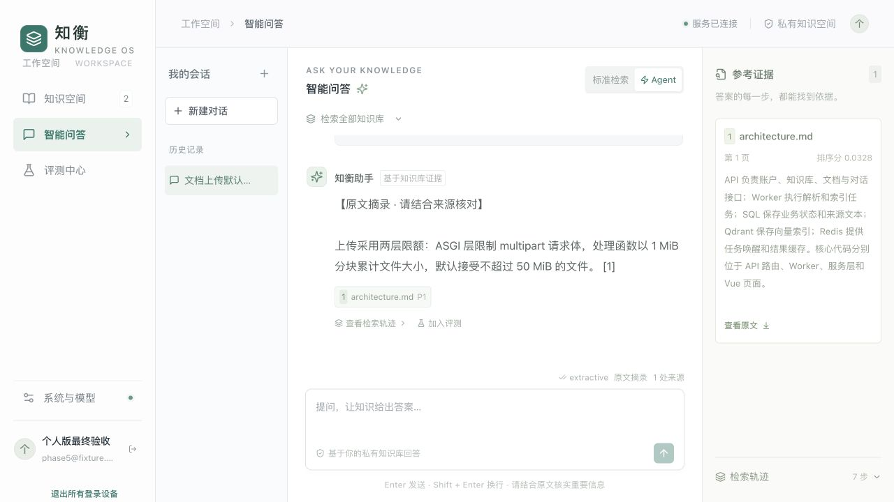
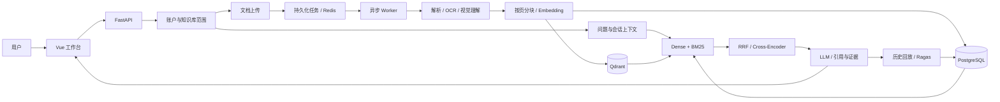

<div align="center">

# 知衡 · Knowledge OS

### 面向个人学习资料的知识检索与引用问答

连接分散的知识，让每一个答案有据可循。

[](https://github.com/Pasicall/Agent_assistant/actions/workflows/ci.yml)


<br>


[](LICENSE)

[项目简介](#项目简介) · [使用流程](#使用流程) · [核心能力](#核心能力) · [系统架构](#系统架构) · [快速开始](#快速开始) · [模型接入](#模型接入) · [文档](#文档)

</div>

---

## 项目简介

**知衡（Knowledge OS）** 是一套面向个人教材、课件 PDF、技术文档和学习笔记的 RAG 应用，将文档管理、多模态解析、混合检索、引用问答与质量评测整合到统一工作台。

从教材、技术手册到研究资料，知衡将原始文档转化为可检索的知识单元，结合大语言模型生成带有原文依据的回答。用户可以沿着引用回到文档与页码，通过检索轨迹了解证据如何被找到，并将历史答案纳入持续评测。

> **知识管理 → 证据检索 → 引用问答 → 质量评测**，形成可追溯、可迭代的知识应用闭环。

### 适用场景

| 场景 | 使用方式 |
| --- | --- |
| 个人学习资料 | 汇集教材、课件与笔记，按问题查找定义及来源 |
| 产品与技术支持 | 将产品说明、使用手册和技术文档组织为可查询的知识库 |
| 研究与资料整理 | 跨文档检索关键信息，保留文献片段和页码依据 |
| RAG 应用开发 | 对比检索策略、检查 Agent 轨迹、复评历史答案与模型效果 |

## 使用流程

创建个人知识库 → 上传资料 → 解析与索引 → 检索 / 引用问答 → 查看来源与历史。

工作台默认打开资料库，侧栏提供问答与已启用的专题学习。受信部署可从账号菜单开放开发工具。每个账号只能访问自己的个人知识库；已有普通邮箱密码登录继续使用。

完整操作步骤见[使用指南](docs/user-guide.md)，覆盖资料上传、版本管理、引用问答与评测。



## 核心能力

### 📚 统一知识空间

知识库归创建者所有，其他账号不能查看、修改或检索其中的资料。在同一界面完成文档上传、任务跟踪、内容预览与原文管理。支持单文件 **50 MiB** 上传、SHA256 去重、失败重试与重新索引。

摄取任务异步完成文档解析、文本分块、Embedding 与向量索引，任务状态持久化，支持租约恢复与退避重试。文档更新生成新版本，旧版持续服务，新索引就绪后切换；支持历史版本恢复、有效期和目录增量同步。

### 🔎 多路召回与融合排序

结合 **Qdrant Dense Retrieval** 与持久化中文 **BM25 倒排索引**，兼顾语义表达和关键词命中，通过 **RRF** 融合候选排名，并支持使用 **Cross-Encoder** 进一步精排。

检索范围在查询前根据当前账号的所有权、活动版本与有效期确定，仅回查命中的候选正文。问答、向量召回、词项检索和历史来源遵循一致的数据访问范围。

### 💬 带有依据的知识问答

回答关联文档名称、页码和原文片段，支持来源编号与证据查看。多轮对话结合服务端会话历史检索，保留问题、答案和引用记录，便于回查与复评。支持真实模型流式输出、停止生成、请求幂等和会话并发保护。

生成后检查引用编号与数字，可选 LLM 核验事实支持和问题可回答性；证据不足时拒答，不支持的生成内容回退为明确标注的原文摘录。

### 🤖 Agent 检索模式

围绕“检索—证据检查—查询改写—生成”组织问答流程。在证据覆盖不足时进行有界关键词改写，对多轮候选合并去重，再统一精排。检索步骤与处理轨迹可在工作台查看。

### 🖼️ 多模态文档理解

支持 **PDF、DOCX、TXT、Markdown、CSV、JSON、HTML 与图片**。PDF 保留页码，Word 文档提取正文与表格；扫描页和图像可接入 **Tesseract OCR** 或 **Qwen 视觉模型**，将图文信息纳入统一检索。

### 🎯 目标驱动的专题学习

以“数据库事务”为首版专题，从选定资料生成三个能力草稿，核对来源后开始解释题、场景分析与方案实践。四级提示记录实际提供的帮助；文字提交异步按固定标准评价，关联作答原句与来源快照，保留疑似障碍、追问证据和下一题调整理由。用户可纠正评价，跨会话恢复学习。

未配置模型时仍可查看模板、核对材料并保存提交，系统不会伪造评价。当前采用八道固定模板，真实模型诊断质量仍需校准。详见[本版更新与未完善项](docs/learning-workbench-v0.2.0-release.md)。

### 📊 评测与回放

内置 **Hit@5、Recall@5、MRR@5** 检索评测与 Dense / Hybrid 对照，支持通过 **Ragas** 评估忠实度、答案相关性、上下文精确率和召回率。

启用评测后，开发工具可异步运行评测并查看状态，也可选择历史答案复用当时的回答和证据。答案缓存与评审缓存分别管理，减少相同内容的重复生成和评分。

### 🛡️ 账户与运行保障

保留邮箱密码登录、可撤销服务端会话、HttpOnly Cookie 和防跨站检查。登录与问答限流、账户和服务并发、存储与每日模型请求预算通过服务端静态配置设置，修改后重启相关服务生效。

文档列表显示处理状态，详情展示进度和版本，并提供重新处理入口。Worker 保留租约恢复与持久清理。显式开放目录同步后，可从当前知识库的更多菜单增量导入。账号菜单的会话安全提供退出所有设备。

Alembic 负责数据库升级，协调备份覆盖数据库、原件与向量数据，并提供完整性校验和空目标恢复保护。健康探针、受保护的 Prometheus 指标与普通运行日志用于诊断。配置与旧数据兼容说明见[部署指南](docs/deployment.md)。

### 🏠 灵活的私有化部署

支持 **Ollama、vLLM / OpenAI 兼容接口与 SentenceTransformers**，可根据硬件和数据需求选择模型。提供 Docker Compose 与本地开发两种运行方式，覆盖前端、API、独立摄取与评测 Worker、迁移及存储服务。

## 系统架构



| 层次 | 技术与职责 |
| --- | --- |
| 交互层 | Vue 3 · TypeScript · Vite，知识管理、问答与评测工作台 |
| 应用层 | FastAPI · SQLAlchemy · LangChain，接口、会话与模型适配 |
| 检索层 | Qdrant · BM25 · RRF · Cross-Encoder，向量召回与融合排序 |
| 任务与缓存 | Redis · SQL 持久化任务，异步摄取、租约恢复与结果复用 |
| 业务存储 | PostgreSQL，账户、知识库、文档、会话及评测记录 |
| 文档理解 | PyPDF · python-docx · Tesseract · 视觉模型 |
| 评测与交付 | Ragas · Pytest · Ruff · GitHub Actions · Docker Compose |

本地开发也可使用 SQLite 与 Qdrant local。完整数据流与实现细节见 [架构文档](docs/architecture.md)。

## 快速开始

### 方式一：Docker Compose

准备 Docker 与 Compose，克隆仓库并创建部署配置：

```bash
git clone https://github.com/Pasicall/Agent_assistant.git
cd Agent_assistant
cp .env.production.example .env.docker
```

编辑 `.env.docker`，配置存储服务密码、应用密钥与模型连接，然后启动：

```bash
docker compose --env-file .env.docker up --build -d
```

| 入口 | 地址 |
| --- | --- |
| 知识工作台 | [http://localhost:8080](http://localhost:8080) |
| API 文档 | [http://localhost:8010/docs](http://localhost:8010/docs) |

使用宿主机 Ollama、配置 OCR 或调整服务参数，可查阅 [部署指南](docs/deployment.md)。

### 方式二：本地开发

环境要求：**Python 3.12、Node.js 20.19+**，以及可用的模型服务。

```bash
git clone https://github.com/Pasicall/Agent_assistant.git
cd Agent_assistant

conda env create --prefix ./.conda-env --file environment.yml
conda activate ./.conda-env

cd frontend
npm ci
cd ..
cp .env.ollama.example .env
```

环境定义包含 Python 3.12、Node.js 22 及开发、模型适配和评测依赖。也可使用部署指南中的 venv 方式。环境和依赖准备好后，在仓库根目录运行：

```bash
./start.sh
```

访问 [http://127.0.0.1:5173](http://127.0.0.1:5173)，按 Ctrl+C 同时停止前后端。启用 Redis 队列时，另在 `backend` 目录运行 `python -m app.worker`，并配置 Qdrant server。

## 模型接入

| 接入方式 | 典型配置 | 用途 |
| --- | --- | --- |
| Ollama | `RAG_LLM_PROVIDER=ollama` | 本地生成与视觉理解 |
| vLLM / OpenAI 兼容 API | `RAG_LLM_PROVIDER=openai` | 自托管或远程模型服务 |
| Ollama Embedding | `RAG_EMBEDDING_PROVIDER=ollama` | 本地语义向量 |
| 兼容 Embedding API | `RAG_EMBEDDING_PROVIDER=openai` | 独立向量模型服务 |
| SentenceTransformers | `RAG_EMBEDDING_PROVIDER=sentence-transformers` | 本地语义编码 |
| Cross-Encoder | `RAG_RERANKER_MODEL` | 检索候选精排 |

Ollama 示例模型为 `qwen3.5:9b` 与 `qwen3-embedding:8b`。视觉模型通过 `RAG_VISION_MODEL` 配置，模型名称、地址、上下文窗口和向量维度均可调整。

项目同时提供轻量演示配置 `.env.example`，使用哈希向量与原文摘录，方便在未接入模型时体验文档管理和检索流程。

## 开始使用

1. 在资料库上传教材或学习笔记。首次上传时在同一步创建知识库。
2. 等待资料可用，点击「基于此库提问」，通过回答引用核对原文。
3. 在专题学习中核对目标、完成练习、查看反馈，再进入下一题。

仓库提供 [演示文档](examples/company-handbook.md)、[产品说明](examples/product-guide.md) 和 [评测案例](examples/evaluation-cases.json)，可用于体验完整流程。

## 测试与开发

| 检查 | 命令 |
| --- | --- |
| 静态检查 | `python -m ruff check backend scripts` |
| 后端测试 | `cd backend` 后运行 `python -m pytest -q` |
| 前端构建 | `cd frontend` 后运行 `npm run build` |
| 业务回归与检索容量 | `python scripts/benchmark.py` |
| 模型链路验证 | `python scripts/smoke.py` |
| Ragas 评测验证 | `python scripts/smoke.py --with-ragas` |

GitHub Actions 覆盖后端测试、真实 PostgreSQL/Redis/Qdrant 集成回归、合成业务门槛与前端构建；模型与本轮验证范围见 [评测与验证](docs/validation.md)。

## 项目结构

```text
rag-knowledge-assistant/
├── backend/
│   ├── app/
│   │   ├── api/             # 账户、知识库、文档、问答与评测接口
│   │   ├── services/        # 文档理解、检索、生成与评测
│   │   ├── models.py        # 业务数据模型
│   │   └── worker.py        # 异步摄取与任务恢复
│   └── tests/               # 接口与检索链路测试
├── frontend/                # Vue 3 知识工作台
├── docs/                    # 架构、部署与评测文档
├── examples/                # 示例文档与评测案例
├── scripts/                 # 开发与验证工具
└── docker-compose.yml       # 应用与基础服务编排
```

## 文档

| 文档 | 内容 |
| --- | --- |
| [开发指南与源码剖析](docs/development-guide.md) | 面向初学者的从零实现路线、后端模块详解、接口契约与测试练习 |
| [使用指南](docs/user-guide.md) | 个人工作台操作、资料版本、问答引用、评测与常见问题 |
| [系统架构](docs/architecture.md) | 数据流、检索策略、任务恢复与缓存设计 |
| [部署指南](docs/deployment.md) | Docker、本地开发、模型接入与运维 |
| [设计原则](docs/design.md) | 设计目标、技术取舍与相关开源项目 |
| [评测与验证](docs/validation.md) | 自动化检查、模型链路与评测记录 |

## License & Acknowledgements

本项目采用 [MIT License](LICENSE)。感谢 [KnowAgenticRAG](https://github.com/Zhongye1/KnowAgenticRAG) 提供的 Agentic RAG 架构设计启发，以及 LangChain、Qdrant、Ragas 和 Vue 等开源项目。

# Agent_assistant
