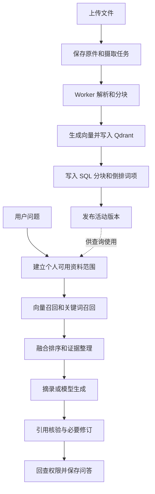
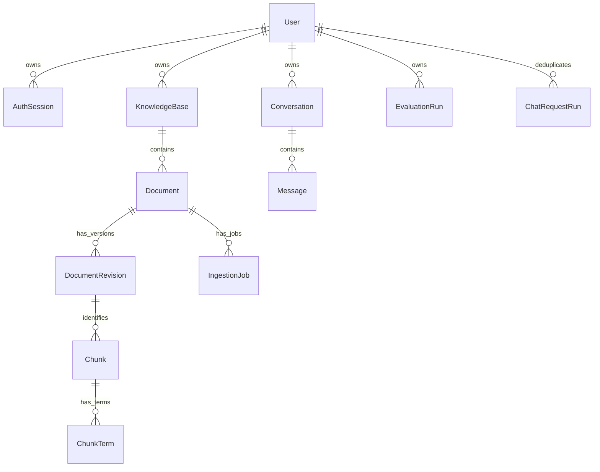
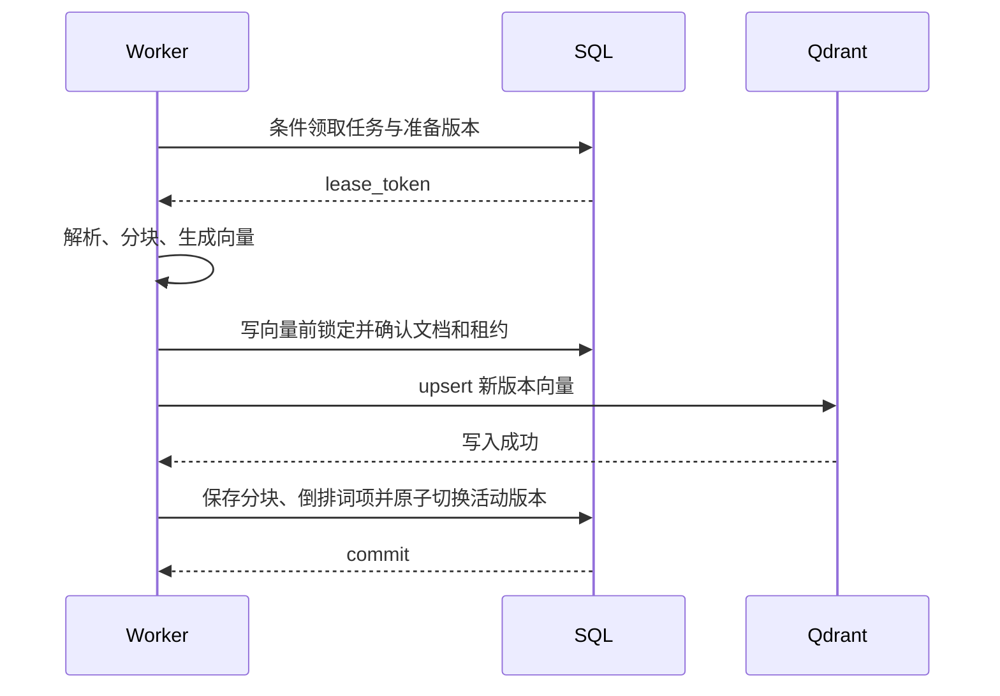

# 从零实现知衡：开发指南与源码剖析

本文面向刚接触后端和 RAG 开发的读者。目标是让你能够解释一份资料如何进入系统、一条问题如何得到有来源的回答，并按顺序实现这些能力。

源码基线为本仓库个人版，阅读日期为 2026-10-26，基于提交 `3904c64`。本文中的“当前实现”指仓库代码；标注为“教学骨架”的片段用于在独立学习目录中逐步搭建，不是可以覆盖本仓库文件的完整替代品。已有工作台的操作方法见[使用指南](user-guide.md)，环境部署细节见[部署指南](deployment.md)。

## 目录

- [1. 阅读方式与实现路线](#1-阅读方式与实现路线)
- [2. 先理解系统解决的问题](#2-先理解系统解决的问题)
- [3. 从空目录启动第一个接口](#3-从空目录启动第一个接口)
- [4. 应用启动与配置如何连接](#4-应用启动与配置如何连接)
- [5. 数据模型与数据库迁移](#5-数据模型与数据库迁移)
- [6. 认证与个人资料范围](#6-认证与个人资料范围)
- [7. 文件上传如何变成后台任务](#7-文件上传如何变成后台任务)
- [8. 解析与分块](#8-解析与分块)
- [9. Worker 如何可靠地发布文档](#9-worker-如何可靠地发布文档)
- [10. 向量检索与混合检索](#10-向量检索与混合检索)
- [11. 从检索结果到可核验答案](#11-从检索结果到可核验答案)
- [12. Agent 实际增加了什么](#12-agent-实际增加了什么)
- [13. 会话幂等并发与流式输出](#13-会话幂等并发与流式输出)
- [14. 文档更新删除与目录同步](#14-文档更新删除与目录同步)
- [15. 评测与历史回放](#15-评测与历史回放)
- [16. 后端接口契约](#16-后端接口契约)
- [17. 前端如何消费这些接口](#17-前端如何消费这些接口)
- [18. 配置模型与运行限制](#18-配置模型与运行限制)
- [19. 生产运行观测与数据恢复](#19-生产运行观测与数据恢复)
- [20. 如何用测试推动实现](#20-如何用测试推动实现)
- [21. 源码阅读地图与开发工具](#21-源码阅读地图与开发工具)
- [22. 排错方法与最终练习](#22-排错方法与最终练习)

## 1. 阅读方式与实现路线

### 1.1 需要先会什么

不要求一开始掌握模型训练。先补齐以下基础，读到对应模块时再深入：

| 基础 | 在项目中的具体用途 |
| --- | --- |
| Python 函数、类、类型注解 | 阅读请求模型、服务函数和数据库模型 |
| HTTP 与 JSON | 理解请求方法、状态码、参数和返回值 |
| SQL 的主键、外键、查询与事务 | 理解所有权、版本发布、任务领取和数据一致性 |
| 上下文管理器 `with` | 理解数据库会话、资源释放和并发名额 |
| 线程与取消信号 | 理解 Worker、心跳与流式生成 |
| 向量与相似度的直观含义 | 理解文本如何进入相似内容检索 |

遇到不熟悉的术语时，先问它在这条请求中负责什么。例如，事务负责让一组数据库变更一起生效；租约负责让一个处理者在有限时间内拥有某项工作。

### 1.2 按里程碑实现

不要按照文件名的字母顺序抄代码。先做一条能运行的链路，再补齐可靠性。

| 里程碑 | 先实现的成果 | 对应章节 | 完成标准 |
| --- | --- | --- | --- |
| M0 | FastAPI 与配置 | 3–4 | `/api/health` 返回 JSON |
| M1 | 数据库与迁移 | 5 | 首次创建表，重启保留数据 |
| M2 | 注册、登录、个人知识库 | 6 | 两个账号无法读取对方的库 |
| M3 | 文件保存与任务记录 | 7 | 上传返回文档 ID、版本 ID 对应的任务 |
| M4 | 文本解析、分块、任务发布 | 8–9 | 一份 TXT 完成入库，生成活动版本 |
| M5 | 向量召回与持久 BM25 | 10 | 能说明每个命中片段为何可访问 |
| M6 | 摘录回答、模型回答与引用核验 | 11 | 无模型也能返回带来源摘录，错误数字不能直接发布 |
| M7 | 有界 Agent | 12 | 改写次数有上限，能查看真实轨迹 |
| M8 | 历史、幂等、并发与 SSE | 13 | 重试不重复保存，停止生成不保存半条答案 |
| M9 | 版本更新、删除、同步 | 14 | 更新期间旧版可用，删除不因向量故障失效 |
| M10 | 评测与历史回放 | 15 | 指标可手算验证，历史复评不重新生成 |
| M11 | 页面接入与生产运行 | 16–19 | 接口、队列、探针、备份恢复形成闭环 |

第一遍做到 M6，理解最小 RAG；第二遍补 M7–M10，理解当前项目的工程边界；第三遍研究部署与恢复。每完成一步，先写一个能证明行为正确的测试，再进入下一步。

## 2. 先理解系统解决的问题

### 2.1 RAG 在这里是什么意思

RAG 是“先找资料，再基于资料回答”。本项目不把上传文件训练进模型，而是建立可更新的检索索引，在提问时把相关片段交给回答模块。

用一句具体问题贯穿后文：

> 上传一份写有“单文件上限为 50 MiB”的说明，提问“默认最多上传多少 MiB？”，最终回答引用那份说明。

要实现它，需要两条独立流程：



上传路径主要是写入和构建索引；问答路径主要是读取和组织证据。把它们拆开，才能分别处理长任务、失败重试、检索耗时和模型耗时。

### 2.2 四类存储各存什么

| 位置 | 保存内容 | 为什么需要 |
| --- | --- | --- |
| SQL：SQLite 或 PostgreSQL | 用户、库、文档、版本、片段、倒排词项、任务、会话和评测 | 作为业务状态及访问范围的最终依据 |
| 文件系统的 `uploads/` | 上传的原文件 | 提供下载、重新解析和历史版本恢复 |
| Qdrant | 片段向量及关联 ID | 根据问题向量查找相近片段 |
| Redis，可选 | 队列唤醒信号、答案及评审缓存 | 支持独立 Worker 和共享缓存 |

Qdrant 当前载荷不存完整正文，命中后要按 ID 回 SQL 读取。Redis 中没有任务的唯一副本；即使唤醒消息丢失，SQL 中的任务仍可由 Worker 扫描处理。

开发模式可先采用 SQLite、Qdrant local 和进程内 Worker。生产模式要求 PostgreSQL、Redis 与 Qdrant server；当前配置类会校验这组要求。

### 2.3 代码分层

```text
HTTP 路由：校验请求、取得当前用户、调用流程、组织响应
    ↓
业务编排：上传 / 版本 / 会话 / 评测 / 任务状态
    ↓
RAG 服务：解析 → 分块 → 向量与词项 → 检索 → 证据 → 生成 → 核验
    ↓
数据库、原文件、Qdrant、Redis、模型 API
```

这不是一个把所有行为交给 Agent 框架的项目。LangChain 主要提供模型适配、消息类型和分块工具；任务状态、检索编排、权限与取消由本项目普通 Python 代码实现。

## 3. 从空目录启动第一个接口

### 3.1 在独立学习目录搭骨架

已有仓库用于对照，重建练习应放在另一个目录，例如 `learning-rag/`，避免覆盖现有配置与资料。

```text
learning-rag/
├── backend/
│   ├── pyproject.toml
│   └── app/
│       ├── __init__.py
│       └── main.py
└── frontend/              # 后端基本链路完成后再创建
```

推荐与项目保持 Python 3.12、Node.js 22 的运行环境。下列是重建时的环境准备示例：

```bash
mkdir learning-rag
cd learning-rag
conda create --prefix ./.conda-env python=3.12 nodejs=22 pip
conda activate ./.conda-env
mkdir -p backend/app
```

在新目录的 `backend/pyproject.toml` 写入教学最小配置：

```toml
[build-system]
requires = ["setuptools>=69"]
build-backend = "setuptools.build_meta"

[project]
name = "learning-rag"
version = "0.1.0"
requires-python = ">=3.11"
dependencies = ["fastapi>=0.115,<1", "uvicorn[standard]>=0.30,<1"]

[project.optional-dependencies]
dev = ["pytest>=8,<10", "httpx>=0.27,<1", "ruff>=0.9,<1"]

[tool.setuptools.packages.find]
where = ["."]
include = ["app*"]
```

在空的 `app/__init__.py` 旁创建 `app/main.py`：

```python
from fastapi import FastAPI


def create_app():
    app = FastAPI(title="Learning RAG")

    @app.get("/api/health")
    def health():
        return {"status": "ok"}

    return app


app = create_app()
```

从学习目录根部安装后端，再启动：

```bash
python -m pip install -e './backend[dev]'
cd backend
python -m uvicorn app.main:app --host 127.0.0.1 --port 8010
```

浏览器打开 `http://localhost:8010/api/health` 和 `http://localhost:8010/docs`。此时你已完成“进程 → HTTP 路由 → JSON 响应”的最短闭环。以后增加一个功能，应继续保持这个闭环可运行。

完整项目依赖按能力逐步补入：数据库用 SQLAlchemy/Alembic；上传用 python-multipart；解析用文档库；检索用 Qdrant/jieba；模型适配用对应 LangChain 包。以[实际依赖表](../backend/pyproject.toml)为对照，不需要在第一天启用全部可选模型依赖。

### 3.2 阅读现有仓库时怎样运行

已有仓库可按 [environment.yml](../environment.yml) 创建完整环境，按[部署指南](deployment.md)启动。已有环境不需要重复安装。

做无模型练习时，在独立学习配置中保持：

```dotenv
RAG_ENVIRONMENT=development
RAG_DATABASE_URL=sqlite:///./data/rag.db
RAG_DATA_DIR=./data
RAG_EMBEDDING_PROVIDER=hash
RAG_EMBEDDING_DIMENSION=384
RAG_LLM_MODEL=
RAG_LLM_API_KEY=
RAG_RERANKER_MODEL=
RAG_VISION_MODEL=
RAG_OCR_ENABLED=false
RAG_REDIS_URL=
RAG_QDRANT_URL=
```

这些是练习配置示例，不能据此覆盖已有 `.env`。真实密钥只留在被 Git 忽略的配置中，学习笔记、示例请求和报告都不应复制真实密钥。

## 4. 应用启动与配置如何连接

源码入口：[main.py](../backend/app/main.py)、[config.py](../backend/app/config.py)、[db.py](../backend/app/db.py)。

### 4.1 `Settings` 将配置变成有类型的对象

`Settings` 继承 `BaseSettings`，统一使用 `RAG_` 前缀。因此 `llm_model` 对应环境变量 `RAG_LLM_MODEL`。常规优先级中，进程环境变量可以覆盖 dotenv 文件，文件中的值可以覆盖字段默认值。

配置读取了 `../.env`、`.env` 两个相对路径，所以本地后端命令约定在 `backend/` 中执行。启动目录不同，会影响 SQLite 文件与 `data_dir` 的相对位置。

`get_settings()` 使用 `lru_cache` 缓存配置对象。运行期间编辑 `.env` 不会自动刷新配置，通常需要重启。测试修改环境变量后必须 `get_settings.cache_clear()`。

校验器也承担组合约束，例如：

- 分块重叠不能大于等于分块长度。
- 输出预算之外必须留出足够输入空间。
- 使用 Redis 独立 Worker 时必须使用 Qdrant server，不能多进程共享 Qdrant local。
- 生产环境必须具备独立密钥、PostgreSQL、Redis 和 Qdrant server。

重建时先定义少量必要字段，再补约束；不要等运行到深层模型调用才发现配置互相矛盾。

### 4.2 `create_app()` 与 lifespan

当前 `create_app(settings=None)` 创建 FastAPI，注册中间件与三组路由。真正打开数据库、启动 Worker 的工作在 lifespan 进入时执行：

```text
进入 lifespan
→ 创建数据目录
→ app.state 保存 settings 与 Database
→ 初始化或校验迁移
→ 标记过期的旧式同步评测为失败
→ 没有 Redis 时启动本进程 Worker 线程
→ 开始接收请求
→ 退出时设置停止信号、等待 Worker、释放数据库连接池
```

这解释了测试中为什么用 `with TestClient(create_app()) as client:`：`with` 会进入和退出 lifespan。

虽然 `create_app` 接受 settings，一部分深层服务仍调用全局 `get_settings()`。不能假定只传一个新对象，就替换了所有模块配置；当前测试主要通过环境变量和清除缓存保持一致。

### 4.3 数据库会话与事务

`Database.session()` 负责打开/关闭 SQLAlchemy Session，异常时回滚。**正常退出不会自动提交**；业务需要持久化时显式 `db.commit()`。

| 操作 | 作用 |
| --- | --- |
| `db.add(obj)` | 将对象加入待写入集合 |
| `db.flush()` | 把当前变化送到数据库，获得默认生成 ID；事务仍未提交 |
| `db.commit()` | 提交事务，其他连接才能稳定看到变化 |
| `db.rollback()` | 放弃当前事务的未提交变化 |
| `db.expire_all()` / `refresh()` | 重新从数据库读取状态，避免使用长调用前的旧快照 |

SQLite 使用外键检查、WAL、连接超时，并注册 BM25 所需的 `ln` 函数。`check_same_thread=False` 允许连接按框架线程模式使用，但不表示可以把同一个 Session 随意共享给多个线程；Worker 与 SSE 生产线程仍分别创建会话。

### 4.4 中间件解决横切问题

`UploadLimitMiddleware` 在请求体读取过程中累计字节数，不能仅信任 `Content-Length`。上传请求允许文件上限之外多 1 MiB 的 multipart 开销；路由仍精确检查文件大小。其他 POST/PUT/PATCH 请求体上限为 4 MiB。

HTTP 中间件分配请求 ID、检查 Cookie 写请求的跨站来源与 `X-RAG-Request`、记录状态码和耗时，并返回安全响应头。CORS 负责浏览器跨域规则，不代替登录与资料所有权校验。

**本阶段完成标准**：修改配置能在重启后生效；错误组合在启动前被拒绝；测试退出后不会遗留数据库连接或后台线程。

## 5. 数据模型与数据库迁移

源码入口：[models.py](../backend/app/models.py)、[migrations](../backend/migrations/)。

### 5.1 先建关系，再写接口



这是业务关系图，并非每条边都对应数据库外键：例如活动版本、分块版本关联使用字符串 ID，由应用的发布流程保证一致性。

| 模型 | 要解决的问题 | 关键字段 |
| --- | --- | --- |
| `User` | 账号归属与禁用 | `email`、`password_hash`、`disabled` |
| `AuthSession` | 每次登录可单独撤销 | `user_id`、`expires_at`、`revoked` |
| `KnowledgeBase` | 一组个人资料及变更代次 | `user_id`、`generation` |
| `Document` | 文档当前可用状态 | `active_revision_id`、`sha256`、`expires_at`、`source` |
| `DocumentRevision` | 保存某一次文件内容 | `stored_path`、`sha256`、`status` |
| `Chunk` | 一段可检索原文 | `document_id`、`revision_id`、`page`、`ordinal`、`text` |
| `ChunkTerm` | 关键词倒排索引 | 联合主键 `term + chunk_id`，以及 `frequency` |
| `IngestionJob` | 谁在处理哪份版本、进展如何 | `revision_id`、`attempts`、`lease_token`、`available_at` |
| `Conversation` | 一段会话及并发控制 | `user_id`、`lease_token`、`lease_expires_at` |
| `Message` | 最终问答、证据与运行元信息 | `role`、`content`、`citations`、`trace`、`run_metadata` |
| `ChatRequestRun` | 同一请求不要重复执行 | 唯一 `user_id + request_key`、`body_hash`、`result` |
| `EvaluationRun` | 保存异步评测与执行租约 | `cases`、`metrics`、`results`、`use_ragas` |
| `CleanupTask` | 数据删除后仍能重试外部清理 | `document_id`、`revision_id`、`paths`、`retained_bytes` |
| `AdmissionSlot` | 请求计数、并发占用与 Worker 心跳 | `key`、`count`、`expires_at` |

`Document` 与 `DocumentRevision` 的区别尤其重要：前者是用户管理的“这份资料”，后者是它的一次具体内容。回答引用版本 ID，才能在资料更新后下载当时的原件。

`CleanupTask.document_id` 不使用指向文档的外键，因为文档被删除后，清理任务必须继续存在。若把任务也级联删除，向量服务一旦故障，就没有记录告诉系统以后清理哪些文件和向量。

### 5.2 约束不是装饰

- `User.email` 唯一，防止重复账号。
- `Document` 的 `knowledge_base_id + sha256` 唯一，实现库内内容去重；相同文件可以分别出现在不同个人库。
- `ChatRequestRun` 的 `user_id + request_key` 唯一，阻止并发插入相同请求。
- 主要所属关系采用级联删除，配合业务清理任务移除关联记录。

只在 Python 中“先查一下再插入”不能阻止两个请求同时通过检查。正确做法是同时使用数据库约束，并处理 `IntegrityError`。

ID 使用 UUID；`utcnow()` 返回不带时区的 UTC 时间，供 SQLite 与 PostgreSQL 统一比较。外部提交的有效期则必须携带时区，再转换成这种内部表示。

### 5.3 迁移如何保证老数据可启动

当前迁移链为：

```text
001_baseline → 002_enterprise → 003_kb_acl
→ 004_pg_org_fk → 005_cleanup_quota → 006_operations
```

`001_baseline` 使用冻结的 `schema_v1.py`，后续历史结构还会使用冻结定义。它们不等同于今天的运行 ORM。这样清理运行代码时，不会改变旧版本数据库的创建过程。

`Database.initialize()` 构造 Alembic 配置：开发默认升级到 head；关闭自动迁移时，只允许已到 head 的数据库启动。PostgreSQL 额外使用事务级 advisory lock，避免多个进程同时迁移。

新项目可先仅建 `User`、`KnowledgeBase`、`Document`、`Chunk` 四类核心对象，再逐步引入版本与任务。第一次练习可以在新数据库中理解 `create_all`，但本仓库正式启动走 Alembic，不能用修改 ORM 加 `create_all` 代替已有表的字段升级。

### 5.4 历史兼容字段怎样理解

当前仍保留最小 `Organization.id` 映射，以解析旧知识库的外键。`organization_id` 非空的库不会进入个人访问范围；`visibility` 的旧默认值不代表现在仍开放共享。

旧成员、审计、OIDC 和动态策略等表由冻结迁移保留，但相应运行 ORM、接口和业务已经移除。重建纯个人项目时，不需要重新开发这些旧功能；维护现有仓库时也不能随意删除历史迁移或自动搬移旧资料。

**本阶段完成标准**：能指出文档“身份”、文件“版本”、检索“片段”分别在哪张表；新建与旧版个人数据库都可升级启动；重启不丢数据。

## 6. 认证与个人资料范围

源码入口：[security.py](../backend/app/security.py)、[dependencies.py](../backend/app/api/dependencies.py)、[access.py](../backend/app/services/access.py)、[routes.py](../backend/app/api/routes.py)。

### 6.1 注册到当前用户的完整过程

```text
注册 / 登录
→ 校验邮箱、密码请求字段
→ 按来源地址限流
→ 创建用户或验证密码
→ 创建 AuthSession
→ 签发包含用户 ID、到期时间和会话 ID 的令牌
→ 设置 rag_session Cookie，同时返回 bearer token
→ 后续依赖 current_user 校验令牌、用户和数据库会话
```

密码采用带随机盐的 PBKDF2-HMAC-SHA256，当前为 600000 轮，比较用 `hmac.compare_digest`。盐、轮数和摘要一起保存，数据库不保存原密码。

**当前令牌不是标准三段 JWT**。`issue_token()` 生成 `base64url(payload).HMAC签名` 两段格式，`token_claims()` 自行校验签名与到期时间。虽然依赖表中列有 PyJWT，也不能据此把实际实现写成 JWT，或直接用 `jwt.decode()` 解析它。

数据库会话是可撤销性的来源。只有签名正确还不够：`current_user()` 同时检查用户未禁用、会话属于该用户、未撤销且未过期。

### 6.2 依赖注入把校验放在入口

```python
# 当前源码采用的接口形态
@router.get("/auth/me")
def me(user: CurrentUser):
    return user_payload(user)
```

`CurrentUser` 是带 `Depends(current_user)` 的类型别名，`DB` 同理。FastAPI 在进入路由前解析依赖。路由不需要重复手写获取 Session 和解析 Cookie，但仍要检查具体资料的所有权。

### 6.3 所有权不能只在列表页检查

个人范围的核心条件是：

```python
(KnowledgeBase.user_id == user_id) & KnowledgeBase.organization_id.is_(None)
```

`require_kb()` 用这组条件读取知识库；`own_document()` 将文档连接到知识库；`CorpusScope` 把同一范围延伸到检索；`citations_available()` 检查已保存引用的文档仍存在且属于当前范围。

返回 404 同时覆盖“不存在”和“不属于你”，避免把其他用户资料的存在性作为接口结果暴露。

重建时至少做两个账号的测试：B 不能通过猜 ID 下载 A 的文件、读取分块、查任务、恢复版本、检索或复评 A 的历史消息。只有列表不显示，不足以证明隔离成立。

### 6.4 Cookie 与跨站保护

浏览器采用 HttpOnly、SameSite=Lax 的 `rag_session` Cookie，生产 HTTPS 场景还会使用 Secure 标记。服务端把返回访问令牌保留给 API 客户端，当前网页不把它当作 localStorage 长期凭证。

Cookie 认证的写请求还要通过来源检查；非认证类写接口需携带 `X-RAG-Request: 1`。当前用户的 bearer token 也可用于 API 调用，但 `/api/metrics` 使用独立监控令牌，普通登录凭证不能代替它。

**本阶段完成标准**：能注册登录、撤销单个或全部会话；被撤销的旧令牌立即不能使用；两个用户在各类资料接口中均隔离。

## 7. 文件上传如何变成后台任务

源码入口：[routes.py](../backend/app/api/routes.py) 的 `upload_document()`、[lifecycle.py](../backend/app/services/lifecycle.py) 的 `reserve_ingestion()`。

### 7.1 输入是 multipart，不是 JSON 文件路径

上传接口为 `POST /api/documents/upload`：

| 字段 | 形式 | 含义 |
| --- | --- | --- |
| `knowledge_base_id` | 表单文本，必填 | 所属个人库 |
| `file` | 文件，必填 | 实际文件内容 |
| `document_id` | 表单文本，选填 | 指定时表示替换已有文档 |

服务器不接受客户端指定任意磁盘路径。文件名称只用于显示和选择解析方式；存储路径由服务端在 `uploads/` 内以 UUID 生成。

### 7.2 顺着 `upload_document()` 阅读

1. `require_kb()` 确认库可写；替换时确认目标文档也在同一个库中，且没有更新任务运行。
2. 去掉文件名中的目录部分，检查扩展名。
3. 每次读取 1 MiB，边写文件、边统计大小、边更新 SHA256；超过上限或空文件则拒绝。
4. 查库内相同 SHA256：普通上传可直接返回原文档；替换不能与库中的另一文档冲突。
5. 通过 `reserve_ingestion()` 检查存储和待处理任务配额。
6. 创建或复用 `Document`，创建新的 `DocumentRevision` 和 `IngestionJob`，初始排队。
7. SQL 提交成功后，再尝试 `notify_job()` 唤醒 Worker。
8. 返回文档对象、`job_id`、`duplicate`，HTTP 201 不表示解析已经完成。

保存文件和 SQL 不是同一个事务，所以函数还跟踪 `committed`：在 SQL 提交前失败，要删除刚写入的原件，不能留下大量没有记录的上传文件。

### 7.3 为什么配额逻辑单独放一个服务

上传、重新索引和恢复历史版本都可能产生摄取任务，因此统一调用 `reserve_ingestion()`，避免某个入口绕过配额。

该函数锁定所属用户，再统计其版本原件占用、待清理文件保留占用，以及排队/处理中任务数。按原文件路径去重计费，使复用同一原件的恢复不重复计算存储；删除后仍未清理的文件则继续占用额度。

### 7.4 任务响应要让客户端可跟踪

```json
{
  "document": {
    "id": "文档UUID",
    "knowledge_base_id": "知识库UUID",
    "name": "architecture.md",
    "status": "queued"
  },
  "job_id": "任务UUID",
  "duplicate": false
}
```

这是字段节选。客户端继续请求 `GET /api/jobs/{job_id}`，读取 `status`、`progress`、`stage`、`processed_pages`、`total_pages` 和错误。不要在 HTTP 上传连接中等待整份 PDF 的解析与模型计算结束。

**本阶段完成标准**：文件内容正确落盘；同库同内容去重；越权、空文件、超限和非法格式被拒绝；提交后可以查到持久任务。

## 8. 解析与分块

源码入口：[parsing.py](../backend/app/services/parsing.py)。

### 8.1 先统一解析结果

解析器把不同格式统一为：

```python
from dataclasses import dataclass


@dataclass(frozen=True)
class ParsedPage:
    text: str
    page: int = 1
```

后面的分块、向量和引用模块只需要处理文字与页码，不必知道原文件是 PDF 还是 DOCX。这是第一次重建时值得保留的接口边界。

| 格式 | 当前解析路径 | 边界 |
| --- | --- | --- |
| TXT、CSV | `_decode()` 读取文本 | 尝试 UTF-8-SIG、GB18030、UTF-16；CSV 当前按文本处理 |
| Markdown | 解码后 `clean_text()` | 去除纯导航和图片标记，保留正文及行内链接文字 |
| JSON | `json.loads()` 后格式化为文本 | 非法 JSON 会报错 |
| HTML | BeautifulSoup 清除 script/style/noscript 后取文本 | 不执行脚本，不自动抓网址 |
| PDF | pypdfium2 逐页提取文字层 | 最多 2000 页，页面逐个释放资源 |
| DOCX | python-docx 读取段落和表格 | 检查压缩包解压总大小，不把逻辑页当排版页 |
| 图片 | `_image_text()` | Pillow 校验图片，最多 4000 万像素，再按配置 OCR/视觉识别 |

PDF 优先使用文字层。启用全页视觉识别，或页面含图片且文字很少时，才进入页面渲染与图片识别路径。图片识别先尝试已启用 OCR；OCR 提取足够文字时可直接返回，否则按配置尝试视觉模型。

初学阶段先完成 TXT 和 Markdown，再加入 PDF/DOCX；OCR 和视觉转录可以最后接入。它们增加外部依赖与故障来源，不影响前面理解基本检索流程。

### 8.2 分块长度不是 token 数

`chunk_pages()` 使用 `RecursiveCharacterTextSplitter`，默认窗口为 **800 字符**，重叠为 **120 字符**，长度函数为 Python 的 `len`。分隔顺序优先段落、换行、中文句号，再逐步细化。

例如连续两块可共享末尾和开头的一小段，减轻一句话在边界被截断的问题；这种重叠不等于在所有格式下严格每 680 字符切一次，实际切点还受段落与分隔符影响。

每块输出以下内容：

```json
{
  "text": "单文件上传默认上限为50 MiB。",
  "page": 1,
  "ordinal": 0
}
```

`ordinal` 在整份文档内递增，页面边界保留；空白文本不进入索引，整份文档没有有效文本会失败。`token_count` 则在后续持久词项构建时统计，两者用途不同。

### 8.3 必须保留溯源字段

从解析开始保留页码，建立 Chunk 时补上文档 ID、版本 ID。只留下字符串列表，后面就无法可靠回答“这句话来自哪份文件的哪个版本”。

**本阶段练习**：给两页内容分别设置 page=1/2，分块后确认没有把第一页末尾和第二页开头合成一块；上传空白 PDF 时应得到明确失败信息。

## 9. Worker 如何可靠地发布文档

源码入口：[worker.py](../backend/app/worker.py) 的 `_claim()`、`_heartbeat()`、`process_job()`、`run_worker()`。

### 9.1 任务队列与任务状态分开

`notify_job()` 向 Redis 列表放入唤醒信号，并限制列表长度、设置过期时间。Worker 真正处理什么任务，依然通过 SQL 扫描确定。

```text
查 SQL 中到期可处理的任务
→ 尝试原子领取
→ 成功的处理者执行
→ 失败、超时或重启后，SQL 中仍保留恢复依据
```

`run_worker()` 一轮最多取 10 个摄取任务、20 个清理任务和 1 个评测任务，依次处理。`worker_role` 可限制为 ingestion 或 evaluation；清理任务仍会处理。它不是一个一次性把所有任务并行扔进线程池的实现。

### 9.2 领取任务要用条件更新

`_claim()` 的含义可简写为：

```sql
UPDATE ingestion_jobs
SET status = 'processing', lease_token = :new_token, attempts = attempts + 1
WHERE id = :id
  AND 到达可处理时间
  AND (仍在排队 OR 上一个处理租约已过期);
```

判断影响行数是否为 1，才能确认自己领取成功。两个 Worker 同时看到“排队中”不重要，真正的所有权由数据库条件更新决定。

`lease_token` 类似这一轮处理的唯一工牌，`lease_expires_at` 是工牌有效期。后台心跳用同一 token 续租；旧处理者不能凭旧工牌提交新处理者的结果。

### 9.3 `process_job()` 的三个阶段

**阶段 A：准备。** 领取任务后打开短 SQL 会话，确定文档及待处理版本，标记 processing，预留失败向量的清理任务，然后提交并释放事务。

**阶段 B：耗时计算。** 检查原件路径，解析、分块、生成向量。每块 ID 用 `UUID5(revision_id, ordinal)` 生成，同一版本相同分块序号的 ID 稳定，有利于重试时覆盖写入而非不断新增点。

**阶段 C：发布。** 确认文档仍存在、任务仍由当前租约持有，在 SQL 事务内保存 Chunk/ChunkTerm，标记版本 ready，把 `active_revision_id` 切到新版本，同步文档摘要字段，增加知识库 `generation`，完成任务并登记旧版本索引清理。



为什么先写向量再发布 SQL？如果先把活动版本改为新版本，而向量稍后才写完，用户会查到没有完整索引的新版本。当前先建立新向量，只有发布事务成功后，SQL 才允许它作为活动版本被使用。

如果向量写完、SQL 发布前崩溃，新向量暂时没有活动 SQL 分块，查询时会被回查过滤；后续清理任务负责清除它。这里采用分步骤的一致性保障，没有跨 SQL 与 Qdrant 的分布式事务。

### 9.4 为什么向量写入需要 `fence()`

危险场景：Worker 已经计算好向量，用户此时删除文档；如果 Worker 稍后仍无条件 upsert，删除后的向量又会出现。

`fence()` 在真正外部写入前锁定文档和任务，核对存在性、处理状态和租约，锁的范围覆盖该次向量写入。删除路径也先取得对应写入顺序，再移除 SQL 可见性。

耗时的 Embedding 计算不占用这段 SQL 锁；只有写入动作需要保护。这个选择同时考虑了删除安全和长时间占锁的问题。

### 9.5 失败与重试

当前把 ValueError、FileNotFoundError 当作不自动重试的内容/文件问题；其他异常按 `worker_max_attempts` 限制重试，摄取退避为 `2 ** attempts` 秒。

更新失败时，若文档还有活动旧版本，文档可恢复 ready，失败原因仍记录在任务及文档错误中；并不是每次失败都让原资料不可用。Worker 重启后可以重新领取过期 processing 任务。

SQL 心跳还用于 ready 探针证明 Worker 最近活跃。任务执行租约、进程健康心跳虽然都涉及时间，但用途不同。

**本阶段完成标准**：能模拟解析中删除、外部服务暂时失败、进程中断和过期任务恢复；旧处理者不能发布已经失去租约的结果。

## 10. 向量检索与混合检索

源码入口：[embeddings.py](../backend/app/services/embeddings.py)、[corpus.py](../backend/app/services/corpus.py)、[retrieval.py](../backend/app/services/retrieval.py)。

### 10.1 Embedding 是统一适配接口

调用方只使用 `embed(texts) -> list[list[float]]`，不关心底层是远程 API 还是本地库。

| 提供方 | 实现 | 当前需要注意的配置 |
| --- | --- | --- |
| `hash` | jieba 分词、稳定摘要映射、带符号计数、归一化 | 可确定性测试，不具备语义理解能力 |
| `openai` | `OpenAIEmbeddings` 调用兼容接口 | 独立向量地址/密钥/模型/维度，服务需支持 `dimensions` 参数 |
| `ollama` | `OllamaEmbeddings` 分批调用 | 校验实际返回维度与配置一致 |
| `sentence-transformers` | 延迟加载 SentenceTransformer | 读取模型实际输出维度，需可选依赖及权重 |

生成模型负责写回答，向量模型负责把文本编码为可比较的向量，它们可以来自不同服务。只配置 DeepSeek 等生成接口，不会自动获得语义向量能力。

当前学习路径先用 hash。后续若接入真实语义服务，需固定模型、维度、分块与问题集，重新索引后再比较效果；不能把 hash 的命中率视为语义模型指标。

### 10.2 Qdrant 集合与点

`collection()` 根据下列身份字段计算集合名称后缀：

```text
embedding_provider + embedding_model + embedding_base_url
+ 实际维度 + jieba-v1
```

更换模型或维度后进入另一集合，避免把不在同一向量空间中的数据混在一起。集合前缀用于区分不同部署。

`index_chunks()` 每批处理最多 64 个片段，生成向量后 upsert。Qdrant point ID 由 Chunk ID 再做一次稳定 UUID5；载荷只保存 `chunk_id`、`document_id`、`knowledge_base_id`、`revision_id`。

Qdrant local 的客户端被缓存，并用进程内锁协调访问；它仍是单进程目录模式，不能因为用了 RLock 就让 API 和独立 Worker 同时打开同一路径。

### 10.3 `CorpusScope` 不是完整正文列表

虽然部分函数的注解仍写 `list[dict]`，真实请求传入的是 `CorpusScope`，一个按权限惰性访问 SQL 的对象。

| 方法 | 职责 |
| --- | --- |
| `__len__()` | 统计当前范围内活动、未过期、未删除片段数 |
| `fingerprint()` | 对库 ID、变更代次和当前有效片段数计算指纹 |
| `dense_filter()` | 生成当前账号所选个人库的 Qdrant 过滤条件 |
| `hydrate(ids)` | 只读取命中 ID 对应的正文，再检查个人范围、活动版本、有效期 |
| `sparse(question, limit)` | 通过 SQL 倒排表召回候选 |
| `expand_neighbors(candidates)` | 在相同文档、版本、页内读取前后相邻块 |

这使请求不必先把整个知识库正文加载进内存。查询开销仍包含统计和倒排计算，但正文只回查候选部分。

### 10.4 Dense 召回的实际访问控制

当前生产路径不是“把全部权限条件都交给向量库”：

1. 在 Qdrant 排名前按允许的知识库 ID 过滤。
2. 有界多取候选点。
3. 用 `hydrate()` 回 SQL，只保留当前活动版本、未过期、仍属于当前个人范围的片段。
4. 丢弃没有有效 SQL 对应项的点，并只接受正的向量分数。

因此，旧向量即使因清理故障还在 Qdrant，也不能直接变成回答证据。过多陈旧向量仍可能占用有限候选窗口，所以持久清理与索引核对不能省略。

传入纯列表的测试适配则使用该列表的 point ID 白名单过滤。读源码时要分清这两条分支，不把测试里的全量列表实现误认成生产资料加载方式。

### 10.5 持久 BM25：关键词如何找到片段

`term_rows()` 对片段分词，统计每个词的次数并写入 `ChunkTerm`。当用户查询“上传上限”时，SQL 从这些词项关联到候选 Chunk，而不是逐个 Python 字符串扫描全文。

BM25 可以拆成两个直观部分：稀有词更有区分度；词频增加会提高得分，但不能让很长的文档无限占优。当前公式的参数为 `k1=1.2`、`b=0.75`：

```text
idf(t) = ln(1 + (N - df(t) + 0.5) / (df(t) + 0.5))
BM25(d,q) = Σ idf(t) × tf(t,d) × 2.2
                 / [tf(t,d) + 1.2 × (0.25 + 0.75 × len(d)/avg_len)]
```

N、df 和平均长度都按当前允许的活动语料统计，不采用其他账号资料的全局统计。查询词还经过主题提取与停用词处理，当前最多使用 64 个长度不超过 128 的词项。

`rank_bm25.BM25Okapi` 只在 `_small_corpus_sparse()` 的显式小列表适配中使用；生产惰性路径走 `CorpusScope.sparse()` 的 SQL 实现。

### 10.6 RRF 怎样融合两种排名

向量分和 BM25 分的尺度不同，直接相加不容易解释。RRF 使用排名：

```text
RRF(chunk) = Σ 1 / (60 + rank)
```

例如同一片段在 Dense 排第 1、BM25 排第 3，得分为 `1/61 + 1/63`。只在一个列表出现的片段也可以保留，但两路靠前的片段更有机会排到前面。

当前 `score/retrieval_score` 保存融合分，`dense_score`、`bm25_score` 保留各路原始分，`rerank_score` 单独保存模型精排分。不要把这些分数当作同一种概率，或用界面排序分表示回答正确率。

### 10.7 精排与证据排序

开启 CrossEncoder 时，`rerank_candidates()` 对“问题—候选正文”成对打分；未开启时使用 `evidence_score()`，综合主题覆盖、问题意图、标题及有效句等规则排序。

一个容易误读的参数：`rerank_results=False` 在当前 `retrieve()` 中关闭的是模型精排；Hybrid 路径仍会进入非模型的证据排序。Agent 汇集候选后再统一执行一次模型精排，避免每次改写都重复调用重排模型。

**本阶段完成标准**：同一测试集能分别运行 Dense、BM25、Hybrid；能解释命中 ID、原始分、融合分和最终顺序；过期或其他用户的正文绝不进入结果。

## 11. 从检索结果到可核验答案

源码入口：[answering.py](../backend/app/services/answering.py)、[evidence.py](../backend/app/services/evidence.py)、[verification.py](../backend/app/services/verification.py)。

### 11.1 `answer_question()` 的顺序

```text
筛选可用的近期历史
→ 计算缓存键并尝试复用
→ 必要时组合上一轮问题用于追问检索
→ 召回候选与可选 Agent 补检索
→ 统一精排、覆盖过滤、同页相邻片段补全
→ 章节/定义证据整理和上下文裁剪
→ 生成引用对象
→ 无模型时摘录，有模型时 invoke/stream
→ 规范化引用、数值/可选语义核验
→ 至多一次有界修订，仍不满足时回退或拒答
→ 只保留最终用到的引用，记录轨迹与耗时
```

职责分工是：`retrieval.py` 找候选；`evidence.py` 判断候选中哪些内容更像在回答这个问题；`answering.py` 编排；`verification.py` 检查生成结果能否交付。不要把“检索命中了”直接等同于“模型说得对”。

### 11.2 为什么需要 `evidence.py`

技术资料经常含课程导航、作者介绍、相邻主题和产品特例。某段文字虽然出现了关键词，也可能没有回答用户的问题。

| 函数 | 要处理的情况 |
| --- | --- |
| `focus()` / `terms()` | 提取实际主题，减少“请解释一下”等通用词影响 |
| `quantity_subject()` | 识别单一数值查询，避免把相邻指标拿来回答 |
| `definition_subject()` | 判断是否在问概念定义 |
| `requirements_question()` | 识别要求、条件、标准等条款类问题 |
| `coverage()` | 判断主题词是否在文本出现；考虑中文分词粒度差异 |
| `useful_sentence()` | 排除课程宣传、作者简介和明显指令污染等内容 |
| `section_context()` | 精确匹配章节标题并保留子条款，排除同级其他主题 |
| `definition_context()` | 对定义题挑出概念相关句窗 |
| `evidence_score()` | 未启用模型重排时综合多个信号排序 |

这些都是具体规则与启发式，不是训练出来的语义判别器，也不保证处理任意问法。修改一条规则可能影响整个题集，应先加入触发问题的回归用例，而不是不断提高某一题的分数。

相邻片段补全由 `CorpusScope.expand_neighbors()` 完成，当前只补相同文档、版本和页的前后各一块，并消除部分重叠。最终仍以候选块为引用入口，`context_chunk_ids` 记录补进来的块。

### 11.3 上下文预算

大模型输入有上限，不能把全部正文和历史都拼进提示词。当前 `_budget_context()` 使用 UTF-8 字节数做保守预算，并非精确 tokenizer：

```text
输入可用预算 = ollama_num_ctx - max_output_tokens - 1800
```

它先限制近期历史，再给文件名、消息包装和证据预留空间，必要时截断证据；问题与历史本身过长则明确拒绝。虽然配置名带 `OLLAMA`，这个窗口预算也用于 OpenAI 兼容生成路径。

重建时先写一个简单的“只取前几个片段”方案，再补这种预算函数。保留原始 ID、页码和版本，裁剪文字时不要打乱引用身份。

### 11.4 模型适配与提示词

`configured_llm()` 根据 provider 创建 `ChatOpenAI` 或 `ChatOllama`。调用方使用 `invoke(messages)` 得到完整回复，或用 `stream(messages)` 得到内容增量。

发给模型的核心结构不是一大段没有边界的字符串，而是带字段的 JSON：

```json
{
  "question": "默认最多上传多少 MiB？",
  "history": [],
  "sources": [
    {"citation": 1, "document": "说明.md", "page": 1, "text": "单文件上限为50 MiB。"}
  ]
}
```

系统消息要求只依据 sources 回答、事实句带 `[1]` 编号，历史仅用于指代消解，并将文档中的指令视为待引用数据。定义题、条款题、单项数值题再补不同格式约束。

源码系统提示词中仍有历史称呼“企业知识助理”，但没有由此恢复企业权限业务。学习现有实现时应分开看提示文本、访问控制与实际路由；后续修改提示词也应同步更新评测基线。

### 11.5 引用对象与来源编号

```json
{
  "chunk_id": "片段UUID",
  "document_id": "文档UUID",
  "revision_id": "版本UUID",
  "knowledge_base_id": "知识库UUID",
  "document_name": "说明.md",
  "page": 1,
  "text": "单文件上限为50 MiB。",
  "score": 0.03
}
```

回答中的 `[1]` 表示本次引用数组的第 1 项，不是数据库主键，也不恒等于某份文件。模型返回 `[999]` 时不能凭空构造第 999 个来源。

`normalize_citations()` 规范单位旁、标点旁的编号；`CITATION_RE` 避免把 `arr[0]` 等代码数组索引误认成引用。`compact_citations()` 最后按实际使用顺序重编号，前端只展示答案真正引用的来源。

### 11.6 两级核验与回退

**数值与编号检查。** `verify_answer()` 按句分析编号、检查来源范围，并确认句中数字在该句引用证据里出现；进行全角等形式归一化。较长的无引用陈述会记录问题。这不能证明单位、否定、因果关系或全部语义正确。

**可选 LLM 核验。** 当数值检查先通过、且配置 `citation_verifier=llm` 时，把原句分配 `claim_id`，要求评审逐条返回是否有证据、是否切题、来源编号和整体可回答性。代码严格核对返回 ID 是否完整、重复、越界；服务不可用或 JSON 不合法时按不可确认处理。

**有限修订。** 若初次核验失败但仍可回答，最多进行一轮修订：优先保留已支持且相关的原句；否则再要求模型按摘录修订，然后重新核验。不能无限“让模型再试一次”。

**摘录与拒答。** 没有生成模型、有来源但生成引用不合格、或部分核验失败时，可以用 `_extract()` 返回明确标注的原文摘录；证据不足或核验判为不可回答时拒答。外部生成 API 本身抛错不等同于内容核验失败，调用异常会沿上层错误处理返回，不能把所有网络错误都描述成自动摘录。

### 11.7 三类缓存与重放要区分

| 机制 | 代码位置 | 保证什么 |
| --- | --- | --- |
| 答案缓存 | `answering._key/_read_cache/_write_cache` | 相同问题、范围、资料代次、模式、模型和提示版本等条件下复用答案 |
| 请求幂等记录 | `ChatRequestRun` | 同一个用户的同一请求标识不重复执行或保存 |
| 评审缓存 | `evaluation.py` 的 `rag:grade:` 键 | 相同问题、答案、上下文、参考答案和评审模型配置下复用评分 |

答案缓存先尝试 Redis，失败或未配置时使用有锁的进程内 OrderedDict，容量上限为 128 项。缓存键使用资料指纹，不只是问题字符串；当前只在结果的 verification.passed 为真时写入。

**本阶段练习**：把模型伪造为回答“上限 500 MiB [1]”，证据仍为 50，确认不能发布错误数字；再测试没有编号、错编号、代码索引、无来源和评审返回非法 JSON。

## 12. Agent 实际增加了什么

源码入口：[answering.py](../backend/app/services/answering.py) 的 `mode == "agent"` 分支。

当前 Agent 的自主范围是**有界检索编排**，没有联网搜索、浏览器操作、任意工具执行，也没有必要用复杂 Agent 框架才能重建。

教学伪代码如下，完整逻辑以源码为准：

```python
candidates = retrieve(original_question)
seen = {original_question}

for attempt in range(min(configured_rewrites, 3)):
    if coverage_is_sufficient(candidates) or corpus_is_empty():
        break
    rewritten = deterministic_keywords(original_question, attempt)
    if rewritten in seen:
        break
    seen.add(rewritten)
    extra = retrieve(rewritten)
    candidates = merge_by_reciprocal_rank(candidates, extra)

candidates = rerank_once(candidates)
answer = grounded_answer(candidates)
```

当前覆盖停止阈值为 0.65，改写默认最多 2 次、代码硬上限 3 次。改写从分词结果选择关键词组合，是确定性处理，不增加用于“写改写词”的 LLM 请求。

每轮候选通过 ID 去重和排名融合，最终统一精排。`trace` 记录 `plan`、`grade`、`rewrite` 等步骤。这里的 grade 是词项覆盖启发式，不能在界面或文档里称为模型置信度。

重建时先让标准流程可运行，然后只改“候选如何补充”这一段。固定同一资料与问题，检查 Agent 是否确实增加相关证据，而不是每换一个模式就同时更换模型、分块和提示词。

**本阶段完成标准**：改写永远可终止；空库直接结束；重复改写不循环；有且仅有一次融合后模型精排；轨迹能够解释实际执行的分支。

## 13. 会话幂等并发与流式输出

源码入口：[chat.py](../backend/app/services/chat.py)、[admission.py](../backend/app/services/admission.py)、[routes.py](../backend/app/api/routes.py) 的 `stream_chat()`。

### 13.1 为什么 `run_chat()` 独立于 `answer_question()`

`answer_question()` 负责回答质量；`run_chat()` 负责一次真实 HTTP 问答的身份、状态和持久化：

```text
核对会话归属、计算请求正文摘要
→ 读取或竞争创建幂等记录
→ 请求频率与预算计数
→ 获取全局和用户并发名额
→ 获取该会话的独占租约
→ 读取近期历史并执行回答
→ 长调用后重新校验会话、账号和证据
→ 同一事务保存用户问题、助手答案、元信息及幂等结果
→ 释放会话租约和并发名额
```

这些职责不能简单放在前端禁用按钮上。多标签页、网络重试或直接 API 请求都可以绕过页面状态。

### 13.2 幂等标识如何使用

客户端生成 `request_id`，同一未成功完成的操作重试时保持它不变。服务端对排除 request_id 的正文计算摘要：

- 相同 ID、不同正文：409，不能把旧标识用于新问题。
- 相同 ID、仍在运行且未过期：409，提示处理未结束。
- 相同 ID、已完成：先按当前范围重新回查引用片段，再返回已有结果。
- 已过期或失败的旧运行记录：允许清理后重新执行。

`request_id` 与中间件的 `X-Request-ID` 不同：前者用于业务重试，后者是每个 HTTP 请求的日志追踪号。

### 13.3 三种并发控制

| 范围 | 机制 | 冲突行为 |
| --- | --- | --- |
| 同一请求 | `ChatRequestRun` 唯一约束和状态 | 409，避免重复模型调用与消息 |
| 同一会话 | `Conversation` 条件更新租约、后台续租 | 409，避免两条回答写乱顺序 |
| 用户/全服务 | `capacity()` 使用 SQL 到期占用槽 | 429，限制同时运行的工作量 |

`consume()` 是 SQL 原子固定窗口计数，用于登录、问答、评测和预算。不要将它与并发占用混为一谈：每分钟 30 次和同时 2 次控制的是不同维度。

并发槽的释放比较原来的到期时间，避免已过期的旧请求误释放新请求的占用。会话租约释放则比较 token，遵循同样的“只释放自己持有的状态”原则。

### 13.4 历史使用与最终回查

服务端读取最近 6 条消息，先排除来源文档已删除或不在个人范围内的回答。回答模块再根据指代词决定是否需要历史，并进一步裁剪；不是每个新问题都拼接整段聊天。

模型调用可能耗时很长。期间用户可能退出所有设备、资料可能删除、版本可能切换，因此返回前重新检查登录会话和当前可用片段，失效时不保存、不发布这轮结果。

消息持久化还为一问一答分配严格先后的微秒时间，防止仅靠同一个时间戳排序时乱序。`run_metadata` 记录 provider、usage、提示版本、向量/重排模型和核验等信息，为后续解释结果提供依据。

历史回放与新检索范围也有区别：`citations_available()` 允许仍存在且归本人所有的文档的旧版本引用；当前查询的 `hydrate()` 则只认可当前活动、未过期的片段。更新后的旧答案可以下载当时原件，但旧请求幂等重放不能绕过已经改变的活动证据。

### 13.5 SSE 用什么传输

本项目采用 POST + fetch 读取 SSE，不是只能发 GET 的原生 EventSource。

```text
event: sources
data: [{"document_id":"...","text":"..."}]

event: draft
data: {"text":"默认上限","verified":false}

event: done
data: {"answer":"默认上限为50 MiB [1]。","citations":[{"document_id":"...","revision_id":"...","text":"单文件上限为50 MiB。"}],"conversation_id":"...","message_id":"..."}

```

这是字段节选的帧格式示意，done 中的 citations 应为最终真实引用。source 和 draft 都是中间状态，核验后可能被调整或撤回，只有 done 是最终结果。

后端用容量为 128 的线程安全队列连接同步生成线程与异步 HTTP 输出；空闲时发送 keepalive 注释，断线时设置取消事件。生产线程拥有自己的数据库 Session，不共享请求依赖的 Session。

开始发送 SSE 后，错误可能出现在 HTTP 200 的流中，以 `event: error` 携带业务状态。前端必须解析 error，而不只检查 HTTP 状态。

### 13.6 停止生成的边界

前端使用 AbortController 取消，后端通过断线与 `cancelled()` 协作检查停止继续发布。生成中发送事件时也会约每秒回查一次登录和知识库范围。

某次同步远端调用不一定能够立刻打断；保证的是检测取消或状态变化后，不把半条草稿作为完成答案保存。`finally` 中仍需释放租约和名额。

**本阶段完成标准**：在两个连接中同时提问、重试、撤销会话和取消生成；断言第二次生成未被错误触发，取消后的部分答案不进入历史。

## 14. 文档更新删除与目录同步

源码入口：[document_lifecycle.py](../backend/app/api/document_lifecycle.py)、[cleanup.py](../backend/app/services/cleanup.py)、[worker.py](../backend/app/worker.py)。

### 14.1 更新是新建版本再发布

上传替换文件时复用 Document ID，创建新的 DocumentRevision 和摄取任务；完成前保持旧 `active_revision_id`。完成后由 Worker 发布事务切换活动版本，并登记旧索引清理。

保留的是历史原件和版本元信息，旧版本 Chunk/向量可以被清理。历史下载靠 DocumentRevision.stored_path；历史答案的证据文本也已经随 Message 保存，因此不依赖旧索引永远存在。

“恢复此版本”同样创建新版本记录及处理任务，复用历史原件重新索引，不是无条件把指针改回一个可能已被清理的旧索引。恢复后的可见性仍受有效期限制。

当前重新索引接口使用 Document 保存的当前原件；失败更新文件若没有被发布，不应假定点击普通“重试解析”一定重试的是那个新文件，应修正后重新上传更新文件。

### 14.2 有效期与缓存

元数据 PATCH 要求到期时间为含时区 ISO 字符串，转为 UTC；null 表示长期有效。保存来源/有效期时增加库 `generation`。

`CorpusScope` 每次查询过滤过期文档；资料指纹包含当前有效片段数，帮助避免继续读取到期前的缓存。到期本身不删除文件，不抹除已有会话；删除才会触发来源不可用检查与清理。

### 14.3 删除使用事务出箱

“事务出箱”在这里指：先在 SQL 事务中保存需要外部清理的任务，再让 Worker 执行外部动作。

```text
锁定并标记文档删除顺序
→ 收集当前及历史原件路径、保留字节数
→ 插入 CleanupTask
→ 删除 Document，级联移除关联 SQL 记录
→ commit：业务查询立即看不到文档
→ Worker 删除各模型集合中的向量及受控路径下的原件
→ 成功后清理任务 completed，释放保留占用
```

若 Qdrant 不可用，任务按有上限的指数退避重试，SQL 不会把资料重新开放给用户。针对旧版本的清理还会检查其是否仍活动、是否仍有任务使用，避免删除正在处理或当前可用版本。

`delete_revision()` 扫描本部署集合前缀下的所有历史模型集合，因此切换模型后，删除也不会只清掉“新模型那一份”。

这比“先删除数据库记录，再试着删一次向量，失败就算了”多一个持久任务，但解决了跨存储故障后无人继续收尾的问题。

### 14.4 来源目录同步复用上传流程

同步接口只允许配置的 `source_sync_root` 内路径，检查 resolve 后的范围和符号链接，限制扫描 2000 条目、单次 100 份支持格式文件。

它用 `folder:相对路径` 关联文档：相同内容跳过，有变化则调用既有 `upload_document()` 创建或更新版本。不是另一套绕过权限和配额的文件导入器。

同步是手动触发，不自动监视目录；源文件删除时不会自动删除知识库版本。当前也是逐文件提交，不是整批事务回滚：后面某份文件失败，前面已提交的工作可能已经生效，调用方应刷新并查看实际任务。

**本阶段完成标准**：旧版在更新期间仍可查；历史原件可下载；删除发生在解析或写向量期间也不能恢复资料；向量服务恢复后清理能继续完成。

## 15. 评测与历史回放

源码入口：[evaluation.py](../backend/app/services/evaluation.py)、[worker.py](../backend/app/worker.py) 的 `process_evaluation()`，以及评测路由。

### 15.1 先明确评什么

| 评测 | 需要的输入 | 能回答的问题 |
| --- | --- | --- |
| 检索命中指标 | 问题、期望文档 ID | 正确来源有没有进入前 5 个片段 |
| 参考词项召回率 | 问题、参考答案、最终回答 | 参考答案中的词项有多少出现在回答里 |
| Ragas，可选 | 问题、回答、证据、参考答案、真实模型 | 忠实度、答案相关性、上下文精确率与召回率 |

不能用词项重合度冒充语义相关性，不能用一次模型接口返回 200 冒充质量验收。先用可以手算的小例子验证指标实现。

### 15.2 Hit@5、Recall@5、MRR@5

`_retrieval_metrics()` 把前 5 个**片段**映射为文档 ID，并以用户标注的文档集合作为相关来源。

假设期望来源为 A、B，返回文档序列为 `[C, A, A, D, E]`：

```text
Hit@5 = 1                     # 至少命中 A
Recall@5 = 1/2 = 0.5          # A、B 中只覆盖 A
MRR@5 = 1/2 = 0.5             # 第一个正确来源出现在第2个片段
```

未命中且有标注时记 0；没有期望文档标注时这三个值为 null，该题不计入已标注用例的均值。重复命中 A 不会把 Recall 的分子变成 2。

### 15.3 创建评测到保存结果

`POST /api/evaluations` 先校验所选库与期望文档归属，解析历史消息，做预算计数，再保存 queued 运行并返回 HTTP 202。页面后续轮询运行结果。

Worker 通过条件更新领取运行，核对用户状态和历史来源，建立 CorpusScope 并记录资料指纹，执行评测；结束时指纹变化则失败，避免报告混用两个资料版本。

当前评测执行有单独的较长租约，不使用与摄取完全相同的逐阶段重试方案。不要因为同在 worker.py，就假定两者的恢复与重试策略完全一致。

### 15.4 普通用例与历史用例不同

普通用例先计算当前检索指标，再调用默认标准模式的 `answer_question()` 得到答案，也可能复用缓存。指标所用的检索结果与生成最终筛选后的引用不是同一个字段，分析报告时要区分。

历史用例传入 `message_id`。后端从当前用户的助手消息中取原问题、答案和引用，覆盖客户端随意填入的“原问题”，并注入 `recorded_answer`、`recorded_citations`。评测函数发现这些字段后：

- 不重新调用回答生成。
- 用保存的引用计算检索指标，标记 `retrieval_basis=recorded`。
- 仍可用填写的参考答案进行比较。
- 若启用 Ragas，评审仍可能调用模型，并不表示整次评测零调用。

历史来源的可用性在创建、Worker 执行和结果回显时均检查，删除资料后不能利用旧评测继续读取证据。

### 15.5 Dense/Hybrid 对照与 Ragas

`compare_retrieval()` 在同一当前语料上分别运行 dense 和 hybrid，并计算 Hit@5 相对变化；Dense 基线为 0 或缺少标注时，相对变化不定义。它不评价生成答案，且比较接口不接受历史 message_id 的回放语义。

Ragas 路径先做依赖和配置预检：必须有可用生成配置、语义 Embedding、每题参考答案和可选评测依赖。失败要在检索与生成前拒绝，避免无效评测先消耗一轮模型调用。

当前使用固定的 Ragas 0.3.9 适配，创建四个指标的独立副本，限制顺序执行，并要求评审输出实际 JSON 数据。评分缓存把问题、答案、上下文、参考答案、模型和端点等一起纳入键；出现缺失或非有限分数时不会伪造为成功评分。

**本阶段完成标准**：手算示例与实现一致；伪造生成函数为“一调用就失败”，历史复评仍能成功；未配置语义向量时 Ragas 预检应拒绝而非降级为假分数。

## 16. 后端接口契约

以下列出当前三组路由中的 34 个方法/路径组合，均含 `/api` 前缀。认证除特别说明外，使用当前账号 Cookie 或 bearer token。FastAPI 自动生成的 `/docs`、`/openapi.json` 不计入这 34 项。

接口字段的最终依据是 [schemas.py](../backend/app/schemas.py)，成功响应的实际字段在路由返回值及 [frontend/src/api.ts](../frontend/src/api.ts) 中对照。

### 16.1 账号与知识库

| 方法 | 路径 | 成功码 | 输入与输出 |
| --- | --- | --- | --- |
| POST | `/api/auth/register` | 201 | 匿名；JSON `email/password/name`，返回令牌及用户并设置 Cookie |
| POST | `/api/auth/login` | 200 | 匿名；JSON `email/password`，返回相同认证结构 |
| GET | `/api/auth/me` | 200 | 当前用户 `{id,email,name}` |
| POST | `/api/auth/logout` | 204 | 撤销当前登录并清 Cookie，无响应正文 |
| DELETE | `/api/auth/sessions` | 204 | 撤销当前用户全部登录会话 |
| GET | `/api/knowledge-bases` | 200 | 自己的库列表，含描述和文档数 |
| POST | `/api/knowledge-bases` | 201 | JSON `name/description`，返回新库 |
| DELETE | `/api/knowledge-bases/{kb_id}` | 204 | 删除自己的库，登记其资料清理 |

认证响应形态如下，令牌只用占位说明：

```json
{
  "access_token": "服务端签发的访问令牌",
  "token_type": "bearer",
  "user": {"id": "用户UUID", "email": "learner@example.com", "name": "学习者"}
}
```

当前请求模型统一 `extra="forbid"` 并去除字符串两侧空白，多余字段会 422。例如创建库不能继续传组织、可见性、角色等旧字段。后端密码长度为 8–256，名字最多 100，库名最多 120、描述最多 2000；页面控件可能采用更小长度，不应据此放宽后端校验。

### 16.2 文档任务与版本

| 方法 | 路径 | 成功码 | 输入与输出 |
| --- | --- | --- | --- |
| GET | `/api/documents` | 200 | 可选查询 `knowledge_base_id`，返回当前账号文档列表 |
| POST | `/api/documents/upload` | 201 | multipart 文件、库 ID、可选文档 ID；返回文档、任务 ID、是否重复 |
| GET | `/api/documents/{document_id}/download` | 200 | 当前原件文件流，不是 JSON |
| DELETE | `/api/documents/{document_id}` | 204 | 登记持久清理并移除可见资料 |
| POST | `/api/documents/{document_id}/retry` | 200 | 失败/就绪文档重新处理，返回 `job_id` |
| GET | `/api/documents/{document_id}/chunks` | 200 | 当前活动版本前 500 块，含 ID、文字、页码、序号 |
| GET | `/api/jobs/{job_id}` | 200 | 文档任务状态、进度、阶段、页数、错误 |
| GET | `/api/documents/{document_id}/versions` | 200 | 最近 100 版本，含 active 标记 |
| GET | `/api/documents/{document_id}/versions/{revision_id}/download` | 200 | 对应历史原件文件流 |
| POST | `/api/documents/{document_id}/versions/{revision_id}/restore` | 202 | 排队恢复，返回 `job_id/revision_id` |
| PATCH | `/api/documents/{document_id}/metadata` | 200 | JSON `source/expires_at`；返回保存值 |
| POST | `/api/sources/sync` | 200 | JSON `knowledge_base_id/relative_path`；返回各文件的 unchanged 或任务信息 |

`expires_at` 可为 null 或含时区时间，例如 `2027-01-01T00:00:00Z`。当前 metadata 虽用 PATCH，模型字段有默认值：客户端仅发送 source 时，未传 expires_at 会按 null 处理；要保留另一个字段，调用方应传入完整期望值，不能默认这是按字段缺省保持原值的局部补丁。

任务状态为 queued/processing/completed/failed 等；文档常见状态为 queued/processing/ready/failed。不要把“任务完成”和“文档 ready”当成同一字段。

### 16.3 问答与会话

| 方法 | 路径 | 成功码 | 输入与输出 |
| --- | --- | --- | --- |
| POST | `/api/chat` | 200 | ChatRequest，返回最终答案及会话、消息 ID |
| POST | `/api/chat/stream` | 200 | 同样的请求体，返回 SSE；业务失败也可能在 error 帧中 |
| GET | `/api/conversations` | 200 | 自己的会话列表，含 ID、标题、创建时间 |
| GET | `/api/conversations/{conversation_id}` | 200 | 消息、最终引用、轨迹、运行元信息；失效来源会隐藏 |
| DELETE | `/api/conversations/{conversation_id}` | 204 | 删除会话和消息，不删除知识库 |

请求示例：

```json
{
  "question": "默认最多上传多少 MiB？",
  "knowledge_base_ids": ["知识库UUID"],
  "top_k": 5,
  "mode": "standard",
  "conversation_id": null,
  "request_id": "learning-turn-0001"
}
```

`knowledge_base_ids=[]` 表示当前账号全部个人库；`mode` 只能为 standard/agent；后端 `top_k` 为 1–20，网页给出的选项更少；问题最多 8000 字符；请求标识长度为 8–64。

以下是回答对象的主要字段，具体引用内容以真实返回为准：

```json
{
  "answer": "默认上限为50 MiB [1]。",
  "citations": [
    {"chunk_id":"片段UUID","document_id":"文档UUID","knowledge_base_id":"知识库UUID",
     "revision_id":"版本UUID","document_name":"说明.md","page":1,"text":"单文件上限为50 MiB。","score":0.03}
  ],
  "trace": [{"step":"generate","detail":"本次实际生成方式"}],
  "cached": false,
  "provider": "extractive",
  "usage": {"model_calls": 0},
  "verification": {"mode":"extractive","passed":true,"semantic_checked":false,"model_calls":0},
  "abstained": false,
  "timings_ms": {},
  "conversation_id": "会话UUID",
  "message_id": "消息UUID",
  "request_id": "learning-turn-0001"
}
```

### 16.4 评测与诊断

| 方法 | 路径 | 成功码 | 输入与输出 |
| --- | --- | --- | --- |
| POST | `/api/evaluations` | 202 | 名称、用例、知识库范围、use_ragas；返回已排队运行 |
| POST | `/api/evaluations/compare` | 200 | 用例与范围；返回 dense/hybrid 指标与相对变化 |
| GET | `/api/evaluations` | 200 | 当前账号的运行记录 |
| GET | `/api/evaluations/{evaluation_id}` | 200 | 运行状态、指标、逐题结果、错误 |
| GET | `/api/health` | 200 | 匿名；进程与版本信息 |
| GET | `/api/ready` | 200/503 | 匿名；数据库、Worker、向量存储及已配置 Redis 的可用性 |
| GET | `/api/ready/models` | 200 | 需运维 Bearer 凭据；检查连接和模型列表 |
| GET | `/api/metrics` | 200 | 独立监控 bearer token；未配置时 404，错误凭证 401 |
| GET | `/api/system` | 200 | 需运维 Bearer 凭据；当前运行配置与功能状态 |
| GET | `/api/capabilities` | 200 | 需登录；上传限制、专题与可选工具开关 |

评测请求示例：

```json
{
  "name": "上传限制回归",
  "knowledge_base_ids": ["知识库UUID"],
  "use_ragas": false,
  "cases": [
    {"question":"默认最多上传多少 MiB？","reference":"50 MiB","expected_document_ids":["文档UUID"]}
  ]
}
```

每次 1–100 题。历史用例再加 `message_id`。后端 reference 可空，但页面要求填写；Ragas 要求非空。受限评测以 `status=restricted` 和空结果返回，不是仍展示原内容的普通成功记录。

### 16.5 错误契约

常规错误使用 `{"detail":"说明"}`；参数校验的 detail 可能是数组。常见状态应在客户端分别处理：

| 状态 | 典型含义 |
| --- | --- |
| 400 | 空文件、某些内容或问答参数无法处理 |
| 401 | 缺少、过期或已撤销的登录；监控凭证无效 |
| 403 | 关闭注册、跨站写请求、历史来源已不可访问 |
| 404 | 资源不存在或不属于当前用户；已移除接口 |
| 409 | 重复账号、任务/会话冲突、请求标识冲突或证据变化 |
| 413 / 415 | 请求或文件过大 / 不支持格式 |
| 422 | 请求字段、路径边界、时间或期望文档范围不合法 |
| 429 | 频率、预算、并发、存储或待处理任务限制 |
| 503 | 依赖或模型服务不可用，或未配置来源目录 |

恢复建议必须结合 detail；不要对所有 4xx 自动无限重试。204 无正文，下载返回文件流，SSE 返回事件流，这三种都不能统一调用 `response.json()`。

## 17. 前端如何消费这些接口

本章只讲接口协作。源码入口：[api.ts](../frontend/src/api.ts)、[App.vue](../frontend/src/App.vue)、[DocumentVersions.vue](../frontend/src/components/DocumentVersions.vue)、[vite.config.ts](../frontend/vite.config.ts)。

### 17.1 请求层

`api<T>()` 统一拼接 `/api` 前缀、发送同源 Cookie、添加跨站标记、处理 JSON/204 和错误说明。FormData 上传时不能手动写 `Content-Type: application/json`，浏览器需要自己生成 multipart boundary。

`downloadDocument()` 读取 blob 并触发文件下载；带 revisionId 时使用历史版本接口。`streamChat()` 读取 ReadableStream，累计 buffer，按空行切 SSE 帧。一次网络 read 不保证刚好是一帧，不能直接逐包 JSON.parse。

### 17.2 页面和后端的对应关系

| 页面/动作 | 主要函数 | 调用接口 |
| --- | --- | --- |
| 登录与刷新恢复 | `signIn()`、onMounted | auth/register、auth/login、auth/me |
| 加载工作台 | `loadWorkspace()` | knowledge-bases、documents、system、conversations、evaluations |
| 创建/删除库 | `createKb()`、`removeKb()` | 库 POST / DELETE |
| 上传/重试/删除/预览 | `uploadFiles()`、`retryDocument()` 等 | upload、retry、DELETE document、chunks |
| 任务进度 | `pollJobs()` | jobs/{id}，再刷新 documents |
| 文档版本弹窗 | DocumentVersions 内 refresh/upload/run | versions、restore、metadata、upload |
| 目录同步 | `syncDocuments()` | sources/sync |
| 发问与停止 | `askQuestion()`、AbortController | chat/stream |
| 历史会话 | `openConversation()`、`deleteConversation()` | conversations/{id} |
| 创建/读取评测 | `runEvaluation()`、`pollEvaluations()` | evaluations、evaluations/{id} |
| 比较基线 | `compareBaseline()` | evaluations/compare |
| 系统状态 | `refreshSystem()`、`checkHealth()` | system、ready |
| 退出所有设备 | `revokeSessions()` | DELETE auth/sessions |

App 当前每 2.5 秒检查活动摄取/评测任务，每 30 秒检查服务状态，并防止同一轮询重入。历史答案加入评测只传 message_id，不把浏览器中可改写的答案当作可信历史来源。

流式草稿单独保存在 `chatDraft`，收到 done 才写入最终消息视图。发送前保留本次请求体与随机 request_id；失败但正文未变时复用标识。前端不应把每次 HTTP 重试都当作全新生成。

### 17.3 开发与生产代理

开发时 Vite 把浏览器同源 `/api` 代理到默认 `http://127.0.0.1:8010`，可通过 frontend 配置 `VITE_DEV_API_TARGET` 调整。`VITE_API_BASE` 控制网页使用的 API 前缀。

生产时 Nginx 提供静态文件，并将 `/api/` 代理给 `api:8000`，关闭代理缓冲以支持 SSE。开发者应优先保持同源入口；仅把 API_BASE 改成跨域绝对地址，不会自动补齐 Cookie 的跨域发送与服务端配套配置。

后端约束比 TypeScript 类型更权威：TS 类型用于开发期提示，不会阻止恶意客户端直接发送请求。页面也没有覆盖每个 API 的独立按钮，例如 `/ready/models` 是诊断接口，不能据此杜撰一个现有的“模型推理测试”按钮。

## 18. 配置模型与运行限制

源码入口：[config.py](../backend/app/config.py)、[runtime.py](../backend/app/services/runtime.py)，环境样例以仓库 `.env*.example` 为准。

### 18.1 把两种模型配置分开

| 能力 | 配置项 | 说明 |
| --- | --- | --- |
| 回答生成 | `RAG_LLM_PROVIDER/BASE_URL/API_KEY/MODEL` | openai 表示兼容协议；实际发送位置由地址决定 |
| 文本向量 | `RAG_EMBEDDING_PROVIDER/BASE_URL/API_KEY/MODEL/DIMENSION` | 地址和密钥可独立；未设置时部分适配会复用生成配置 |
| 可选重排 | `RAG_RERANKER_MODEL` | 当前为本地 CrossEncoder 适配，留空不用 |
| 视觉转录 | `RAG_VISION_MODEL` | 当前复用生成端点及鉴权，需要该服务支持图像请求 |
| OCR | `RAG_OCR_ENABLED/OCR_TIMEOUT` | 除 Python 依赖，还需要可执行程序和语言包 |
| 核验 | `RAG_CITATION_VERIFIER/VERIFIER_MODEL` | numeric 或 llm；可选评审模型复用当前生成端点 |

`llm_ready()` 和系统页的 ragas_ready 等标识主要说明配置是否满足条件，不代表已经成功调用或效果通过。连接检查、生成可用性、检索质量和整体答案质量是四件需要分别验证的事。

本项目当前 OpenAI 兼容适配没有额外的思考模式开关；若某服务要求专有参数，应在模型适配层确认与测试，不能发明一个并不存在的 `.env` 字段。也不要为了扩大输出预算而忘记同步检查整体上下文约束。

### 18.2 常用默认值

以下为配置类默认值，部署文件可能覆盖它们：

| 配置项 | 默认值 | 影响 |
| --- | --- | --- |
| `RAG_CHUNK_SIZE / RAG_CHUNK_OVERLAP` | 800 / 120 | 字符分块窗口与重叠 |
| `RAG_MAX_UPLOAD_MB` | 50 | 文件大小上限，按 MiB 计算 |
| `RAG_JOB_LEASE_SECONDS` | 600 | 摄取任务领取有效期 |
| `RAG_WORKER_POLL_SECONDS` | 2 | 无唤醒时的扫描间隔 |
| `RAG_WORKER_MAX_ATTEMPTS` | 3 | 摄取自动尝试上限 |
| `RAG_AGENT_MAX_REWRITES` | 2 | Agent 改写次数，当前逻辑另有 3 次硬上限 |
| `RAG_EVIDENCE_MIN_COVERAGE` | 0.25 | 证据过滤启发式阈值 |
| `RAG_MODEL_TIMEOUT` | 180 | 生成调用超时秒数 |
| `RAG_MAX_OUTPUT_TOKENS` | 2048 | 单次输出预算 |
| `RAG_OLLAMA_NUM_CTX` | 16384 | 当前回答链路也使用的上下文预算窗口 |
| `RAG_CACHE_TTL` | 3600 | 答案与评分缓存存活秒数；0 为停用 |
| `RAG_TOKEN_LIFETIME_SECONDS` | 86400 | 登录令牌与会话有效期 |
| `RAG_AUTH_RATE_PER_MINUTE / RAG_CHAT_RATE_PER_MINUTE` | 20 / 30 | 登录类请求与账号问答频率 |
| `RAG_USER_STORAGE_MB / RAG_MAX_PENDING_JOBS` | 1024 / 20 | 账号存储和待处理摄取任务限制 |
| `RAG_MAX_ACTIVE_CHATS / RAG_GLOBAL_ACTIVE_CHATS` | 2 / 4 | 用户与服务并发名额 |
| `RAG_USER_DAILY_MODEL_REQUESTS` | 500 | 固定窗口预算单位 |

每日预算是请求级计数：问答消耗一个单位，评测按题数计，启用 Ragas 时按每题六个单位计。它不等于实际模型调用数、token 账单或费用；命中缓存也不表示业务入口完全没有预算消耗。

### 18.3 从演示到真实服务的验收分层

1. hash + 摘录：检验上传、状态、权限、引用、版本和删除。
2. hash + 远程生成：检验真实模型回答、流式协议、核验与缓存，不认定语义检索效果。
3. 真实语义向量 + 生成：固定资料、模型、分块和题集，比较召回片段、排名、事实与引用。
4. 再接入真实重排、语义核验或 Ragas，并分别记录收益、耗时和失败。

当前已经记录的实际范围见[验证记录](validation.md)，其中 DeepSeek 生成链路通过不等于真实 Embedding 和 Ragas 已通过。本文不启动本地模型，也不把可选能力默认变成学习前提。

## 19. 生产运行观测与数据恢复

源码入口：[Dockerfile](../Dockerfile)、[docker-compose.yml](../docker-compose.yml)、[observability.py](../backend/app/services/observability.py)、[health.py](../backend/app/health.py)、[maintenance.py](../backend/app/maintenance.py)。

### 19.1 单进程开发与多进程部署

| 组件 | 开发最小链路 | Compose 生产编排 |
| --- | --- | --- |
| API | 本机 Uvicorn | api 容器 |
| 原件 | 本机 data/uploads | API/Worker 共用 app-data 卷 |
| SQL | SQLite | PostgreSQL 16 |
| 向量 | Qdrant local | Qdrant server |
| 队列 | SQL 扫描、进程内线程 | Redis 唤醒、独立 ingestion/evaluation Worker |
| 迁移 | 默认启动时自动升级 | migrate 服务先执行，API/Worker 再启动 |
| 网页 | Vite 开发服务器 | Nginx 静态文件与 API 代理 |

后端镜像安装文档解析、OCR、数据库客户端及可选模型/评测依赖，以非 root 用户运行；前端镜像先用 Node 构建，再复制到 Nginx。镜像里有某个库不表示运行时会自动启用模型，配置仍决定实际路径。

Redis 的唤醒与缓存、SQL 的持久任务和 Qdrant 的向量存储各有职责。不要为了“用了队列”就把 SQL 任务状态移走，也不要在多个容器间共享 Qdrant local 数据目录。

### 19.2 健康可用与质量要分别观察

- `/health`：进程能响应，返回版本，不证明依赖可用。
- `/ready`：数据库可查、SQL 中有近期 Worker 心跳、向量存储可用，以及已配置 Redis 可用。
- `/ready/models`：检查远程连接/模型列表，或报告已加载的本地权重状态，不做实际推理。
- `/system`：解释配置和能力开关，不代替上述健康检查。

`stage()` 为 retrieve、generate、verify 等阶段记录耗时；HTTP 中间件记录路由模板和状态，不以用户邮箱、问题正文或文档名作为指标标签，避免敏感信息与标签数量膨胀。

HTTP 响应头耗时不等于 SSE 全部生成完成耗时，应结合 stage 与运行元信息分析。指标注册在各进程中，Worker 存活与任务数来自 SQL；不能假定不同进程的所有阶段计时天然汇聚成一份全局统计。

监控配置在 [monitoring/prometheus.yml](../monitoring/prometheus.yml)、[monitoring/alerts.yml](../monitoring/alerts.yml)。告警覆盖 API 失联、Worker 缺失、摄取积压、反复清理失败和高服务错误率。监控令牌通过私密文件配置，不在浏览器公开。

### 19.3 为什么备份不只复制数据库

SQL 可能记录了版本 V2，但文件目录和 Qdrant 仍是 V1；这样的三份“各自成功复制”并不组成可用备份。

`backup()` 要求停止所有 API/Worker 写入者，并显式 `--quiesced`，同时备份：

1. SQLite backup API 的数据库副本，或 PostgreSQL 的 custom 格式 dump。
2. 原件 uploads 目录。
3. Qdrant local 目录或指定前缀的 server snapshots。
4. 每个文件的字节数、SHA256 和存储模式等 manifest 信息。

`--quiesced` 是操作者对已停止写入的确认，不会替你自动停止其他进程。学习时先在副本中演练，不能对仍在使用的资料目录直接执行恢复。

在后端目录的维护命令形态如下，前提是已经按部署方式停止写入：

```bash
python -m app.maintenance backup --path ../artifacts/learning-backup --quiesced
python -m app.maintenance verify-backup --path ../artifacts/learning-backup
```

备份目标必须是新目录。恢复命令需要另一个事先配置好的**空目标数据库与目录**，并保持数据库类型及向量存储模式匹配：

```bash
python -m app.maintenance restore --path ../artifacts/learning-backup --quiesced
```

`restore()` 先校验 manifest、全部文件摘要及路径，再拒绝非空数据库、非空上传/向量目录和已有目标集合；恢复时重写原件路径以支持迁机。它不是 SQLite 到 PostgreSQL 的通用转换工具，也不会覆盖现有库替你做合并。

### 19.4 索引核对与迁移

`reconcile()` 分页检查本部署前缀下的向量，找出 SQL 中不再有效、也没有待处理任务解释的孤儿点。默认只报告；应用删除需要停止写入并显式确认：

```bash
python -m app.maintenance reconcile
python -m app.maintenance reconcile --apply --quiesced
```

这个动作只清孤儿，不能补齐丢失向量或替换模型后的索引，缺失向量仍需重新索引文档。数据库升级则用 `python -m app.maintenance migrate`。历史迁移主动禁用破坏性 downgrade，回退以匹配代码和已验证备份为依据。

**本阶段完成标准**：在独立副本中完成备份、校验、空目标恢复和一次问答；验证恢复工具确实拒绝覆盖已有资料。

## 20. 如何用测试推动实现

源码入口：[tests](../backend/tests/)、[conftest.py](../backend/tests/conftest.py)、[CI](../.github/workflows/ci.yml)。

### 20.1 先理解测试环境怎样隔离

`client` fixture 用临时目录和数据库，显式选择 hash、关闭生成模型/密钥和重排，并设置很短的 Worker 轮询间隔。它进入应用 lifespan，测试退出后停止 Worker、关闭向量客户端、清除配置缓存。

设置 `RAG_TEST_DATABASE_URL`、`RAG_TEST_REDIS_URL`、`RAG_TEST_QDRANT_URL` 时，同一套行为测试会转到真实服务。PostgreSQL 按测试创建独立 schema，Qdrant 使用独立集合前缀，结束时清理自身测试资源。

因此单元/集成回归可在没有真实模型的情况下验证大部分工程保证；而生成质量仍需专门的真实 API 题集，不能靠 mock 自证。

### 20.2 写一条从上传到引用的测试

在已经实现 client fixture 的学习项目中，可以写下面的测试；它也可作为阅读当前测试辅助函数前的独立示范：

```python
import time


def test_text_upload_to_cited_answer(client):
    auth = client.post("/api/auth/register", json={
        "email": "learning@example.com",
        "password": "fixture-password-47",
        "name": "学习者",
    })
    assert auth.status_code == 201
    headers = {"Authorization": "Bearer " + auth.json()["access_token"]}

    created = client.post("/api/knowledge-bases", headers=headers,
                          json={"name": "项目说明", "description": "教学资料"})
    assert created.status_code == 201
    kb_id = created.json()["id"]

    uploaded = client.post("/api/documents/upload", headers=headers,
                           data={"knowledge_base_id": kb_id},
                           files={"file": ("limit.txt", "文档上传默认最多接受50 MiB的文件。".encode())})
    assert uploaded.status_code == 201
    payload = uploaded.json()

    deadline = time.monotonic() + 10
    while time.monotonic() < deadline:
        job_response = client.get("/api/jobs/" + payload["job_id"], headers=headers)
        assert job_response.status_code == 200
        job = job_response.json()
        if job["status"] in {"completed", "failed"}:
            break
        time.sleep(0.05)
    else:
        raise AssertionError("摄取任务超时")
    assert job["status"] == "completed", job

    answered = client.post("/api/chat", headers=headers, json={
        "question": "文档上传默认最多接受多少 MiB 的文件？",
        "knowledge_base_ids": [kb_id],
        "mode": "standard",
    })
    assert answered.status_code == 200
    answer = answered.json()
    assert "50" in answer["answer"]
    assert answer["citations"]
    assert all(c["document_id"] == payload["document"]["id"] for c in answer["citations"])
```

先断言 HTTP 状态，再访问 JSON 业务字段；轮询必须有截止时间，并在失败时保留实际任务信息。不要用固定睡眠三秒猜测所有机器都能完成摄取。

### 20.3 阅读测试的顺序

| 测试文件 | 对应要实现的行为 |
| --- | --- |
| `test_api.py` | 注册、库归属、上传、任务、问答、引用与评测基本闭环 |
| `test_services.py` | hash 确定性、检索融合、解析格式、缓存、Agent 与评测预检 |
| `test_kb_acl.py` | 跨用户与旧组织资料隔离、删除后的历史/缓存/评测不可复用 |
| `test_auth_sessions.py` | Cookie 防跨站、登录限流与会话撤销 |
| `test_corpus.py` | SQL 持久 BM25 只回查候选正文 |
| `test_evidence_quality.py` | 邻接主题、课程导航、单位数字、数组索引、章节完整性和相关性 |
| `test_verification.py` | 数值失败与语义评审不可用时的保守处理 |
| `test_document_lifecycle.py` | 原子版本切换、恢复和有效期使缓存失效 |
| `test_cleanup.py` | 向量故障时持久清理、解析中删除及时返回 |
| `test_concurrency.py` | 同请求、同会话与全局并发竞争 |
| `test_streaming.py` | 真实适配器形态的流式回归、取消和生成中撤销登录 |
| `test_admission.py` / `test_limits.py` | 上传/重建/恢复共用配额、待清理文件仍计费、静态限制 |
| `test_source_sync.py` | 增量同步、目录边界与符号链接 |
| `test_diagnostics.py` | ready 与独立监控鉴权 |
| `test_migrations.py` / `test_recovery.py` | 老数据库升级、冻结结构、协调备份和防覆盖恢复 |
| `test_removed_routes.py` | 已移除企业接口不可达、OpenAPI 无旧结构 |
| `test_configuration.py` | 环境样例及 Compose 字段与配置类一致 |

文件名中的“真实流式”等描述还要看具体测试：不少测试使用假的 provider 产生可控数据，验证业务处理；不能将它们报告成真实云模型评分。

### 20.4 怎样测难以复现的并发场景

使用 threading.Event 把解析或生成暂停在关键位置：先让线程 A 进入慢步骤，再从线程 B 发起删除、第二轮问题或撤销登录，最后释放 A，检查结果有没有被错误发布。

把模型替换成只返回固定 AIMessage/AIMessageChunk 的小对象，就可以稳定制造错数字、非法 JSON 和分段草稿。重建时测试实际业务结果：没有泄漏引用、没有多存消息、没有重复生成；不要只断言某个内部函数被调用。

### 20.5 推荐验证命令

在本仓库根目录，使用项目环境执行：

```bash
python -m ruff check backend scripts
```

在 `backend/` 执行：

```bash
python -m pytest -q
python -m pytest -q tests/test_kb_acl.py tests/test_streaming.py
```

在根目录执行无模型的实际文档流程：

```bash
python scripts/validate-personal.py --mode demo --lifecycle --output artifacts/personal-demo.json
python scripts/benchmark.py --mode demo --load-chunks 5000 --queries 40 --output artifacts/benchmark.json
```

在 `frontend/` 执行 `npm run build`，同时检查 TypeScript 与构建。CI 依次覆盖开发回归、真实 PostgreSQL/Redis/Qdrant 服务回归、合成业务门槛与前端构建，不自动包含付费真实模型验收。

只有在你明确准备调用真实模型时，才使用 `validate-personal.py --mode generation` 或 `--mode configured`。generation 使用远程生成加 hash，configured 才要求语义向量；Ragas 还需额外 `--with-ragas`，不能混用验收结论。

## 21. 源码阅读地图与开发工具

### 21.1 以问题带着文件读

| 你想弄清什么 | 首先打开 | 跟踪到哪里 |
| --- | --- | --- |
| 服务怎样启动 | [main.py](../backend/app/main.py) | Settings、Database.initialize、run_worker |
| 注册用户怎样被认出 | [security.py](../backend/app/security.py) | dependencies.current_user、AuthSession |
| 为什么只能访问自己的资料 | [access.py](../backend/app/services/access.py) | routes 的 own_document、CorpusScope、历史引用检查 |
| 上传怎样保证不丢任务 | [routes.py](../backend/app/api/routes.py) | upload_document、reserve_ingestion、notify_job |
| 索引什么时候可以查询 | [worker.py](../backend/app/worker.py) | process_job 的向量写入与发布事务 |
| 多种文件怎样统一处理 | [parsing.py](../backend/app/services/parsing.py) | ParsedPage、parse_document、chunk_pages |
| 问题怎样找到片段 | [retrieval.py](../backend/app/services/retrieval.py) | embed、CorpusScope.sparse/hydrate、RRF、rerank_candidates |
| 为什么拒答或给摘录 | [answering.py](../backend/app/services/answering.py) | evidence 过滤、_extract、verify_answer |
| 模型怎样被接入 | [embeddings.py](../backend/app/services/embeddings.py) | answering.configured_llm、config.Settings |
| 历史与模型调用怎样分层 | [chat.py](../backend/app/services/chat.py) | ChatRequestRun、Conversation、answer_question |
| 资料删了为何还有后台工作 | [cleanup.py](../backend/app/services/cleanup.py) | CleanupTask、delete_revision、Worker 重试 |
| 评测是不是重新生成答案 | [evaluation.py](../backend/app/services/evaluation.py) | recorded 字段、_retrieval_metrics、Ragas 预检 |
| 探针为何报告部分故障 | [observability.py](../backend/app/services/observability.py) | readiness、worker_heartbeat、health.model_checks |
| 配置开关怎样在网页展示 | [runtime.py](../backend/app/services/runtime.py) | `/system`、frontend 的 Runtime 类型 |
| 怎样迁机而不覆盖旧数据 | [maintenance.py](../backend/app/maintenance.py) | backup、verify_backup、restore、reconcile |

补充文件：`app/__init__.py` 提供版本号；`api/__init__.py`、`services/__init__.py` 为包边界；`alembic.ini` 与 migrations/env.py 为迁移入口配套；请求字段集中于 schemas.py。不要把这些目录自动理解为额外运行服务。

### 21.2 验证与初始化脚本

| 文件 | 用途与使用边界 |
| --- | --- |
| [validate-personal.py](../scripts/validate-personal.py) | 隔离临时资料流程、快照恢复与前后对照；明确区分 demo/generation/configured |
| [benchmark.py](../scripts/benchmark.py) | 合成业务题集与 SQL 持久 BM25 容量探针；容量部分不包含模型或网络延迟 |
| [smoke.py](../scripts/smoke.py) | 面向已启动本机服务的真实全链路检查；可能调用模型并产生验收资料 |
| [check-infrastructure.py](../scripts/check-infrastructure.py) | 检查实际配置的服务，避免打印秘密值 |
| [validate-infrastructure.py](../scripts/validate-infrastructure.py) | 真实服务回归及受保护的数据库/原件/向量恢复演练 |
| [validate-compose.py](../scripts/validate-compose.py) | 经实际 HTTP 入口验收隔离 Compose 部署 |
| [validate-model-adapters.py](../scripts/validate-model-adapters.py) | 可选真实重排/视觉适配；默认查已有缓存，允许下载需显式选项 |
| [configure-local.py](../scripts/configure-local.py) | 从显式指定的另一份服务配置生成独立数据命名空间；部分选项会创建数据库或容器代理 |
| [configure-monitoring.py](../scripts/configure-monitoring.py) | 准备私密监控令牌及采集配置 |
| [bootstrap.ps1](../scripts/bootstrap.ps1) | 安装依赖并在缺失时创建默认配置；不是只读检查 |
| [dev.ps1](../scripts/dev.ps1) | 在项目 Conda 环境中启动后端、前端、Worker 或测试 |

先看脚本 docstring、参数和输出位置，再决定执行。验收输出通常写到忽略提交的 `artifacts/`；只有脱敏的精简结果明确放入 docs/artifacts。历史说明与截图位于 docs/history，不作为今天的功能规格。

### 21.3 修改时保持职责边界

新增解析格式，优先扩展解析器与格式测试；改变访问范围，先检查 access 与 CorpusScope，再排查历史/缓存/评测；调整回答策略，先固定题集，再同时观察证据和最终答案。

当前路由仍包含相当多编排，部分方法通过函数内导入减少模块循环，部分配置通过全局缓存获取。学习时可以逐步识别这些耦合，但不要把“文件越多越好”当作重建目标；先确保数据与状态边界清楚，再决定是否抽分模块。

## 22. 排错方法与最终练习

### 22.1 按链路定位，不直接归因于模型

| 症状 | 先检查 | 再检查 |
| --- | --- | --- |
| 启动失败 | 运行目录、配置组合、数据库迁移 head | 外部连接、重复打开 Qdrant local |
| 一直排队 | SQL 任务状态、可处理时间、Worker 心跳 | worker_role、Redis/Qdrant 组合与处理错误 |
| 解析失败 | 文件扩展名、原件路径、解析错误 | OCR/视觉依赖、空白/加密 PDF、文本编码 |
| 资料 ready 但检索失败 | 当前向量集合是否对应已索引配置 | 活动版本、有效期、库范围及候选回查 |
| 检索命中却拒答 | evidence 覆盖过滤、章节/定义分支 | 词项粒度、相关片段是否只有目录或宣传 |
| 模型有输出但变成摘录 | citation_validation、fact_verification 轨迹 | 编号、数字、相关性、评审 JSON 与有界修订 |
| 刷新后退出登录 | Cookie 地址/HTTPS、会话到期与 revoked | 同源代理、来源标记及 API 地址 |
| 修改配置没有效果 | 环境变量覆盖、get_settings 缓存 | 是否重启了所有 API/Worker，是否需要重新索引 |
| 删除后额度没恢复 | CleanupTask 状态与 retained_bytes | Qdrant/文件清理故障和下次重试时间 |
| 历史答案和新答案不同 | 引用 revision_id、模型/提示版本 | 是否是历史回放或新检索，是否命中缓存 |
| SSE 没逐步显示 | 是否调用 provider.stream、是否缓存命中 | Nginx 缓冲、帧解析、网络中断及 error 事件 |
| 评测指标为空 | 是否有期望文档标注、运行是否完成 | restricted、Ragas 配置/评审失败 |

调试日志优先打印请求 ID、任务 ID、状态和错误类型。不要直接打印 settings 全对象、完整 Authorization 头或真实 `.env`；这些操作对定位多数问题没有必要，还会把密钥写进终端记录或报告。

### 22.2 用一组完整练习验收自己的重建版

按顺序准备 A、B 两个账号，以及“原资料”和“更新资料”两份文本：

1. A 注册、创建库、上传原资料，等待任务完成；B 各类资料访问均被拒绝。
2. 重复上传相同内容，确认没有增加第二份文档。
3. 运行标准与 Agent，记录片段、版本、答案和引用，不只截一张聊天图。
4. 相同 request_id 重放，确认消息 ID 不变；不同正文复用同 ID 应冲突。
5. 上传更新资料，处理期间旧版继续可用；发布后新问题读取新版。
6. 历史答案下载旧版原件；恢复版本后再查一次。
7. 设置过期时间，确认新检索和旧缓存不能继续当作当前可用语料。
8. 创建普通评测和历史复评，手算一题指标，证明历史复评没有重新生成答案。
9. 在受控的暂停点模拟并发、取消与撤销会话，确认不发布失效结果。
10. 在向量服务故障场景删除文档，确认 SQL 查询立即不可见，恢复服务后清理完成。
11. 停止写入并备份，在空目标恢复，然后重新完成一次带引用问答。

这些练习都通过后，再考虑为真实语义向量、生成、重排和评审建立更大题集。任何“效果提升”都应保留比较条件，任何“功能完成”都应能指出对应测试或实际流程证据。

### 22.3 能回答这些问题，才算理解了项目

- 为什么上传成功不等于索引已经可查询？
- 为什么一份文档、一个版本和一个片段要使用不同 ID？
- 为什么只验证令牌签名不足以支持退出所有设备？
- 为什么向量命中后还要回 SQL，且不能只靠前端隐藏其他用户资料？
- 为什么 Agent 改写不是越多越好，排序分也不是准确率？
- 为什么草稿不能等同于最终答案，数字核对不能等同于语义事实核验？
- 为什么幂等缓存、答案缓存和评审缓存需要分开？
- 为什么删除要留下清理任务，备份要同时保存 SQL、文件和向量？

逐个解释这些因果关系，再回到源码跟踪对应函数，能比一次照抄整个仓库更可靠地建立独立实现能力。
