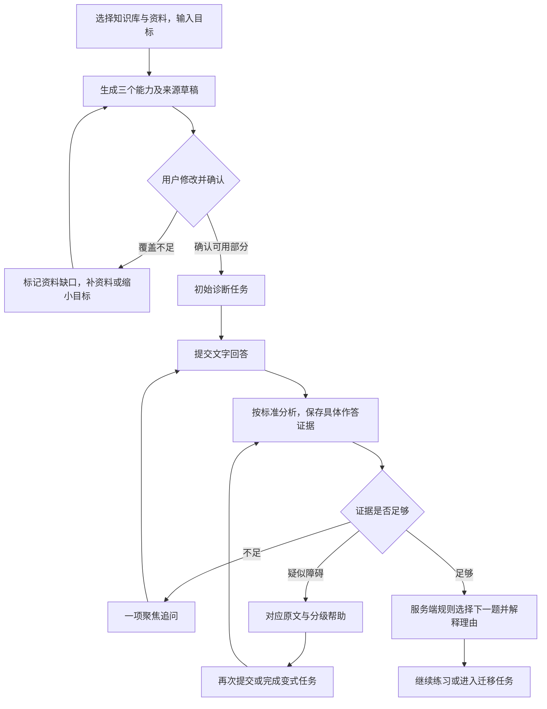
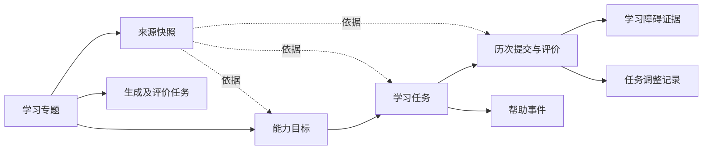
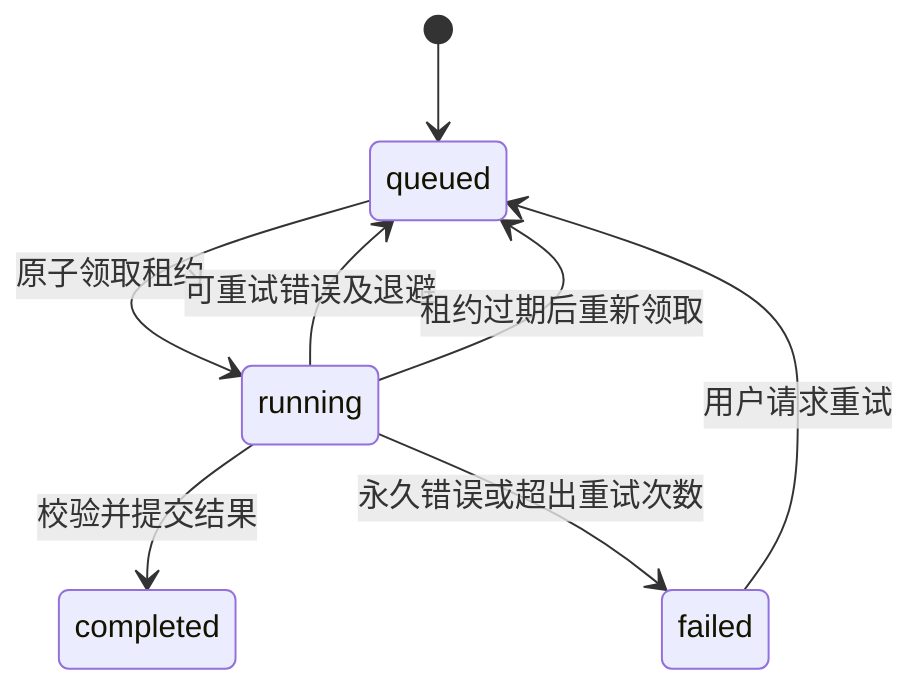

# 知衡：目标驱动的专题学习工作台修改方案

> 后续实施：已完成首版代码更新，实际完成范围与剩余项见 [v0.2.0 更新说明](learning-workbench-v0.2.0-release.md)。
>
> 版本：V0.1，供讨论修改思路使用
> 日期：2026-10-31（Asia/Shanghai）
> 基线：当前工作区源码，包含尚未提交的修改；不是仅依据 README 推断。
> 本次交付：方案文档。以下接口、数据表与文件均为拟议设计，尚未实施，也未进行运行验收。

## 1. 建议先做什么

**在现有知识空间、智能问答、评测中心旁，新增一个独立的“专题学习”入口。底层沿用现有资料与模型能力，上层增加“能力目标—任务—作答证据—障碍—下一步”的学习流程。**

首版围绕“数据库事务”完成一个可反复演示、可检查依据的学习闭环。重点投入回答分析、疑似障碍确认和后续任务调整；目标拆解与题目生成采用有边界的方案。

这样安排的原因：当前项目已经能回答“资料里怎么说”，但还不能可靠保存“你已经能做什么、判断依据是什么、接下来为什么练这一题”。新增模块的主要工作在学习业务状态，而不是再增加一套检索系统。

实施原则：

1. 学习状态保存为结构化记录，不能靠每轮对话重新总结。
2. 模型提出分析，服务端检查依据并按明确规则更新状态。
3. 评价区分“答案是否满足标准”和“是否独立完成”。
4. 一次错误不足以确认障碍，一次答对也不足以标记掌握。
5. 保留原有个人知识库的所有权、来源访问和文档删除规则。

## 2. 代码现状与复用边界

### 2.1 当前已经具备的基础

| 当前实现 | 核查位置 | 本模块如何使用 |
| --- | --- | --- |
| FastAPI、SQLAlchemy，SQLite / PostgreSQL 双环境 | `backend/app/main.py`、`db.py`、`models.py` | 新增学习接口、业务表与数据库迁移 |
| 个人知识库所有权，旧组织资料不可访问 | `services/access.py`、`api/dependencies.py` | 工作台归当前用户所有，所有子资源继承该范围 |
| 按活动版本、有效期与权限建立检索范围 | `services/corpus.py::CorpusScope` | 为目标拆解和资料匹配提供证据，但需要补文档范围 |
| Dense + BM25、融合、精排、相邻片段扩展 | `services/retrieval.py`、`corpus.py` | 继续检索相关定义、示例和解释材料 |
| Ollama / 兼容接口模型适配 | `services/answering.py::configured_llm` | 复用模型连接，另写学习用结构化提示词 |
| 引用编号、数字检查，可选模型事实核验 | `services/verification.py` | 复用适合的引用检查思路，新增作答证据检查 |
| 会话历史、请求幂等、并发限制与配额 | `services/chat.py`、`admission.py` | 借鉴可靠性处理方式，学习记录另行保存 |
| SQL 持久化任务、租约、摄取重试与心跳 | `worker.py`、`models.py::IngestionJob` | 新增学习任务执行分支，复用执行模式 |
| 文档版本、旧版清理、删除清理 | `api/document_lifecycle.py`、`services/cleanup.py` | 结合学习来源快照处理版本切换和删除 |
| Vue 单页工作台、统一请求方法 | `frontend/src/App.vue`、`api.ts` | 增加导航入口和独立学习组件 |

### 2.2 不能直接复用的部分

**评测中心不是学习档案。** `EvaluationRun` 保存的是 RAG 测试用例、检索指标与回答评测结果。学习模块需要保存个人作答、提示使用、能力表现和障碍证据，不能把两者塞进同一张表。

**现有问答生成器不等于作答评价器。** `answer_question()` 面向回答问题，其缓存、问题相关性和数字核验针对知识问答。学习评价还要核对评分标准、学生原句和场景条件，因此应直接复用模型适配器与检索服务，而不是把提交内容包装成普通聊天后解析自然语言结果。

**版本 ID 与 chunk ID 不足以长期追溯。** `worker.py::process_job` 在发布新版本后登记旧版本清理任务，`cleanup.py::process_cleanup` 会删除对应旧分块与向量。因此学习任务必须保存使用过的正文片段快照，不能依赖旧 chunk 永远存在。

**现有检索不能精确表达“只使用选中的几份教材”。** `CorpusScope` 当前按知识库限定，尚无文档白名单。只在前端传文档 ID、或召回后再过滤，会出现范围错误或漏召回，需要在服务端检索范围中补齐。

**Worker 不是现成的通用任务平台。** 当前摄取、评测、清理分支各有状态与执行函数。建议增加学习专用任务记录和执行函数，沿用租约模式；首版不重构所有历史任务。

## 3. 第一版范围

### 3.1 学习目标与产出

专题：“理解数据库事务，并能分析并发场景下的数据异常”。建议先收敛成三个可验证能力：

| 能力 | 完成后应能做什么 | 验证产出 | 建议先修 |
| --- | --- | --- | --- |
| C1 解释事务边界 | 区分原子性与隔离性，说明各自解决的问题 | 一段自己的解释及反例 | 读、写、提交的基本含义 |
| C2 分析交错执行 | 按时间线跟踪读写、提交和业务结果，解释题目中的异常 | 事务执行表和原因分析 | C1；区分数据库值与业务结果 |
| C3 选择防护方案 | 根据库存场景的约束提出方案，解释能防止的问题和代价 | 方案说明或伪代码 | C2 |

隔离级别作为 C3 的材料和判断内容。首版不穷尽所有数据库产品语义；涉及具体数据库时，在题面明确产品、隔离级别及必要条件，避免把不同实现当作同一种行为。

### 3.2 功能取舍

| 首版必须具备 | 后续再扩展 |
| --- | --- |
| 选一个个人知识库，再选其中的文档 | 跨多个知识库组织学习 |
| 三个能力的拆解草稿、修改确认、资料缺口 | 任意主题的完整课程自动生成 |
| 6–8 道人工检查的题目模板，含追问及变式 | 开放式无限出题、自动扩建题库 |
| 文字回答，支持纯文本伪代码 | 在线 SQL、代码执行、自动运行测试 |
| 四级按需提示与使用记录 | 语音、图片作答、复杂编辑器 |
| 按标准评价、疑似障碍、追问确认 | 通用知识图谱、概率掌握度模型 |
| 明确规则选择下一题，至少演示一次有效调整 | 长期遗忘曲线、跨专题推荐 |
| 刷新与跨会话恢复、错误纠正、来源回看 | 教师管理、多人协作、排行榜 |

首版仍使用真实上传资料检索和绑定引用，不能把预置教材伪装成用户资料。人工题目模板提供题面、标准、提示层级和变式；模型主要负责匹配资料、生成拆解草稿及分析作答。

## 4. 用户流程和页面

### 4.1 完整流程



### 4.2 页面组织

沿用当前 `App.vue` 的视图切换方式，将 `View` 增加为包含 `learning`，导航加入“专题学习”。首版无需引入新的路由框架或状态管理库。

建议新增 `LearningWorkspace.vue`，在模块内部展示：

- **专题列表 / 恢复入口**：目标、最近学习时间、当前任务、来源是否发生变化。
- **创建与确认页**：知识库、资料多选、目标输入、能力草稿、先修建议、来源和缺口。确认前可以修改能力描述与验证产出。
- **学习主界面**：左侧能力列表；中间题面、草稿和提交；右侧按需展开提示、原文和反馈。小屏改为分区切换。
- **学习记录**：历次提交、当时使用的帮助、评价依据、障碍状态与任务调整理由。

每项能力显示“尚未验证 / 需要补充证据 / 帮助下完成 / 独立完成 / 迁移验证通过”，不展示缺乏校准的“掌握度 87%”。

### 4.3 关键交互约定

1. 初始诊断建议先独立作答，也允许查看帮助；一旦获得帮助，本次记录相应级别。
2. 提交后先显示评价进度；失败保留作答，可重新评价，不要求重复输入。
3. 反馈按“已满足标准、尚缺证据、疑似障碍、建议下一步”展示，并可展开对应学生原句和原文。
4. “我不同意这个判断”可记录原因并选择“证据不足 / 已理解但表达遗漏 / 评价理解错误”。先暂停受争议结论的调度影响，再聚焦复核。
5. 修改草稿不改变历史提交；再次提交生成新记录。
6. 首版确认后的能力与任务标准冻结。若要大幅修改目标或替换资料，复制为新专题草稿；旧记录继续可回看，避免偷偷更换评价口径。

## 5. 学习业务模型

### 5.1 建议新增九类记录

首版使用现有关系数据库。需独立查询、授权和控制并发的对象建表；评分明细、少量先修 ID 和模型分析结果使用经过校验的 JSON，避免过早拆成几十张表。

| 模型 / 建议表名 | 核心字段 | 责任 |
| --- | --- | --- |
| `LearningWorkspace` / `learning_workspaces` | `id, user_id, knowledge_base_id, selected_document_ids, goal_text, plan_version, status, state_version, current_task_id, created_at, updated_at` | 专题归属、确认版本与整体进度 |
| `LearningCapability` / `learning_capabilities` | `id, workspace_id, title, observable_outcome, prerequisite_ids, source_ids, coverage_status, state, state_evidence_ids, ordinal` | 能力要求、资料覆盖与可解释的状态摘要 |
| `LearningSourceSnapshot` / `learning_source_snapshots` | `id, workspace_id, knowledge_base_id, document_id, revision_id, chunk_id, context_chunk_ids, document_name, page, ordinal, section_label, excerpt, content_hash, captured_at` | 冻结实际使用的来源内容与位置 |
| `LearningTask` / `learning_tasks` | `id, workspace_id, capability_id, kind, task_family, template_version, parent_task_id, prompt, rubric, source_ids, hints, status, ordinal` | 一份可提交的产出及固定评价标准 |
| `LearningAttempt` / `learning_attempts` | `id, task_id, workspace_id, user_id, request_key, body_hash, answer_text, submitted_at, hint_level_at_submit, assessment_status, assessment, assessment_version` | 不可覆盖的原始提交与评价结果 |
| `LearningHintEvent` / `learning_hint_events` | `id, workspace_id, task_id, request_key, level, revealed_at` | 记录服务端实际向用户提供过的帮助 |
| `LearningObstacle` / `learning_obstacles` | `id, workspace_id, capability_id, obstacle_code, status, evidence_refs, counter_evidence_refs, updated_at` | 疑似、确认、争议和解除状态 |
| `LearningDecision` / `learning_decisions` | `id, workspace_id, trigger_attempt_id, kind, rule_version, evidence_refs, before_state, after_state, reason, status, created_at` | 下一题选择、跳过、纠正与状态重算的历史 |
| `LearningJob` / `learning_jobs` | `id, workspace_id, user_id, kind, target_id, status, stage, request_key, body_hash, input_version, attempts, available_at, lease_token, lease_expires_at, error, result_ref` | 草稿生成与作答评价的持久化执行 |

通用主键沿用 `new_id()`，时间沿用项目的 UTC 存储方式。提示词、规则和题目模板各自有版本号，模型名及调用信息保存在评价元数据中。

### 5.2 关系和约束



- 能力、任务、提交等业务记录使用外键关联所属专题，删除专题时清理其学习记录。
- 来源里的 `document_id / revision_id / chunk_id` 是可回查的标识；**不对会清理的 Chunk 建立级联删除外键**。否则旧版本清理会连带删除学习依据。
- 引用必须属于同一专题选中的资料，先修 ID 必须属于同一专题，不能自引用或形成环。
- `LearningAttempt` 的 `(user_id, request_key)` 唯一；相同 key 不同正文返回 409，同一正文重试返回既有记录。
- `LearningHintEvent` 的请求 key 防止重复点击产生重复事件；真正获得过的提示不能因撤回而消除。
- `LearningJob` 按用户及请求 key 去重；状态变更用 `state_version` 和任务租约作条件更新。
- `LearningDecision` 对同一次提交的同一规则处理去重，防止任务重试导致重复推荐或重复累计证据。
- 任务标准、题面和来源在发布后不可直接覆盖；修改应生成新任务，保留原任务与提交关系。
- `assessment` 保留原始判定；纠正写入 Decision，标记哪条结论不再有效，并根据有效记录重算能力与障碍摘要。不能把旧判定悄悄改成新判定。

能力状态是可重算的摘要，历史提交、提示事件和调整记录才是依据。首版不建设通用事件溯源框架。

## 6. 资料范围和来源快照

### 6.1 从资料得到能力草稿

1. 校验知识库属于当前用户，所有文档均属于该库且存在可用活动版本、未过期。
2. 以原始目标及三个候选能力分别检索，不只用整个目标召回一次。
3. 合并命中结果，按需扩展相邻片段，限制片段数与输入长度。
4. 模型输出能力描述、验证产出、先修建议及候选来源 ID。
5. 服务端检查引用、先修关系和资料覆盖，保存为草稿。
6. 用户确认后冻结目标版本、任务标准和来源快照。

覆盖状态分为 `covered / partial / missing`。检索没有找到依据只表示“本次资料匹配未找到足够依据”，不能断言全书没有这部分内容。用户可查看候选片段并补选原文。

当前分块有页码和顺序，但没有完整、稳定的章节树。首版优先展示“文档名 + 实际页码 + 原文片段”；章节名只在原文明确提供时记录，没有页码或章节名就留空，不能由模型编造定位信息。先修关系也标注为学习建议，不伪称教材已经证明了能力之间的依赖。

缺口可以保留在计划中，但不可生成依赖该缺口的正式计分任务。先补资料或调整范围，再继续该部分。

### 6.2 为 CorpusScope 增加文档白名单

建议增加可选 `document_ids` 参数，保持现有问答调用不传该参数时的行为：

- SQL 范围增加所选 `Document.id` 条件。
- Dense 检索的 Qdrant filter 同时限制知识库与文档 ID；SQL 回查仍校验权限、活动版本和有效期。
- BM25 统计、正文回查、邻居扩展与范围指纹使用同一组条件。
- 检索前验证每个传入文档 ID；非法或全部失效时返回明确错误，不能退回全库。
- 区分未指定文档范围和显式空数组；学习模块禁止以空数组表示全库。

该改动只扩大“范围表达能力”，不改现有融合权重、排序算法与问答提示词。需补回归测试证明原问答路径不受影响。

### 6.3 版本变化、删除与过期

| 情况 | 建议行为 |
| --- | --- |
| 文档更新，新版本已发布 | 已有任务继续使用冻结快照，并显示“采用历史版本”；新专题使用新活动版本 |
| 旧版 Chunk / 向量被清理 | 历史任务仍能展示快照；回看原文件时使用现有历史版本下载接口 |
| 生成草稿过程中资料版本改变 | 比较所选文档版本及范围指纹，作废本次草稿结果并提示重新生成 |
| 来源文档被删除或移出可访问范围 | 隐藏来源摘录及依赖它的题目、提示、评价和模型解释，暂停相关任务；保留用户自己的提交和非敏感状态记录 |
| 来源过期 | 首版保守处理：保留历史回看且标明过期，暂停基于该来源的新评价与新任务；补充有效来源后另建草稿 |
| 知识库删除 | 专题进入来源不可用状态，停止运行；用户可以删除专题，也可保留自己的作答记录 |

删除知识库时不要把专题根记录直接外键级联删除，以便保留用户作答；其 `knowledge_base_id` 可设为可空外键并使用 `SET NULL`。原知识库与文档标识在快照中作历史标识保留，但不再授予读取权限。

现有 `citations_available()` 只判断文档当前是否仍存在于个人范围，不检查过期；学习模块应明确区分“历史可回看”和“可继续用于新任务”，增加自己的来源可用性检查，不暗中改变原问答历史规则。

删除时在现有清理入口增加学习数据失效/摘录清除处理，读接口再动态核验一次，防止遗漏路径仍返回缓存中的材料。模型任务执行前、结果提交前均复查来源与账户状态。快照可跨版本保存，但不能绕过资料删除。

## 7. 任务、提示和提交

### 7.1 题目模板

每个模板包含：目标能力、题型、业务条件、评价标准、常见障碍、四级提示、完整解析、来源需求、所属题目家族与变式。

建议准备 8 道模板：

| 编号 | 类型 | 用途 |
| --- | --- | --- |
| T1 | 解释题 | 初步区分原子性和隔离性 |
| T2 | 库存交错时间线 | 初步区分数据库值、成功订单数与业务约束 |
| T3 | 聚焦追问 | 判断是时间线理解问题还是表达遗漏 |
| T4 | 修改错误方案 | 检查“加事务就一定安全”的推理 |
| T5 | 交错执行变式 | 在改变条件后重新分析，验证障碍 |
| T6 | 库存防护方案 | 给出思路、伪代码和成立条件 |
| T7 | 独立解释变式 | 不重复原题，补独立完成证据 |
| T8 | 迁移题 | 用不同业务或数据条件检验应用能力 |

模板发布前人工检查题面是否自洽、来源能否支持标准、提示是否逐级增加帮助。开发测试中的合成教材应明确标注为测试资料。

### 7.2 四级帮助

| 级别 | 返回内容 | 对学习记录的影响 |
| --- | --- | --- |
| 0 | 未请求系统帮助 | 仅能记为“未使用系统帮助”，不保证用户未查阅外部资料 |
| 1 | 提醒需要考虑的条件 | 标记提示下完成 |
| 2 | 返回相关原文及引用 | 标记资料辅助完成 |
| 3 | 局部示例或部分推导 | 标记示例辅助完成 |
| 4 | 完整解析 | 标记解析后完成，安排新的独立变式 |

普通任务响应不得包含所有提示、完整标准答案或隐藏解析；提示接口按需返回并先记录提供事件。

提交时从服务端事件计算帮助级别，不能相信前端上报的 `hint_level`。同一题已看过完整解析后再次提交，仍然保留解析暴露记录，不能刷新页面后恢复为独立完成。可展示已获得的最高级别，而不宣称测得了用户实际阅读程度。

提示与提交同时发生时，按服务端数据库事务的先后顺序确定本次帮助级别，提交后提供的提示影响下一次尝试。反馈中若直接给出完整解法，同样记录为解析暴露，避免绕过提示入口。

## 8. 开放式回答评价与障碍诊断

### 8.1 先固定标准，再分析回答

以库存题为例，评分标准可以拆为：

- K1：按题面跟踪两个请求的读取和写入顺序。
- K2：区分“最后数据库记录为 0”和“有几个订单成功”。
- K3：说明为什么业务约束仍可能被破坏。

如果这是一道初始原因分析题，不因为用户没写解决方案就判不通过；解决方案由后续任务单独验证。评价对象必须与题目要求一致。

每个标准使用 `met / partial / not_met / insufficient_evidence`，不先合成一个掩盖差异的总分。遗漏、明确错误、题面歧义和模型无法判断需要分开。

### 8.2 结构化结果示意

下例为拟议契约，ID 和学生文本仅作格式示意：

```json
{
  "task_id": "task-2",
  "rubric_version": "inventory-v1",
  "criteria": [
    {
      "criterion_id": "K2",
      "verdict": "not_met",
      "student_evidence": [{"quote": "库存没有负数，所以没有超卖"}],
      "source_ids": ["source-snapshot-2"],
      "reason": "该句只根据最终库存值判断，未结合题面中两个成功订单分析。"
    }
  ],
  "obstacle_candidates": [
    {
      "code": "stock_value_vs_order_count",
      "criterion_ids": ["K2"],
      "status": "suspected",
      "alternative_explanation": "也可能是省略了对订单成功条件的说明。",
      "followup_template_id": "T3"
    }
  ],
  "feedback": "请分别写出最后库存值和成功订单数，再判断是否满足题目中的业务约束。"
}
```

### 8.3 服务端必须校验什么

1. 使用严格 Pydantic 模型解析，拒绝未知字段、无效枚举和缺失标准。
2. 返回的标准 ID 必须覆盖本题所有标准且不重复，不能临时增加评分项。
3. 引用只能来自任务已冻结的来源集合；学生证据必须在本次作答中真实存在。字符位置由服务端定位，不能只信模型给出的偏移。
4. 学生原文为空或无法支持判断时，结果应为“证据不足”；不能自动推导为“不掌握”。
5. 反馈区分资料原文、题面给定条件、学生原句和评价推断。场景中的库存数字来自题面，不强制要求教材原文出现同样数字。
6. 模型返回的推荐题必须属于已检查的模板集合；所有状态变化由规则层决定。
7. 学生作答、教材片段中的指令都作为待分析文本处理，不能覆盖评价规则。

现有数字检查不能完整校验这类反馈：它只对比答案与引用中的数字，可能把题面推演数字误判为无依据。学习模块增加专用校验，不把 `verify_answer()` 的通过结果当作“诊断可信”的充分条件。

首版不对每次评价强制再调用一个模型投票。先使用明确标准、结构校验、人工检查案例和保守追问；需要复核时才追加一次模型分析。复核仍不等于客观真值。

### 8.4 障碍状态

| 状态 | 进入依据 | 后续处理 |
| --- | --- | --- |
| `suspected` 疑似 | 一次有效评价出现有原句支持的障碍表现 | 选择一项聚焦追问，不直接贴确认标签 |
| `confirmed` 有重复证据支持 | 同一障碍在不同题目家族或独立聚焦追问中再次出现，且不存在未解决的冲突证据 | 优先安排对应材料和补练 |
| `disputed` 存在争议 | 用户提出纠正，或不同证据互相矛盾 | 暂停该结论的自动调度影响，复核或追问 |
| `resolved` 已有反证支持解除 | 新的无系统帮助变式满足相关标准，且能够解释原错误 | 保存解除依据，继续后续验证 |

同一答案重复提交、同题看解析后的修正、Worker 重试，不算多条独立确认依据。首版可以先保留四类障碍码：交错执行理解、库存与订单混淆、防护方法不足、表达证据不足；最后一类主要触发追问，不等同于知识错误。

这些门槛是首版可解释的产品规则，需要用案例校准，不宣称为经研究验证的心理诊断模型。

## 9. 下一步任务如何调整

### 9.1 模型与规则分工

模型输出逐项标准结果、原句证据、候选障碍及建议。规则层结合已生效记录、提示暴露和任务依赖选择下一项，保存理由。

建议按以下优先级处理：

| 优先级 | 条件 | 服务端动作 |
| --- | --- | --- |
| 1 | 来源不可用、评价失败、判断被争议 | 不推进能力状态；先补来源、重试或复核 |
| 2 | 表达不完整，无法定位具体障碍 | 发一个聚焦追问；连续两次仍不足时允许跳过并保留未验证状态 |
| 3 | 存在有重复证据支持的障碍 | 从该障碍对应的材料与练习集合选择下一项 |
| 4 | 本次已满足标准，但获得过提示或完整解析 | 记为辅助完成，选择新的无系统帮助变式 |
| 5 | 一次独立完成 | 记为独立完成，减少同类定义重复，推进不同题目家族的验证 |
| 6 | 不同家族独立验证满足要求，先修也满足 | 可进入后续能力或迁移题 |

同一时刻只变更下一项任务，不重新生成整条路线，也不删除已有题目。模板耗尽时提示“目前缺少合适的后续练习”，不能循环推荐同一题或编造进度。

用户可以跳过建议，但跳过不等于通过。用户纠正使旧证据失效时，重算相应摘要，保留已经完成的真实提交，并标明此前建议已被替代。

### 9.2 调整记录示例

> 你已经在 T1 中独立区分了原子性与隔离性；在 T2 和 T3 中，两次依据最终库存值判断是否超卖，仍未分别说明成功订单数。下一项先完成 T5 的事务时间线分析，再继续库存防护方案。依据：两次提交的 K2 评价；规则版本 learning-rules-v1。

界面提供“查看依据”和“纠正判断”。理由必须由真实记录生成；如果只有一次有效证据，不得写成“两次分析均出现”。

## 10. 服务划分与接口草案

### 10.1 服务结构

```text
api/learning.py              请求校验、用户身份、专题范围、结果响应
schemas_learning.py         目标、任务、提交、结构化评价契约
services/learning/
  planning.py               目标拆解、资料匹配与草稿检查
  tasks.py                  模板实例化、提示提供与提交登记
  assessment.py             标准评价、学生原句和来源校验
  progression.py            障碍与能力状态重算、下一题规则
  sources.py                快照、可用性与失效处理
  jobs.py                   生成/评价执行、租约与重试
```

数据模型首版仍放入现有 `models.py`，以 `Learning` 前缀区分。提示词及数据库事务专题模板存放在 `services/learning/` 下的版本化资源中，无需引入独立 Agent 框架、图数据库或新的数据库服务。

### 10.2 接口草案

以下路径均位于现有 `/api` 前缀下：

| 方法与路径 | 行为 |
| --- | --- |
| `POST /learning/workspaces` | 校验选定资料，保存目标，创建草稿生成 Job，返回 202 和 ID |
| `GET /learning/workspaces` | 分页列出本人的专题 |
| `GET /learning/workspaces/{id}` | 返回能力、当前任务与进度摘要 |
| `PATCH /learning/workspaces/{id}/plan` | 仅在草稿状态修改能力及先修关系，携带版本号 |
| `POST /learning/workspaces/{id}/confirm` | 检查覆盖、冻结计划、实例化首批任务 |
| `GET /learning/tasks/{id}` | 题面、用户可见标准、历史提交；过滤未请求的帮助和答案 |
| `POST /learning/tasks/{id}/hints` | 校验级别，记录后返回该级帮助 |
| `POST /learning/tasks/{id}/attempts` | 保存提交及帮助级别，创建评价 Job，返回 202 |
| `GET /learning/attempts/{id}` | 返回提交与评价状态，隐藏受限来源内容 |
| `GET /learning/jobs/{id}` | 生成/评价进度、失败原因与结果引用 |
| `POST /learning/jobs/{id}/retry` | 对失败任务发起幂等重试，不复制原提交 |
| `GET /learning/workspaces/{id}/history` | 按时间分页返回提交、帮助和调整记录 |
| `POST /learning/workspaces/{id}/corrections` | 保存争议或纠正，暂停对应依据影响并安排复核 |
| `POST /learning/workspaces/{id}/next` | 按有效规则幂等选择或跳过当前建议，返回调整记录 |
| `DELETE /learning/workspaces/{id}` | 删除本人专题及其学习记录，不删除原始知识库资料 |

校验建议：目标 10–1000 字、首版最多 10 份资料、提交 1–10000 字、纠正理由 1–1000 字。超过限制返回可理解的错误；这些是工程默认值，可在实现时按模型上下文预算调整。

子资源不能仅按 ID 查询后返回，必须沿所属专题校验当前用户。404 用于不存在或不属于本人；409 用于并发版本冲突或来源在执行期间变化；429 用于配额；422 用于输入校验失败。

## 11. 后台执行、失败与并发

### 11.1 作业状态和恢复



- SQL 是事实来源，Redis 继续只负责唤醒；将学习作业加入 Worker 定时扫描。
- 学习生成和评价均可耗时，API 不等待全部模型调用完成；前端沿用轮询方式，首版不新增学习 SSE。
- 学习 Job 有自己的状态、阶段和租约，不能伪装成 `IngestionJob` 或 `EvaluationRun`。
- 使用摄取任务的原子领取、心跳、租约 token 与退避模式，但不直接照搬评测分支的所有恢复行为。
- 过期 Worker 的结果必须被 token 条件更新挡住。
- 模型网络调用在短数据库事务之外进行；完成后重新校验用户状态、来源、输入版本和租约，再一次性写入评价、障碍及调整记录。
- 同一专题同时修改计划、请求下一题或提交结果时，使用 `state_version` 条件更新；冲突一方刷新，不覆盖更新后的状态。
- 同一任务有尚未完成的评价时，首版不接受另一份新提交，返回当前评价进度；用户仍可编辑本地草稿。这样可以避免前后两次评价倒序完成而覆盖学习状态。
- 原始作答先持久化。评价失败不能抹掉作答，也不能累计障碍或推进学习状态。

### 11.2 模型失败和降级

| 异常 | 行为 |
| --- | --- |
| 未配置模型 | 可以查看已确认的人工模板、原文和历史；禁止假装已经自动诊断。提交保存为待评价 |
| 超时或临时网络错误 | 有上限的后台退避重试，显示阶段；达到上限后可手动重试 |
| 输出格式错误 | 最多一次有界格式修复；仍不合规则失败，不默认判错 |
| 引用越界、学生原句不存在、标准缺失 | 拒绝应用结果，保留作答，提示无法可靠评价 |
| 资料不足或题面存在歧义 | 暂停本题评价，标记待补充或需修订题目 |
| 模型不可判断 | 给出聚焦追问或“暂不能判断”，不制造障碍标签 |

### 11.3 配额与部署接入

学习调用需要接入现有 `consume()` 和 `capacity()`，与聊天共享每日模型预算及服务总并发，避免新增接口绕过限制。多个学习调用按实际调用次数计费/扣量，包含修复与复核；异步 Job 在实际调用时扣量，重放已完成结果不重复扣量。

限额等待应作为可恢复等待处理，不能因为 429 把学生判错。现有聊天请求预算的历史口径不在本次重构。

`config.py` 的 `worker_role` 当前只接受 `all / ingestion / evaluation`。需增加 `learning`，并同步 Compose 配置；部署可以先由 `all` 处理，也可运行独立 learning Worker。每轮扫描有数量上限，学习生成不能长期阻塞摄取与现有评测。无 Redis 模式继续由 API 内 Worker 执行。

建议提供 `RAG_LEARNING_ENABLED` 功能开关以及学习单次调用/修复上限，并由 `runtime.capabilities()` 暴露可用状态。关闭模块不删除学习数据。

## 12. 具体文件修改地图

| 位置 | 计划修改 | 边界 |
| --- | --- | --- |
| `backend/app/models.py` | 新增九类 Learning 模型、索引和约束 | 保留现有业务模型语义 |
| `backend/app/schemas_learning.py`（新增） | 输入、评价、提示和响应契约 | 不继续把所有契约堆入 `schemas.py` |
| `backend/app/api/learning.py`（新增） | 学习模块接口 | 依赖现有 CurrentUser 与 DB |
| `backend/app/services/learning/`（新增） | 目标、任务、评价、状态规则、来源、作业 | 学习业务主体 |
| `backend/app/services/corpus.py` | 文档白名单及范围指纹 | 保持旧调用默认行为 |
| `backend/app/services/cleanup.py` | 删除资料时使学习来源失效、清理摘录 | 保留旧版分块清理机制 |
| `backend/app/services/runtime.py` | 暴露学习模块与模型评价能力 | 不将未配置模型标为可诊断 |
| `backend/app/worker.py` | 扫描并派发 LearningJob | 不重写原摄取和评测流程 |
| `backend/app/config.py` | 功能开关、调用限制和 learning 角色 | 延续静态配置方式 |
| `backend/app/main.py` | 注册新路由 | 沿用既有身份与请求保护 |
| `backend/migrations/versions/v007_learning.py`（拟定） | 新表及约束，接在当前 `006_operations` 后 | 不改写冻结的历史迁移 |
| `frontend/src/api/learning.ts`（新增） | 学习类型与接口方法 | 复用 `api.ts` 的请求和错误处理 |
| `frontend/src/components/learning/`（新增） | 专题入口、能力确认、任务、提示、反馈与记录 | 主逻辑在模块组件内 |
| `frontend/src/App.vue`、`style.css` | 导航入口、组件挂载与必要样式 | 不展开全站页面重构 |
| `examples/learning/database-transactions-v1.json`（新增） | 人工检查的题目模板与版本 | 区分模板内容与用户上传依据 |
| `backend/tests/test_learning_*.py`（新增） | 评价契约、状态规则、权限与恢复测试 | 用有区别的案例验证实际行为 |
| `backend/tests/test_migrations.py` | 更新迁移 head 断言并验证旧数据保留 | 当前断言硬编码 `006_operations` |
| `docker-compose.yml` 与配置示例 | 补学习 Worker 角色与开关 | 可复用已有服务和依赖 |
| `docs/user-guide.md`、`architecture.md`、`validation.md` | 补学习流程与验收结果 | 实现验收后更新，不提前宣称完成 |

当前工作区已有 README、身份验证、路由、模型及解析等未提交修改；实施时必须以这些内容为基线，逐项增量编辑，不覆盖用户现有工作。

## 13. 建议实施顺序

以下是依赖顺序，不是已经承诺的工期。以阶段验收推进，比一次写完所有自动生成能力更稳妥。

| 阶段 | 工作内容 | 阶段验收 |
| --- | --- | --- |
| A：建立底座 | 学习模型与迁移、本人权限、来源快照、文档检索范围、模板导入 | 只能检索选定资料；升级保留原数据；版本切换后快照可回看 |
| B：先走通任务 | 固定三能力草稿、人工模板、页面、提示事件、提交持久化、Job 恢复 | 能确认目标、答题、看帮助、刷新恢复，重试不重复提交 |
| C：接入可信评价 | 结构化模型评价、原句检查、评分标准、疑似障碍与追问 | 对正确、错误、遗漏和无法判断作出区分；模型坏输出不影响学习状态 |
| D：打通调整 | 规则层、障碍确认/解除、独立变式、调整理由及纠正重算 | 重复证据可改变下一题；同题重交不冒充独立证据；纠正后建议更新 |
| E：补目标生成并验收 | 从资料生成草稿、缺口标记、失败降级、部署和回归 | 完整走通用户提出的闭环；与人工模板路径使用同一契约 |

优先完成 A–D，可以先验证最有价值的诊断与调整链路；E 将入口从固定专题模板升级为“围绕资料提出草稿”，仍限制在数据库事务专题。

## 14. 验证方式与首版验收

### 14.1 核心闭环验收剧本

1. 登录账号 A，上传事务材料，另放入一份不相关资料。
2. 在专题学习中只选择事务材料，输入目标；检查三个能力及实际引用，不得混入未选资料。
3. 修改并确认能力草稿；缺乏依据的部分明确标记且不产生正式计分任务。
4. 提交“库存没有负数，所以没有超卖”等样例回答；系统记录具体原句，只给疑似障碍。
5. 回答一项聚焦追问，提供进一步证据；能区分知识问题和表达遗漏。
6. 请求第二级提示，看到对应原文；刷新后继续保留帮助记录。
7. 再次提交，反馈关联标准、原句和来源；帮助后完成不能记为独立验证。
8. 系统按规则改选事务时间线变式，展示真实调整依据。
9. 独立完成新的变式，状态可更新；随后提出一次纠正，检查争议状态与下一步重算。
10. 刷新页面、重新登录，仍能恢复当前任务及全部有效记录。

### 14.2 必须覆盖的工程场景

| 场景 | 通过标准 |
| --- | --- |
| 跨用户访问 | 账号 B 无法读取 A 的专题、任务、提示、作答、Job 或来源 |
| 选中文档范围 | Dense、BM25、邻居扩展都不能进入未选文档；空列表不扩大范围 |
| 历史版本清理 | 主动执行旧分块清理后，历史任务仍可展示当时快照 |
| 文档删除 / 知识库删除 | 新请求、历史接口、缓存重放及在途 Job 均不泄露来源和派生讲解；用户原始作答保留 |
| 文档过期 | 历史标注清楚，新的任务推进受到限制 |
| 双击与网络重试 | 同一提交只有一条 Attempt；同一次评价只有一次有效状态应用 |
| 提示与提交并发 | 按服务端顺序冻结帮助级别，不由前端任意修改 |
| Worker 退出与过期租约 | 新 Worker 可恢复，旧 Worker 无法覆盖新结果 |
| 评价输出异常 | 虚构原句、非法来源、漏标准或 JSON 错误均被阻止 |
| 证据计数 | 重复答案、看解析后重交和作业重试不累计独立验证次数 |
| 用户纠正 | 原判定保留但不再驱动调度，摘要及建议可以重算 |
| 现有功能回归 | 上传、版本、问答、历史、评测、身份验证原有测试继续通过 |
| 数据迁移 | 从 `006_operations` 升级、新库初始化、重复启动均通过，保留既有记录 |

### 14.3 评价质量如何检查

准备约 24 条人工标注案例，覆盖正确但措辞不同、部分正确、明确错误、表达不足、题目歧义、诱导指令和使用提示等情况。开发用例与保留验收用例分开，避免只适配示例答案。

分别检查逐项标准判定、证据不足识别、原句引用真实性、疑似障碍归因及下一题规则。记录人工与模型的分歧，不用单一“诊断准确率”掩盖误判类型。

首版硬门槛：非法来源和虚构学生原句不得发布；证据不足不得直接确认为障碍；重复记录不得造成状态升级；所有调整都有可点击的有效依据。语义评价效果需在人工案例检查后报告，当前不预填准确率。

### 14.4 实现时的检查命令

沿用现有工具，无需为了方案安装依赖：

```bash
# 仓库根目录
python -m ruff check backend scripts

# backend 目录
python -m pytest -q

# frontend 目录
npm run build
```

另外在真实 PostgreSQL / Redis / Qdrant 环境验证迁移、恢复、并发与文档过滤；在已配置模型的环境运行少量完整评价流程。测试结果在实施后写入验证文档。本次仅编写方案，不把代码阅读当作测试通过。

## 15. 成功定义、风险与待确认项

### 15.1 首版成功定义

工程成功：一个专题完整走通“确定目标—作答—发现疑似障碍—原文帮助—重新提交—有依据反馈—调整后续任务”，记录可恢复、可追溯、可纠正。

产品观察：记录首次提交率、闭环完成情况、评价失败率、用户纠正情况、帮助后是否完成新变式，以及每个学习单元的模型调用量。少量自测只用于发现问题，不足以证明学习效果。

用户引用的研究支持把检索与重建知识作为学习活动：该实验在其测试材料中观察到对理解和推理题的帮助。它没有检验本模块，也不能证明自动诊断和推荐有效。模块效果后续需要独立评估。[Karpicke & Blunt，2011，PubMed 摘要](https://pubmed.ncbi.nlm.nih.gov/21252317/)

### 15.2 主要风险与处理

| 风险 | 首版应对 |
| --- | --- |
| 把材料命中当成完整覆盖 | 显示实际依据、partial / missing，允许补选原文 |
| 模型把遗漏解释成知识错误 | 单列证据不足，先追问，保留其他可能解释 |
| 刷题或看解析后被误判掌握 | 帮助暴露持久化，使用不同家族变式独立验证 |
| 生成题面或标准本身有问题 | 人工检查小题库，题面与标准冻结、可作废 |
| “智能调整”只是在随机换题 | 有限模板集合、规则优先级、依据记录与重放检查 |
| 快照绕过来源删除 | 删除时失效与清理，读取和结果发布再次校验 |
| 调用成本和耗时持续增加 | 拆解/评价调用有上限，异步执行，不默认多模型复评 |
| 新模块推动无关重构 | 仅新增学习目录及必要接入点，保留已有检索算法和业务流程 |

### 15.3 评审时需要确认的默认建议

这些选择不影响本次方案交付，后续实施前可按反馈修改。

| 事项 | 默认建议 | 影响 |
| --- | --- | --- |
| 首个专题 | 数据库事务，三个能力与八道模板 | 决定模板和验收案例范围 |
| 首版生成边界 | 自动生成目标草稿；正式练习来自人工检查模板 | 决定可靠性与开发投入 |
| 自动调整方式 | 用户确认目标后，规则自动调整下一题，可跳过及纠正 | 决定学习流程交互 |
| 确认后修改目标 | 复制为新草稿，不就地重写历史目标 | 简化版本与评价口径 |
| 无模型模式 | 可读材料、查看任务与保存提交；不生成诊断结论 | 决定演示和降级体验 |
| 来源过期 | 历史可回看，新任务暂停；删除则隐藏相关派生内容 | 决定来源生命周期策略 |
| 排期 | 按 A–E 分阶段验收，暂不承诺日期 | 需要结合可投入时间确定 |

建议第一步从阶段 A 开始，先保证“选定资料、固定标准、保存依据”的底座可靠，再逐步接入评价与调整。
