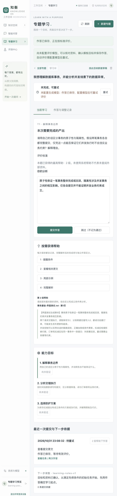

# 知衡 v0.2.0：专题学习工作台更新说明与未完善项

更新日期：2026-10-31（Asia/Shanghai）。范围依据 [修改方案 V0.1](goal-driven-learning-workbench-plan.md)。本版为数据库事务专题的首个可用流程版本。

## 1. 这次更新带来的变化

项目在知识空间、智能问答和评测中心之外增加“专题学习”。用户可以选择资料、确认三个能力目标、提交文字回答、查看分级帮助，获得按标准组织的反馈，再查看为什么下一步改做某项练习。

已提交作答、帮助使用、来源版本、障碍线索与任务调整保存到数据库。学习评价和原来的检索/回答评测分别保存，不混用评测指标。

应用、后端包、前端版本均更新为 `0.2.0`。未安装新依赖；前端锁文件只同步了项目版本号。

## 2. 已实现内容

| 内容 | 当前行为 |
| --- | --- |
| 专题创建 | 单个个人知识库，选 1–10 份有效文档；限定数据库事务主题 |
| 能力草稿 | 三个默认能力；配置模型后可按资料细化描述；无模型时返回明确待核对的模板草稿 |
| 目标确认 | 可编辑描述、原文绑定、先修关系与覆盖状态；拒绝循环依赖、跨专题引用与无依据的覆盖标记 |
| 资料缺口 | 区分已覆盖、部分覆盖、缺少依据；有缺口的能力不实例化正式任务 |
| 任务 | 八道固定模板，覆盖解释、时间线、聚焦追问、错误方案修改、防护设计与迁移 |
| 分级帮助 | 条件提醒、原文、局部示例、完整解析；服务端记录提供时间与最高级别 |
| 作答与恢复 | 文字/纯文本伪代码；本地草稿按账号和任务保存，提交与进度服务端持久化，可恢复最近专题 |
| 异步评价 | 保存提交后执行 Job；按每条固定标准输出满足、部分满足、未满足或证据不足 |
| 评价检查 | 严格输出结构，完整标准 ID、来源白名单、真实学生原句与服务端定位；异常输出不改变能力状态 |
| 障碍线索 | 交错执行、库存值与订单数、防护方法、表达证据四类；一次表现仅疑似，不同家族独立证据才可确认 |
| 下一步调整 | 按具体障碍码、提示暴露、先修状态与任务可用性选择下一题，保存规则版本、理由及提交依据 |
| 独立验证 | 同题重交不增加题目家族数量；看过解析不能刷新为独立完成；至少两类独立任务满足标准才进入变式验证通过 |
| 用户纠正 | 争议使整次评价停止影响状态，保留原判定和纠正理由；旧推荐标为已替代，重新作答补充证据 |
| 原文回看 | 快照保留文档、实际页码、版本与正文，可下载任务采用版本；不伪造章节名 |
| 权限与生命周期 | 子资源统一校验本人；文档更新可保留历史快照；删除时清除复制材料及派生评价，用户原始作答保留 |
| 幂等和并发 | 创建、提示、提交、纠正等记录去重；版本冲突提示刷新；同专题评价未完成时不接受另一份新提交 |
| 作业恢复 | SQL 扫描、租约、心跳、过期恢复、有界退避和手动重试；旧 Worker 不能覆盖后继结果 |
| 部署 | 新增 `007_learning` 迁移、学习开关、learning Worker 角色及 Compose 服务 |

### 资料删除的实际策略

本版采用保守策略：某份来源被删除后，清除关联整个专题的来源摘录、题面、提示、能力派生描述和评价文字，保留用户自己输入的目标和作答。其他未删除原件不会受影响。相关专题需重新选资料建立草稿。

这样可以避免派生讲解间接保留已删除材料，但也会暂停仍有部分有效来源的任务；后续可以缩小为精确的依赖失效范围。

### 下一题调整示例

若库存场景中出现一次“只看库存是否为负”的错误，先记录疑似混淆，安排订单数量的聚焦追问。若回答反映交错顺序理解困难，优先转入时间线练习。帮助下完成后会安排不同变式；不能把同题看解析后重交当作新独立证据。

## 3. 如何使用这一版

1. 重启匹配本版的后端与前端；既有服务不会自动载入 Python 代码更新。
2. 上传事务教材或笔记并等待解析。
3. 打开“专题学习”→“新建专题”，选资料并输入事务目标。
4. 核对每项能力的原文与先修关系，确认有依据的部分，开始任务。
5. 提交后查看标准反馈、疑似障碍与下一步理由。需要帮助时逐级展开。
6. 从历史记录中回看原题、再次提交，或提出评价纠正。

详细步骤见 [使用指南](user-guide.md)。运行及迁移见 [部署指南](deployment.md)。默认未配置模型时允许保存提交，评价会明确提示未配置，配置后可重试。

题目模板位于 `examples/learning/database-transactions-v1.json`，运行包使用同步的 `backend/app/services/learning/templates.json`；有测试保证两份内容一致。

## 4. 代码改动位置

| 部分 | 位置 |
| --- | --- |
| 九类业务表 | `backend/app/models.py` 中的 Learning 模型 |
| 冻结迁移 | `backend/migrations/learning_v1.py`、`versions/v007_learning.py` |
| 接口与严格契约 | `backend/app/api/learning.py`、`schemas_learning.py` |
| 资料及目标 | `services/learning/sources.py`、`planning.py` |
| 评价与模型调用 | `services/learning/assessment.py`、`model.py` |
| 学习规则及作业 | `services/learning/progression.py`、`jobs.py` |
| 既有基础接入 | `corpus.py`、`cleanup.py`、`worker.py`、`runtime.py`、`main.py`、`config.py` |
| 前端 | `frontend/src/components/learning/LearningWorkspace.vue`、`src/api/learning.ts`、`App.vue` |
| 测试 | `backend/tests/test_learning.py`，配置与迁移测试同步更新 |

工作区原有未提交修改已作为基线保留。本次只对解析文件的导入分组补了一行空白，以通过现有静态检查，没有修改其解析行为。

## 5. 验证结果与范围

最终结果记录见本节及 [评测与验证](validation.md) 的 v0.2.0 条目。

- 后端全量测试：**114 项通过**（SQLite / Qdrant local，包含 20 项新增学习测试）。
- 新增学习测试：覆盖完整闭环、障碍类别分流、帮助记录、无模型重试、来源失效、权限、重复请求、版本冲突、旧租约隔离与模型调用上限。
- 后端静态检查：`python -m ruff check backend scripts` 通过。
- 前端：类型检查与 Vite 生产构建通过；依赖版本未变化。
- 实际浏览器：在临时 SQLite、Qdrant local、合成教材和临时测试账号中，验证登录、进入专题、复制目标时保留资料选择、生成能力草稿、任务展示、第二级原文帮助、帮助级别记录、文字提交、无模型失败提示和历史记录。
- 自动评价与调整链路：使用固定的模型响应测试夹具，验证原句和来源检查、疑似→重复证据、后续任务改变及纠正。没有将这些夹具冒充真实模型效果。
- 未进行：远程真实模型语义效果测评，以及本机真实 PostgreSQL / Redis / Qdrant server 组合验收。现有 CI 的基础设施任务会执行同一测试集，但本次未取得其运行结果。

浏览器截图使用合成资料，明确展示无模型降级状态：

## 6. 尚未完善的内容

### 优先级 P0：真实模型评价质量和模板审定

1. **尚未建立方案建议的约 24 条人工标注语义案例集。** 当前测试验证工程规则与已给定模型输出的处理，不证明模型能正确理解所有学生回答。下一步应建立正确但换措辞、部分正确、表达遗漏、歧义和误区等保留案例，逐项人工核对。
2. **八道题尚未经用户或教学专家审定。** 本次编写并检查了题面、标准、提示和解析，但不能称为已经完成外部人工验收的题库。正式使用前需核对教材是否支持每个评分标准。
3. **同一模型返回的合理误判仍可能通过结构校验。** 原句真实、来源存在，不代表解释一定正确。本版通过证据不足、追问和用户纠正降低影响，还没有自动完成可靠的语义复核。
4. **完整解析暴露依赖模型自报。** 显式四级提示有可靠记录；评价反馈是否意外泄露完整解法，目前依赖 `reveals_solution` 字段，存在漏报可能，需要专门的反馈泄露案例与检查。

### 优先级 P1：状态精细化与实际基础设施

5. **纠正粒度为整次评价。** 暂不支持只否定其中一条标准。复核通过重新作答完成，没有独立的多评审仲裁流程。
6. **资料覆盖仍需用户核对。** 命中片段和模型建议都不能证明教材完整覆盖；没有稳定章节树、整本教材完整性扫描或冲突来源消解。
7. **有限题库可能耗尽。** 即使仍有障碍，也可能缺少新的独立变式；系统会停在“需要更多练习”，不会虚构掌握。需要扩充经审定的变式。
8. **确认后不能就地改计划。** 采用新建草稿保留历史口径；尚未实现完整计划修订、部分资料替换和旧证据迁移。
9. **实际基础设施验收未执行。** 迁移、锁、租约已在 SQLite 测试；真实 PostgreSQL 和多独立 Worker 仍需验证。`all` Worker 在本地仍串行执行长任务，生产建议采用新增独立 learning Worker。
10. **操作记录和界面仍较基础。** 列表 API 有分页，历史每类返回最近 50 条；前端暂未提供完整翻页、学习数据导出、事件统计看板与证据逐条跳转。依据可以展开原文，但尚无 PDF 页内高亮。
11. **草稿仅保存在当前浏览器。** 已提交记录可跨设备恢复；未提交文字不跨设备同步。共享设备应留意账号各自保存的本地草稿。

### 优先级 P2：专题与产品扩展

12. 仅有三个固定能力与事务模板，目标文本只做基本主题限制，没有通用课程生成或知识图谱。
13. 无在线 SQL/代码执行，伪代码只作为文字评价；没有语音、图片提交或自动运行结果。
14. 没有长期复习、遗忘曲线或跨专题推荐，也没有通过对照研究证明学习效果。
15. 没有教师后台、人工审题工作流或多人协作；当前继续服务个人资料学习。

## 7. 后续建议

先用一套明确版本的真实事务教材，人工审定八道模板并建立保留语义案例；接入实际使用的模型逐项记录误判与“无法判断”情况。随后完成 PostgreSQL/Redis/Qdrant server 环境的迁移和多 Worker 恢复验收，再扩充新的练习变式与专题。

## 8. 2026-11-14 补充：通用专题的续题与障碍线索

v0.2.0 之后新增的通用专题（`plan_version=2`）补齐了两处闭环缺口，本文第 2 节“任务＝八道固定模板”和第 6 节第 7、12 条据此更新：

- **续题**：批次用完后专题进入 `needs_practice`，`POST /api/learning/workspaces/{id}/practice` 会针对仍未通过独立变式的已覆盖能力再生成最多 3 道题，每个专题最多补充 3 批；任务序号跨批次连续，生成失败回退到 `needs_practice` 而不是草稿，已完成作答与进度保留，可直接重试。
- **疑似障碍**：v2 不再采用模型自报的固定障碍码，而是由评分标准里“部分满足/尚未满足且能定位学生原句”的 `focus` 派生候选障碍，仍沿用“不同题目家族出现两次才确认”的规则；下一题理由会列出当前线索，反馈中标注为疑似、需独立确认。
- 默认部署仍使用人工审定的八道模板（`plan_version=1`）；通用专题需要把 `RAG_LEARNING_GENERAL_ENABLED` 设为 `true` 并配置生成模型。

仍未完成：真实模型语义质量与人工标注案例集、教学专家审题、真实 PostgreSQL/Redis/Qdrant 多 Worker 验收、纠正粒度细化（当前仍是整次评价）、跨知识库专题与复习计划。
