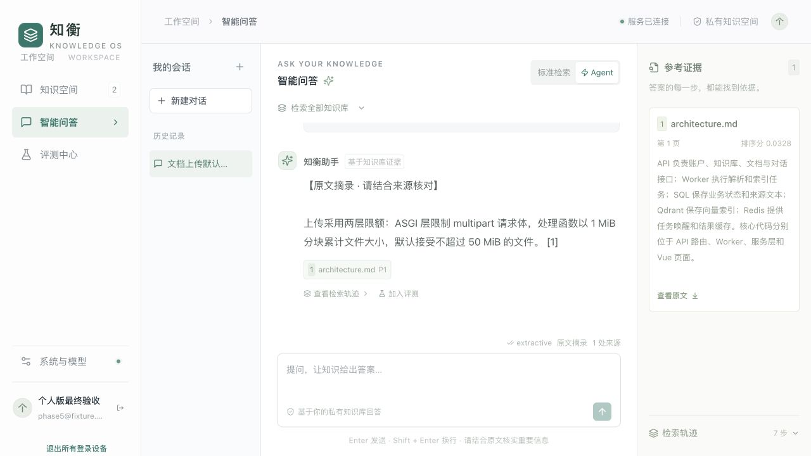

# 知衡使用指南（个人版）

本文说明当前工作台已有功能的使用方法：管理个人资料、基于资料提问、查看引用、更新版本，以及评测检索与回答。部署和模型连接配置另见[部署指南](deployment.md)。

## 目录

- [1. 使用前了解](#1-使用前了解)
- [2. 开始使用](#2-开始使用)
- [3. 账号与登录](#3-账号与登录)
- [4. 知识空间：建立知识库与导入资料](#4-知识空间建立知识库与导入资料)
- [5. 更新资料、恢复版本与设置有效期](#5-更新资料恢复版本与设置有效期)
- [6. 同步文档源](#6-同步文档源)
- [7. 智能问答与来源核对](#7-智能问答与来源核对)
- [8. 评测中心](#8-评测中心)
- [9. 系统与模型](#9-系统与模型)
- [10. 常见问题](#10-常见问题)
- [11. 当前功能边界](#11-当前功能边界)

## 1. 使用前了解

每个账号拥有独立的个人知识库，其他账号不能列出、下载、修改或检索你的资料。知识库适合按课程、项目或主题划分，例如“数据库学习”“Python 文档”“毕业设计资料”。

工作台有四个入口：

| 入口 | 主要用途 |
| --- | --- |
| 知识空间 | 创建知识库、上传资料、查看处理进度、预览解析内容、管理版本 |
| 智能问答 | 选择资料范围、提问、继续会话、查看引用与检索轨迹 |
| 评测中心 | 编写问题集、复评历史答案、比较检索方式、查看评测记录 |
| 系统与模型 | 查看当前模型、存储、队列与可选能力的配置状态 |

默认演示配置使用哈希向量和原文摘录，可以体验资料管理与检索流程，不需要启动本地模型。哈希向量不具备真实语义理解能力，演示结果不能代表语义检索效果。生成式回答、语义向量、视觉识别和 Ragas 评分取决于部署者实际接入的服务。

## 2. 开始使用

### 2.1 打开工作台

如果应用已经部署，直接打开部署者提供的网页地址。

| 运行方式 | 默认网页地址 |
| --- | --- |
| 本地开发 | [http://localhost:5173](http://localhost:5173) |
| Docker Compose | [http://localhost:8080](http://localhost:8080) |

本地开发环境已经安装好依赖时，可按以下方式启动演示配置：

1. 如果项目根目录还没有 `.env`，将 `.env.example` 复制为 `.env`；已有配置时先确认其内容，不覆盖原配置。
2. 在第一个终端，从项目根目录启动后端：

   ```bash
   conda activate ./.conda-env
   cd backend
   python -m uvicorn app.main:app --host 127.0.0.1 --port 8010
   ```

3. 在第二个终端，从项目根目录启动前端：

   ```bash
   conda activate ./.conda-env
   cd frontend
   npm run dev
   ```

4. 打开本地开发地址。默认演示配置在后端进程内处理摄取和评测任务；如果部署启用了 Redis，需要另行启动 Worker，具体见[部署指南](deployment.md)。

尚未安装环境依赖、需要生产部署或接入远程模型服务时，也请先按部署指南准备环境。

### 2.2 完成第一次体验

可以直接使用仓库内的文档：

1. 注册账号并进入“知识空间”。
2. 新建名为“项目说明”的知识库。
3. 上传 [architecture.md](architecture.md)，等待状态变为“已就绪”。
4. 进入“智能问答”，在检索范围中勾选“项目说明”。
5. 选择“标准检索”，输入：`文档上传默认最多接受多少 MiB 的文件？`
6. 查看回答中的 `50 MiB` 及对应来源，点击“查看原文”核对。
7. 点击该回答下方的“加入评测”，填写参考答案“默认最多 50 MiB”，选择刚上传的文档作为期望来源，运行一次不启用 Ragas 的评测。

这条流程用于熟悉操作。若资料版本或部署配置发生变化，应以实际来源内容为准。

## 3. 账号与登录

- **注册**：在“注册账号”中填写名字、邮箱和至少 8 位密码，点击“创建账号并进入”。如果提示公开注册已关闭，需要使用已有账号。
- **登录**：在“登录账号”中填写邮箱和密码，点击“进入工作台”。
- **恢复登录**：页面刷新后会尝试恢复当前登录状态；会话过期或被撤销时，需要重新登录。
- **退出当前设备**：点击左下角账号区域的“退出登录”图标。
- **退出所有设备**：点击“退出所有登录设备”，所有已有登录会话都会失效，包括当前设备。

当前界面没有自助找回或修改密码入口。无法登录时，请联系部署者处理，不要通过反复注册尝试恢复原账号资料。

## 4. 知识空间：建立知识库与导入资料

### 4.1 创建与选择知识库

1. 点击右上角“新建知识库”。
2. 填写知识库名称，按需填写描述。
3. 点击“创建知识库”。
4. 点击知识库卡片，切换下方文档列表的范围。

名称和描述用于帮助你识别资料主题；当前页面提供创建、选择与删除入口，尚未提供已建知识库名称和描述的编辑入口。

知识空间中选中的库与问答、评测中的检索范围分别设置。切换文档列表后，提问前仍应检查问答页的范围。

### 4.2 上传资料

选中目标知识库，点击“上传文档”，或将文件拖入上传区域。支持一次选择多个文件；每个文件单独提交和处理。

| 类型 | 支持的扩展名 | 使用说明 |
| --- | --- | --- |
| PDF | `.pdf` | 优先读取文字层，保留解析页码；单份 PDF 最多 2000 页 |
| Word | `.docx` | 提取正文与表格；旧版 `.doc` 需先转换 |
| 文本与 Markdown | `.txt`、`.md` | 适合笔记、说明与技术资料；编码无法识别时转为 UTF-8 |
| 结构化文本 | `.csv`、`.json` | 作为文档内容解析和检索 |
| 网页文件 | `.html`、`.htm` | 上传保存好的文件；当前没有输入网址抓取网页的入口 |
| 图片 | `.png`、`.jpg`、`.jpeg`、`.webp` | 需要可用的 OCR 或视觉识别配置；单张图片最多 4000 万像素 |

单文件默认上限为 **50 MiB**，页面显示为 MB；部署者可以设置更低的上限。空文件不能上传。扫描 PDF 和图片能否解析，取决于 OCR、语言包或视觉服务是否可用。

同一个知识库按文件内容去重：再次上传已有的相同内容会复用原文档，不会新增一份。文件同名并不表示更新原文档；更新已有资料应使用[上传更新文件](#51-上传更新文件)。

### 4.3 观察处理状态

上传提交后，系统在后台解析、切块并建立检索索引，页面会自动刷新进度。提交成功并不表示已经可以检索。

| 状态 | 含义与下一步 |
| --- | --- |
| 排队中 | 等待后台处理；稍候查看进度 |
| 处理中 | 正在解析或建立索引；部分文档会显示阶段、百分比和页数 |
| 已就绪 | 已有可检索版本，可以开始问答 |
| 更新中 · 旧版可用 | 新版本正在处理，仍使用已发布的旧版本 |
| 处理失败 | 查看文件名旁的错误信息，解决原因后重试或重新上传 |
| 已过期 | 不再参与新的检索；可调整有效期恢复使用 |

长时间排队时，先检查后端或独立 Worker 是否运行，再查看模型与存储连接情况，避免连续重复上传。

### 4.4 查看内容、下载和重新索引

文档行右侧的图标可悬停查看名称：

| 操作 | 用途 |
| --- | --- |
| 查看解析内容 | 查看当前活动版本的文本分块；点击文档名称也能打开 |
| 下载原文 | 下载当前文档原件 |
| 版本与有效期 | 上传更新文件、恢复版本、修改来源或到期时间 |
| 重试解析 | 失败文档重新提交处理 |
| 重新索引 | 已就绪文档基于保存的原件重新处理 |
| 删除文档 | 确认后移除该资料及其版本 |

文档搜索框按文件名筛选列表，不执行正文全文检索。解析内容预览最多显示当前版本的前 500 个分块，不是完整原文件阅读器；需要完整资料时下载原文。

切换向量模型、模型维度或切块配置后，应由部署者确认重建范围，并对相关文档执行重新索引。单纯刷新网页不会重建索引。

### 4.5 删除文档与知识库

删除单份文档：点击该行“删除文档”，核对名称后点击“确认删除”。删除知识库：先选中目标库，再点击文档区右上角的“删除当前知识库”图标，确认删除该库及其全部资料。

删除后资料立即退出可访问范围，正在处理的相关任务会被取消，原文件与向量在后台持久清理。清理未完成前，部分存储额度仍可能被占用。

删除无法通过“恢复此版本”撤销。涉及已删除资料的旧回答内容和引用会被隐藏，相关评测记录也可能变为受限状态。

## 5. 更新资料、恢复版本与设置有效期

### 5.1 上传更新文件

1. 找到已有文档，点击“版本与有效期”。
2. 在“上传更新文件”中选择新的资料。
3. 等待新版本完成处理。
4. 确认版本列表中“当前使用”标记已经切换，再进行新的问答。

更新期间旧版本继续提供检索；新版本就绪后才切换。更新文件可以使用不同文件名，但内容不能与同一知识库中的另一份文档完全相同。已有更新任务运行时，需先等待其结束。

若更新失败且原文档已有可用版本，旧版仍可使用；修正新文件或连接问题后，再通过“上传更新文件”提交。普通“重新索引”使用当前文档保存的原件，不等同于重新上传失败的更新文件。

### 5.2 恢复历史版本

在同一弹窗的版本列表中，找到目标版本，点击“恢复此版本”。恢复会创建新的处理任务，重新索引完成后切换到该版本内容，等待方式与上传更新相同。列表最多显示最近 100 个版本。

恢复版本不会自动清除有效期；如果文档仍标记为“已过期”，还需调整有效期。

已有历史答案保留当时的证据和版本引用。“查看原文”会优先下载当时引用的版本，而非自动改为最新文件；前提是该文档仍存在且属于当前账号。

### 5.3 来源标识与有效期

在“文档版本与有效期”弹窗中：

- **来源标识**：填写便于识别的来源说明，例如课程名称或资料出处。填写网址只保存标识，不会自动抓取网址内容。
- **有效期至**：按浏览器本地时间选择到期时间；留空表示长期有效。
- 点击“保存来源与有效期”提交修改。

到期后文档退出新的检索范围，但文件和历史版本仍保存，可以下载或调整有效期。到期不是删除，也不会自动抹除既有会话与评测记录。

## 6. 同步文档源

此入口仅在部署者配置 `RAG_SOURCE_SYNC_ROOT` 后出现。它读取的是**运行后端的机器**上已配置目录中的文件，不是任意浏览器本机目录。

1. 进入“知识空间”，展开“同步文档源”。
2. 选择目标知识库。
3. 填写源目录内的相对路径，例如 `notes` 或 `manuals/database.pdf`；填写 `.` 表示配置的源目录本身。
4. 点击“执行同步”，查看检查数量与提交更新数量。
5. 等待文档列表中的处理任务完成。

内容未改变的已关联文件会跳过；内容变化时为对应文档创建新版本。单次最多同步 100 个支持格式的文件，目录扫描上限为 2000 个条目，较大目录应分子目录同步。

同步需要手动触发，当前没有自动监视目录入口。源文件移除不会自动删除知识库中的已有资料，应在工作台显式过期或删除。系统用来源标识关联后续同步，修改 `folder:` 开头的标识会影响该关联。

## 7. 智能问答与来源核对

### 7.1 设置范围与模式

进入“智能问答”，展开顶部的检索范围：

- 勾选一个或多个知识库，只检索这些库中的可用资料。
- 不勾选时，检索当前账号的全部个人知识库。
- “返回证据数量”可选 3、5、8 或 10 段，默认 5 段。这是候选证据数量设置；过滤后实际来源可能更少。

| 模式 | 行为 | 使用方式 |
| --- | --- | --- |
| 标准检索 | 混合召回相关片段，再根据证据回答 | 可先用于检查明确的问题和原文位置 |
| Agent | 在词项覆盖不足时，进行有限次关键词改写和补充检索，再合并候选回答 | 可用于观察补充检索是否找到了更多相关证据 |

两种模式都基于知识库资料，不会联网搜索。Agent 的检索轨迹用于解释处理步骤，不代表答案必然更准确。可选重排由部署者配置，在两个模式中均可使用，页面没有单独开关。

### 7.2 提问与停止生成

输入问题后按 **Enter** 发送，**Shift + Enter** 换行。一次尽量问一个有明确资料依据的问题，例如“事务的隔离性是什么意思？请给出原文依据”。

生成期间显示的“生成中 · 待引用校验”是草稿，最终回答可能经过核验、回退或拒答，应以完成后的结果为准。点击“停止生成”可取消当前请求；页面会恢复问题文本，便于修改后重试。若请求刚好已完成，可重新打开会话确认实际保存结果。

断线后，在同一页面按原问题、范围和参数重试，会复用尚未成功返回的请求标识。若提示请求或资料状态已变化，应刷新会话并重新提问。

### 7.3 查看引用与检索轨迹

1. 点击回答下方带文档名称的引用按钮。
2. 在“参考证据”中阅读片段、文档名称与页码。
3. 点击“查看原文”，下载对应原件或被引用的历史版本。
4. 点击“查看检索轨迹”，检查范围、召回、改写、核验或缓存等实际步骤。

PDF 页码用于定位解析页面，可能与书中印刷页码不同。Word、文本等格式可能使用逻辑页标记，不保证对应排版页码。排序分只表示检索排序依据，不是答案准确率；轨迹中的词项覆盖率也是启发式检查。



### 7.4 理解回答状态

| 提示 | 应如何理解 |
| --- | --- |
| 原文摘录 / `extractive` | 从证据中摘录内容，未必调用生成模型 |
| 已回退原文摘录 | 生成内容未通过现有核验，最终改用证据摘录 |
| 数字核对通过 | 通过数字及引用等局部检查，不代表完整语义事实已核验 |
| 事实核验通过 | 已通过所配置的模型事实核验，重要结论仍应回查来源 |
| 证据不足 · 已拒答 | 当前范围没有足够可用证据；检查资料、范围或问题表述 |
| 缓存命中 | 复用了当前资料范围及版本下的已有结果 |

### 7.5 会话历史与追问

左侧“我的会话”保存已完成的问答。点击记录可查看历史并继续提问；移动端可通过会话历史选择框切换。

与前一轮相关的问题可在同一会话追问，例如“那它的主要限制是什么？”。系统会按需利用近期会话，不保证记住全部历史。切换到新主题时点击“新建对话”，并检查当前知识库范围。

点击历史会话旁的删除图标，可以删除该会话；不会删除知识库资料。未发送的输入和未提交的评测表单没有草稿保存入口，刷新页面前应自行保留需要的内容。

## 8. 评测中心

评测用于检查“是否找到了应当命中的资料”和“回答与参考答案是否一致”。先准备少量有明确答案和来源的问题，再逐步扩充题集。

### 8.1 创建普通评测

1. 进入“评测中心”，填写评测名称，按需选择知识库范围；不选表示全部个人库。
2. 为每个用例填写“测试问题”和“参考答案”。当前页面要求两项均非空。
3. 展开“期望命中的文档”，选择该问题应当引用的来源；来源应位于评测范围内，且已就绪、未过期。
4. 需要多个问题时点击“添加用例”，每次评测最多 100 个用例。
5. 首次使用可保持“启用 Ragas”未勾选，点击“运行评测”。
6. 等待任务完成，在“评测结果”查看汇总指标，展开逐条结果核对答案与来源。

普通用例会重新走问答流程，也可能命中答案缓存；不会自动继承问答页所选的 Agent 模式或证据数量。若已接入真实模型，即使不勾选 Ragas，普通评测也可能调用生成服务和向量服务。

未选择期望文档的用例没有检索标注，不计入 Hit@5、Recall@5、MRR@5 的均值。显示“—”表示没有可计算值，不表示满分。

### 8.2 复评历史答案

在“智能问答”中找到已完成的回答，点击“加入评测”：

1. 页面跳转到评测中心，用例标记为“历史答案 · 不重新生成”。
2. 原问题只读；填写参考答案，并按需选择期望文档。
3. 检查评测范围，点击“运行评测”。

历史复评使用当时保存的问题、答案和引用，不重新生成答案；检索指标也基于保存的引用。若开启 Ragas，评分仍会调用评审及向量服务。来源被删除或不再可访问时，该历史答案不能继续用于复评。

### 8.3 比较 Dense 与 Hybrid

点击“比较检索基线”前，需要为**每个用例**选择至少一篇期望文档。

| 比较项 | 含义 |
| --- | --- |
| Dense / 向量检索 | 只使用向量检索 |
| Hybrid / 混合检索 | 结合向量与关键词召回进行融合 |
| 命中率相对变化 | 当前题集上 Hybrid 相对 Dense 的 Hit@5 变化；Dense 为零时显示“无法计算” |

对照使用当前资料重新检索，不评分生成答案。即使用例来自历史会话，该按钮也比较当前检索，而非历史引用。接入语义向量后会调用对应向量服务；哈希模式下的对照只能用于流程检查。

### 8.4 指标如何解读

检索指标按前 **5 个片段**统计，相关性由你选择的期望文档定义，不随问答页的证据数量改变。

| 指标 | 含义 |
| --- | --- |
| Hit@5 | 前 5 个片段是否至少命中一篇期望文档，汇总为已标注用例的平均值 |
| Recall@5 | 前 5 个片段覆盖的期望文档数，占该用例全部期望文档数的比例 |
| MRR@5 | 第一个正确来源所在片段排名的倒数；未命中为 0，再对已标注用例求平均 |
| 已标注用例 / `labeled_cases` | 选择了期望文档的用例数量 |
| 参考词项召回率 | 参考答案词项被回答覆盖的比例，属于词项比较，不是语义准确率 |
| 延迟 | 当前步骤的实际耗时，历史回放或缓存命中可能更快 |

例如，一题期望命中 A、B 两篇文档，前 5 个片段只找到 A，且 A 首次出现在第 2 位，则该题 Hit@5 为 1、Recall@5 为 0.5、MRR@5 为 0.5。文档命中不等于对应片段一定正确，仍需检查逐条证据。

### 8.5 可选 Ragas 评分

Ragas 提供忠实度、答案相关性、上下文精确率和上下文召回率评分。使用前需由部署者准备评测依赖、可用的生成服务及语义向量配置；哈希向量不满足此要求，每题都需要参考答案。

| 评分 | 关注点 |
| --- | --- |
| 忠实度 | 回答是否得到所给证据支持 |
| 答案相关性 | 回答是否切合问题 |
| 上下文精确率 | 检索到的上下文是否相关、排序是否合理 |
| 上下文召回率 | 上下文是否覆盖参考答案所需信息 |

这类评分会额外调用模型，耗时和请求消耗通常更高；已有相同评分可能复用评审缓存。界面的 `ragas_ready` 是配置条件提示，不保证服务可用或评分成功。失败时查看评测错误，不把缺失分数视为通过。

### 8.6 查看历史评测

右侧“历史运行”可重新打开已保存的运行结果。排队中、运行中表示后台尚未完成，页面会自动更新；失败时查看错误信息。来源文档被删除后，相关记录可能显示 `restricted`，结果和指标会隐藏。

当前页面没有评测集导入、导出、编辑已保存运行或删除运行记录的入口。

## 9. 系统与模型

打开左下角“系统与模型”，点击“刷新状态”，可以查看：

- 运行模式，以及当前生成模型和文本向量配置。
- 重排是否配置、向量存储方式、异步队列方式。
- OCR、视觉识别、目录同步、语义向量和 Ragas 等能力字段。
- 单文件上传上限、前端 API 地址与服务连接状态。

页面用于查看状态，不提供在线切换模型或修改配额的表单。配置变更由部署者在服务端完成，并重启相关 API 和 Worker；模型变化后还应确认现有资料是否需要重新索引。

“服务已连接”不等于生成模型效果已经验收，“已配置”也不保证外部服务连通。开发者可使用默认 [API 文档入口](http://localhost:8010/docs) 查看 `/api/ready` 和需登录的 `/api/ready/models` 等接口；模型诊断只检查连接与模型列表，不执行推理。生产部署请替换为实际后端地址，指标访问还需要独立的服务端配置。

## 10. 常见问题

| 现象 | 排查方法 |
| --- | --- |
| 无法连接服务 | 确认前后端都在运行，访问地址与 API 代理匹配；在登录页点击“重新检测” |
| 登录后立即失效 | 检查是否退出了所有设备、会话是否过期，以及部署的 Cookie/HTTPS 配置；使用同一网页入口重新登录 |
| 上传后文档数没有增加 | 检查是否已存在相同内容；同一知识库会按内容去重 |
| 文档一直排队 | 检查后台任务进程；启用 Redis 的部署需有独立 Worker |
| 图片或扫描 PDF 解析失败 | 查看错误，确认 OCR 及语言包或视觉识别服务可用；可先用有文字层的 PDF 或 Markdown 体验 |
| 提示文件过大或格式不支持 | 按页面上限拆分文件，使用支持的扩展名；`.doc`、`.pptx`、`.xlsx` 当前不能直接上传 |
| 存储或待处理任务达到上限 | 等待现有任务完成；删除不再需要的资料后等待后台清理；历史版本也会占用存储 |
| 资料已上传但回答拒答 | 确认资料已就绪、未过期且在问答范围内；预览解析文本，改用资料中的明确术语提问 |
| 回答一直是原文摘录 | 查看系统页是否为 `extractive`；也可能是生成内容未通过核验后回退，结合回答状态判断 |
| 更新后旧会话仍引用旧文件 | 历史引用保留当时版本；需查看新版本效果时重新提问 |
| 看不到“同步文档源” | 部署者尚未配置文档源目录；浏览器无法直接同步任意本机路径 |
| 比较基线提示缺少期望文档 | 为每个用例选择至少一篇正确来源，并确认它属于评测范围 |
| Ragas 运行失败 | 查看评测错误，检查依赖、生成服务、语义向量和参考答案是否齐备 |
| 提示并发、频率或预算已达上限 | 等待现有请求完成或配额窗口恢复；相关限制通过服务端静态配置设置 |
| 历史回答被隐藏或评测受限 | 对应来源已删除或不再可访问，不能通过历史记录继续取得这些证据 |

## 11. 当前功能边界

当前版本聚焦个人资料检索，支持文档上传、版本、有效期、手动目录同步、标准/Agent 问答、来源追溯、会话和评测。

不提供组织、成员角色、共享授权、平台管理员、在线配额管理或 SSO 登录。笔记编辑器、自动出题、复习计划、教学模式、联网搜索和自动网页抓取也尚未实现；可以上传已有笔记文件作为检索资料。

旧组织资料与旧身份数据可能仍保存在兼容存储中，不会自动转为个人资料。升级或迁移此类数据请按[部署指南](deployment.md)处理。

进一步阅读：[项目介绍](../README.md)、[系统架构](architecture.md)、[部署指南](deployment.md)、[当前验证范围](validation.md)。
