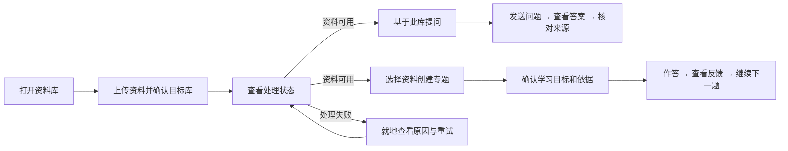
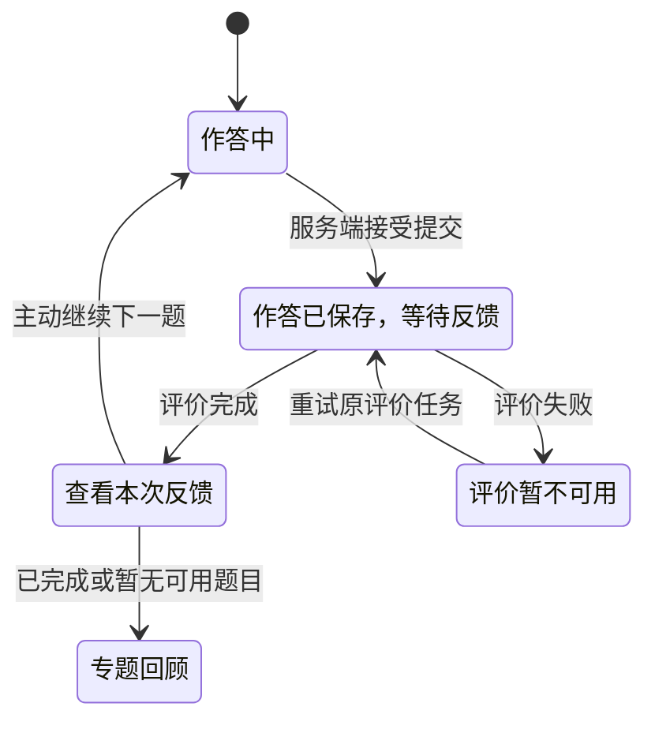

# 知衡前端改版方案：让资料、问答和学习回到主线

| 版本 | 日期 | 修订人 | 说明 |
| --- | --- | --- | --- |
| V0.1 | 2026-11-08 | Codex | 基于当前工作区源码的评审稿，尚未实施 |

**建议先收掉「系统与模型」和「评测中心」在学习者界面的默认入口，再把资料、问答、专题学习三条路径各自梳成一条主线。** 账号菜单只管理账号；技术配置由部署者处理；运行异常在受影响的操作旁说明。日常界面让用户看得见资料状态、当前范围、回答来源和下一步任务。

## 一、概述

### 1.1 为什么改

当前版本已经具备个人资料管理、引用问答和数据库事务专题学习。界面上的问题主要是操作层级和状态边界：

| 当前做法 | 对使用的影响 | 源码依据 |
| --- | --- | --- |
| 「系统与模型」展示模型、向量存储、队列、配置键和 API 地址，唯一日常动作是刷新 | 看起来像设置页，实际是只读诊断；遇到问题时，用户仍需判断哪个参数与自己有关 | [系统页](../frontend/src/App.vue#L473)、[运行能力返回](../backend/app/services/runtime.py#L8) |
| 知识空间同屏显示统计、知识库卡片、上传区、文档表格和多个操作图标 | 选库和上传被统计卡片挤到下面；删除知识库与上传并排；文档名和预览图标重复 | [知识空间](../frontend/src/App.vue#L423)、[文档操作](../frontend/src/App.vue#L441) |
| 新建对话有重复入口；Agent 模式、证据数量、检索轨迹和加入评测出现在问答主界面 | 用户在输入问题前就看到检索实现选择，想看出处时又容易和调试信息混在一起 | [问答](../frontend/src/App.vue#L448)、[证据栏](../frontend/src/App.vue#L458) |
| 专题学习同屏显示能力、题目、四档提示、最近反馈和规则信息 | 写答案时主按钮与提示、跳过、历史回看争抢注意力；评价完成后，反馈可能出现在新题下方 | [专题学习](../frontend/src/components/learning/LearningWorkspace.vue#L102) |
| 登录后一起拉取资料、会话、运行参数和评测；多个操作复用全局错误 | 非当前页面的失败也可能打断当前任务；部分成功容易被后续刷新失败描述成整个操作失败 | [首屏加载](../frontend/src/App.vue#L150)、[问答提交](../frontend/src/App.vue#L299) |

这些是源码走查结论，尚未测量点击耗时或学习效果。本文用固定任务验收交互，不以拉新或留存为目标。

### 1.2 目标与角色

| 角色 | 要完成的事 | 验收目标 |
| --- | --- | --- |
| 学习者 | 上传第一份资料并围绕它提问；回来能继续上次专题 | 从空库点一次「上传资料」即可开始导入；提问前无需理解或选择检索算法；在专题页首屏能看到「继续学习」 |
| 自部署者 | 设置模型、排查服务、需要时运行评测 | 在部署文档找到对应配置和诊断方法；常规模式下评测和诊断不进入学习界面 |
| 开发与测试 | 保留引用、版本、会话和学习证据的正确性 | 常用动作只有一个主入口；删除、恢复和跨页面异步操作有明确状态和回归用例 |

「部署者」指持有服务器配置权限的人，可能与学习者是同一人。现有登录账号仍只有个人资料范围；本方案不新增管理角色。术语：**资料可用**指有可访问的活动版本且未过期；**运行能力**指功能是否配置或启用；**运行健康**指实际检查结果，两者分别展示。

## 二、产品描述

### 2.1 导航和设置去向

| 层级 | 改后入口 | 处理原则 |
| --- | --- | --- |
| 一级导航 | **资料库、问答、专题学习** | 默认进入资料库；专题入口受服务端功能开关控制，状态未知时先加载，不闪现 |
| 账号菜单 | 显示名称与邮箱、退出登录；「会话安全」内可退出所有设备 | 侧栏底部只留一个账号入口；移除顶部重复头像。退出所有设备明确说明包含当前设备，二次确认 |
| 就地提示 | 上传进度、回答降级、评价不可用、连接异常 | 正常时不常驻显示健康绿灯；异常只说明影响及下一步。问答降级为摘录时须在相应消息标明 |
| 对象详情 | 文档版本、有效期、更新文件；会话和专题的「更多」 | 在相关对象内处理，避免回设置页找操作 |
| 部署侧 | 模型、Embedding、重排、OCR、Qdrant、Redis、API 地址、目录来源配置、原始健康与指标 | 「系统与模型」整页退出用户导航，不搬进普通设置的折叠区；在[部署指南](deployment.md)补齐排查入口 |
| 可选开发工具 | 评测用例、历史复评、检索对比、技术轨迹 | 部署侧显式启用后，通过账号菜单的「开发工具」进入；默认界面和回答操作中不出现「加入评测」 |

不另做空的「通用设置」页。保留现有产品名称，品牌变更单独处理。视觉上先减少页面层级和重复文案，沿用现有样式；首屏优先显示当前资料、会话或任务，不新加宣传卡片。

### 2.2 主流程

数据由现有资料、问答和学习 API 提供。前端分别维护列表、当前对象、提交中和已保存状态；服务端继续决定资料权限、可用版本、引用检查及学习进度。进度和能力标记不从按钮点击推断。

### 2.3 全局交互

- **操作层级：**每个页面状态只设一个主动作。低频且与对象相关的操作放「更多」或详情；不可撤销的删除、撤销所有会话统一用可键盘操作的确认框，默认焦点在「取消」，列出实际影响。
- **反馈：**区分「提交中」「已接收」「处理中」「完成」「失败」。操作成功但刷新失败时保留成功状态，提示「已保存，暂未刷新」；对资源失败给局部重试，保留用户输入。网络或超时导致结果不明时先查询结果或按原请求键重试，不自动重发变更。
- **列表与空状态：**复用已有搜索和排序，不引入新分页协议。区分未加载、没有数据、筛选无结果和读取失败。失败状态不伪装成空列表，避免误引导用户重建或重复上传。
- **登录失效与切换：**统一处理 API、流式问答、原文下载和专题请求的鉴权错误。退出后清空会话、证据、选库、模态框和请求上下文；过期响应不得写回另一账号、会话或专题。请求取消与服务端任务完成分开呈现。
- **移动端：**侧栏变为导航抽屉；来源和历史按需打开；表格降为可换行列表或卡片；弹层关闭后焦点回触发按钮。键盘可完成上传、提问、查看来源和作答；中文输入法组词时 Enter 不发送。

### 2.4 改动顺序

| 批次 | 内容 | 合并门槛 |
| --- | --- | --- |
| P0-A 入口减法 | 导航、账号菜单、系统页迁出、评测和目录同步的服务端开关、启动请求按需拆分 | 默认账号只能看到学习导航和账号操作；禁用能力的 API 无法通过直接请求执行 |
| P0-B 资料与问答 | 上传主路径、文档详情、清晰问答范围、来源抽屉、SSE 失败和恢复 | 空库上传、部分成功、原文引用、停止与重试、跨会话切换通过 |
| P0-C 专题学习 | 继续学习、草稿核对、单任务作答、提交反馈和历史分离 | 草稿、作答、帮助级别、资料失效与下一步的现有规则均通过回归 |
| P1 可选改进 | 已启用开发工具内的评测布局、资料筛选和长列表细化 | P0 稳定后再做；不阻塞学习流程 |

## 三、功能需求

### 3.1 资料库：先上传，再管理

**用户故事：**作为学习者，我希望把文件放进正确的知识库，并能看出何时可用于问答和练习。

- **入口与前置条件：**登录后进入资料库。顶部用知识库选择器显示当前库；已有库时直接上传到当前库。无库时，点击「上传资料」在同一流程内确认新库名称，保留已选文件，再创建并上传。复用现有两个 API；建库成功但上传失败时，保留新库和失败项，不再建一次。已有资料时保留单一「上传资料」主按钮；空列表中的拖放区承担同一动作。
- **列表与详情：**行内显示文档名、用户可理解的状态、更新时间和「更多」。点击文档名打开资料详情，查看解析文本与来源页码、下载原文。将分块数、完整进度和版本 ID 移到详情；现阶段仍是解析文本预览，不承诺 PDF 在线翻页。文档级失败在状态旁显示「重试」；就绪文档的「重新处理」、更新文件、版本恢复与有效期进入资料详情；「删除文档」放更多菜单底部。
- **知识库管理：**库选择器附近的更多菜单放「新建知识库」和「删除此知识库」。删除确认显示库名、所含文档数量及关联资料不可再被检索或用于学习的影响；成功后切到可用库或空状态，不把原会话的查询范围静默改成全部。
- **批量上传：**按文件展示「待提交 / 已接收 / 失败」，文件大小使用后端上限，扩展名与后端白名单保持一致。单个文件出错可继续其余文件；遇鉴权失效或持续断网则暂停，保留未提交队列。失败项可单独重试；结果不明时先刷新列表核对去重结果。同一个批次锁定目标库。
- **文档状态与版本：**有活动版且更新中显示「正在更新，旧版仍可用」；更新失败且旧版可用时显示「更新失败，仍在使用旧版」。恢复旧版要经过后台重建，接受后展示「正在恢复」，以服务端发布状态为准。已过期文档仍可管理，不能用于新检索或新专题。
- **目录同步与元数据：**默认不展示目录路径表单。受信自部署显式开放后，放在当前库「更多 → 从目录同步」，直接使用当前库。保留路径校验、扫描上限和增量行为。来源标识显示为「上传」或「目录同步」，普通用户不直接编辑内部 `source`。当前元数据 PATCH 会同时写两个字段，修改有效期须先带回原值；如改后端则按字段是否提供更新，避免意外覆盖来源。

### 3.2 问答：范围明确，证据随答案打开

**用户故事：**作为学习者，我希望马上提问，确认回答查了哪些资料，并点开对应来源。

| 控件 / 状态 | 改后规则 |
| --- | --- |
| 新建对话 | 桌面和手机各保留一个可见入口，同一屏不重复。切会话时保留各自未发送的草稿；同一会话生成期间禁重复发送 |
| 问答范围 | 输入框旁用一个范围控件明确显示「全部资料」或库名；从某库发起提问时预选该库。显式范围不可用时提示改选，不把空数组当兜底发送，因为 API 的空数组代表全部 |
| 检索策略 | 普通问答沿用当前界面默认 Agent 策略和 5 段证据，通过内部默认值发送；不把算法和 Top K 当作必要选择。开发工具若提供调试设置，仅对调试会话生效 |
| 输入与发送 | 问题去除首尾空白后须有内容，最多 8000 字符。当前范围无可用资料时给「上传资料」或「切换范围」；校验以服务端为准 |
| 来源 | 点击引用打开对应消息的来源抽屉，定位对应摘录、文档名和页码；按钮叫「下载原文」，有版本 ID 时下载该版本。来源删除或无权限时显示不可用，不回退到最新版 |
| 状态 | 流式片段显示「生成中，尚未核对」；收到完成事件后用最终答案替换。证据不足、原文摘录和请求失败各有清楚提示；模型名、缓存、分数、原始轨迹不进入默认消息 |
| 停止、断线和重试 | 停止后保留问题文本，不把临时答案当成已保存答案。相同问题、会话、范围和请求参数用原请求键恢复；修改其中任一项才生成新键。已有最终答案时，会话列表刷新失败只提示列表未更新 |

**范围边界：**当前问答范围是每次请求参数，历史会话并无已证实的持久化范围。第一版可在浏览器按账号和会话保存最近明确选择，打开旧会话时标明「本次范围」，不伪造历史范围；用户明确变更范围后开启新会话，避免旧范围的消息作为新范围的上下文。原会话仍可回看。

### 3.3 专题学习：作答、反馈、继续

**用户故事：**作为学习者，我希望先完成一题，再看到这次作答说明了什么、下一步练什么。

1. **专题列表：**有进行中的专题时主动作「继续学习」，其次是「新建专题」；空列表只保留一个创建入口。创建仍限定数据库事务专题，选择单一知识库和 1–10 份可用资料，目标长度沿用现有 10–1000 字符。无可用资料时直接返回对应库上传，保留已填目标。已创建的专题可从更多菜单「以此为模板」或删除，删除只影响学习记录。
2. **目标核对：**每张能力卡先展示「你将能做什么」和资料覆盖摘要。先修与原文绑定放在「编辑目标与依据」；确认开始前让用户明确核对每个要用于正式练习的能力。部分覆盖和缺失沿用后端规则，不自动标成已覆盖。保存成功但确认失败时保持草稿状态并显示失败原因，不重复生成草稿。
3. **当前任务：**中间以题目、评价要求和作答区为主，进度简化为当前能力与已完成情况。一个「需要提示」入口按需展开四种帮助，保留逐级含义与现有服务端记录。看原文会计入第 2 级帮助，完整解析会改变验证口径；点击前说明影响。「跳过」置于更多菜单，执行前说明不记为通过。正文为空不可提交，最多 10000 字符；草稿仍按账号和任务保存在当前浏览器。
4. **提交与反馈：**收到提交成功回执后显示「作答已保存，等待反馈」，把视图固定在本次提交的题目与答案；服务端可计算下一题，用户点「继续下一题」才切换显示，不为阅读反馈重复调用推进接口。按「本次结论 → 关键改进点 → 下一题理由」呈现；逐项标准、依据、纠正、完整帮助历史放到详情。评价失败时在此处重试同一个评价任务，用户无需重新提交。评价未配置时允许保存作答，只在相关位置说明限制，不给出掌握结论。
5. **历史与异常：**查看旧提交进入只读回看，明确「返回当前任务」；「再次作答」需显式进入，不混用当前草稿。反馈中的「查看依据」若调用有副作用的帮助接口，先告知会记录帮助级别。争议按现有规则使该次评价不再影响推荐；来源删除导致暂停时给「重新选择资料」，保留用户原始作答。遇 `state_version` 冲突保留本地草稿并拉取最新状态，让用户核对后再提交，不能盲目覆盖。

图示是界面状态，不替代服务端学习状态。回到页面后应可根据当前任务和最近提交重新定位反馈；题面、反馈、帮助和草稿按任务 ID 或提交 ID 绑定。

### 3.4 设置与开发工具：保留必要操作，收紧暴露

| 项目 | 实施要求 |
| --- | --- |
| 账号与会话 | 保留当前退出与退出所有设备。后者确认成功才清理本地状态；撤销失败留在账号菜单并提示重试。一般退出如果服务端未确认，不提示「已安全退出所有设备」 |
| 安全能力契约 | 新增精简的登录后能力接口（建议 `GET /api/capabilities`），或在兼容评估后缩减 `/api/system`。只返回界面需要的上传限制、专题开关、评价是否配置、可选工具权限等白名单字段。区分「未配置」与「暂时不可用」，配置标志不代表模型探活成功 |
| 运维诊断 | 保留部署文档中已有的就绪探针与指标检查。新界面不展示原始探针结果，也不常规轮询模型探针；原始 `/system`、`/ready/models` 的实际客户端和访问边界先盘点，再迁到受限运维入口或兼容期内限制访问。面向浏览器的健康信号仅提供粗粒度状态；不把 API Key、绝对路径、连接串或原始异常返回给学习者 |
| 评测 | 建议新增默认关闭的部署开关。评测页面、回答里的「加入评测」、评测轮询和服务端读写及对比路由一起受控。保留已有评测数据；关闭时不删除记录。受信单人自部署可开启；多人部署若缺少独立授权机制，保持关闭。学习作答评价使用独立 API，不受此开关影响 |
| 目录同步 | 配置目录不等于授权浏览器导入。建议增加独立于目录路径的浏览器同步开关，默认关闭；未启用时 API 拒绝，不能靠隐藏面板。仅在信任实例内所有可登录账号访问所挂载目录时开启，否则仍关闭；服务端保留现有库所有权与目录边界校验 |

### 3.5 数据契约与代码落点

| 字段或状态 | 类型 / 是否必要 | 用途 |
| --- | --- | --- |
| `max_upload_mb` | 正整数 / 必需 | 文件上限，如配置为 50，则按 50 × 1024² 字节校验 |
| `learning_enabled`、`learning_assessment_configured` | 布尔 / 必需 | 建议能力接口字段名；后者只反映配置条件 |
| `evaluation_enabled`、`folder_sync_available` | 布尔 / 必需，默认关闭 | 建议能力接口字段名；后端鉴权和开关为准 |
| `knowledge_base_ids` | ID 数组 / 每次问答明确提交 | 复用现有契约，`[]` 只用于明确选中全部资料 |
| `request_id`、`request_key` | 字符串 / 相关幂等操作提交时提供 | 同一次逻辑提交在重试时复用，避免重复消息和作答 |
| `active_revision_id`、`expires_at` | 可空 ID、可空 ISO 时间 / 复用 | 计算资料可用性，前端共用同一时间解析和状态映射 |
| `state_version`、`current_task_id`、`hint_level_at_submit` | 版本号、可空 ID、整数 / 复用 | 处理编辑冲突、继续专题和如实呈现帮助记录 |

先把 [App.vue](../frontend/src/App.vue) 收到应用壳、登录和页面切换，按批次拆出资料、问答、账号组件；[DocumentVersions.vue](../frontend/src/components/DocumentVersions.vue) 合并进资料详情；[LearningWorkspace.vue](../frontend/src/components/learning/LearningWorkspace.vue) 分离当前任务、反馈和历史展示。统一在 [api.ts](../frontend/src/api.ts) 处理错误、身份失效与请求中止，在 [learning.ts](../frontend/src/api/learning.ts) 保留原请求契约。后端改动集中在能力输出、开关和 API 访问控制；第一版沿用 Vue 与现有样式，不为拆页面增加依赖或更换框架。

## 四、非功能需求

- **安全和数据：**复用 Cookie 会话、跨站请求保护、个人知识库权限及学习资料清除规则。直接调用被禁用的路由也应被拒绝；历史资料不得通过抽屉、缓存或旧请求复现。现有业务表和数据保留，本期不新增学习字段；若兼容期涉及旧 API，写明替代项和移除条件。
- **性能和异步：**首屏不请求评测历史、开发诊断或模型探针；会话历史进入问答再拉取。只轮询有未完成任务的资源，并避免重叠请求；离开页面或标签页不可见时暂停可延后的轮询，回来主动对账一次。提交和 SSE 结果以服务端回执为准。
- **验证记录：**本期无需第三方埋点。用浏览器测试或本地验收日志记录 `upload_batch_finished`（成功数、失败数）、`chat_finished`（完成 / 停止 / 失败、耗时）、`learning_feedback_opened`（状态、帮助等级）及首屏请求清单。只记录必要枚举与计数，不记录文档名、问题、作答和原文。
- **部署与回退：**更新使用指南和部署指南，说明新入口和开关。按批次交付；故障时可回退前端和对应的能力接口版本，原文、会话、版本及专题记录可继续读取。安全相关开关不因回退默认打开。

## 五、验收与待确认项

| 用例 | 通过条件 |
| --- | --- |
| 默认首屏与授权 | 侧栏只出现已启用的学习导航；没有运行配置、全设备退出按钮、评测及同步面板。直接请求关闭的评测读写、对比与目录同步接口被拒绝 |
| 首次上传与批量错误 | 无库时在一条流程完成创建及提交；3 个文件中第 2 个失败时，第 1、3 个结果独立展示，重试只提交失败项；目标库不会被中途切换 |
| 文档版本 | 更新失败时旧版仍可用；恢复先显示处理中，发布后才标为当前。只改有效期不改变来源标识；确认删除前能看到影响 |
| 问答范围与来源 | 从单库发起时范围明确；库删除后不会自动扩大；打开引用定位正确答案和片段，能下载对应版本；已删除或越权的来源不可见 |
| 问答与账号竞态 | 流式中断后原问题可恢复，重试不会出现重复消息；收到最终答案后会话列表请求失败仍保留答案；快速切会话或换账号时迟到响应不污染当前页面 |
| 专题闭环 | 打开专题能继续作答；提交后先读本题反馈，再进入推荐题。评价失败可重试原任务；打开帮助后等级正确；历史回看不覆盖当前草稿；来源失效和版本冲突有明确出口 |
| 响应式与键盘 | 在 390px 手机和 1280px 桌面宽度完成上传、提问、打开来源与提交作答，无横向溢出遮挡主按钮；确认框支持键盘退出和焦点归还；中文输入法确认组词不会发送 |
| 开发工具与回归 | 显式启用的受信部署可读原评测记录并运行评测；关闭后专题评价不受影响。前端类型检查和生产构建通过，相关后端权限、版本及幂等测试通过；交互验收可使用固定响应，不依赖真实模型 |

待确认项均有默认建议，不阻塞方案评审：

| 决策 | 默认建议 | 影响 |
| --- | --- | --- |
| 是否继续从浏览器操作目录同步 | 只保留给受信自部署，独立开关默认关闭 | 决定部署文档、权限用例及旧实例升级提示 |
| 是否保留开发工具入口 | 保留可选入口；无独立授权的多人部署关闭 | 决定评测页面访问规则与部署方式，不改变学习流程 |
| 是否有人依赖旧诊断响应 | 实施前盘点脚本和文档；有依赖先加精简能力接口，旧诊断限定访问后再退场 | 决定兼容期和运维迁移范围 |

现状参考：[使用指南](user-guide.md)、[专题学习 v0.2.0 更新说明](learning-workbench-v0.2.0-release.md)、[部署指南](deployment.md)。建议从 P0-A 开始验收：用默认账号登录，确认页面仅呈现日常动作，再逐条验证被移走的功能仍能由有权限的部署者使用。
